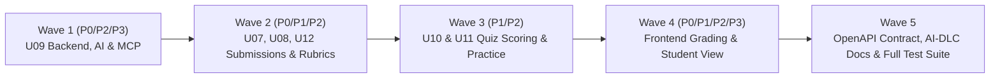

> Historical Antigravity plan, copied unchanged from session b11619f9-a269-4758-afc7-b5891b83299e. Execution decisions and current status are in [the continuation plan](2026-11-10-grading-remediation-continuation.md). Original local file links are historical references, not portable repository links. The actual permission table is `grade_distribution_visibility`; the four OpenAPI endpoints already exist.

# Kế hoạch sửa lỗi hệ thống Chấm điểm (Grading & Scoring Remediation Plan)

Kế hoạch này giải quyết toàn bộ **28 lỗi (4 P0, 10 P1, 10 P2, 4 P3)** đã phát hiện trong đợt audit trên phạm vi Backend (`U06`, `U07`, `U08`, `U09`, `U10`, `U11`, `U12`), Database Migrations, OpenAPI Contract và Frontend (`grading`, `assignmentwork`).

> [!IMPORTANT]
> **Nguyên tắc thực thi (theo `CLAUDE.md`)**:
> - Tuân thủ quy trình AI-DLC (cập nhật `aidlc-docs/audit.md` và các tài liệu thiết kế liên quan khi thực thi).
> - Ràng buộc kích thước: mỗi file code $\le 350$ dòng, mỗi hàm/phương thức $\le 40$ dòng (nếu file đang sát ngưỡng 350 dòng sẽ tách helper/sub-component trước khi thêm logic).
> - Không sửa các file migration đã phát hành; tạo migration mới cho thay đổi DB/권한.

---

## 1. Các điểm cần xác nhận nghiệp vụ trước khi thực thi

1. **[Q1 - P0-03] Nộp lại bài nhóm (thủ công hoặc tự nộp khi hết hạn) khi bài nhóm đã được giảng viên chốt (`FINALIZED`) hoặc công bố điểm (`PUBLISHED`)**:
   - **Phương án A (Khuyến nghị - Đồng nhất với bài cá nhân `BR-U09-07`)**:
     - Với `GroupAutoSubmitScanner.autoSubmit`: Nếu nhóm **đã có bản nộp thủ công của trưởng nhóm (`document.submitted() == true`)**, khi hết hạn chỉ đóng tài liệu (`status = CLOSED`) và giải phóng các mục `CLAIMED`, **không** tự tạo bản nộp `AUTO_DEADLINE` đè lên bản nộp của trưởng nhóm.
     - Với `EvaluationLifecycleService.onGroupSubmitted`: Nếu `rootEvaluation.hasOfficialGrade()` (`FINALIZED` hoặc `PUBLISHED`), **bảo toàn điểm chính thức** của nhóm và các thành viên (không gọi `resetForGroupSubmission` xóa điểm về `PENDING`), giống hệt cách bài cá nhân xử lý ở `BR-U09-07`.
   - **Phương án B**: Chặn luôn việc nộp lại bài nhóm (`GroupSubmissionService.submit` / `autoSubmit`) ngay khi `Evaluation` của nhóm đã ở trạng thái `FINALIZED` hoặc `PUBLISHED`.

2. **[Q2 - P1-01] Hành vi sau khi đề xuất AI (`GradingProposal`) chuyển sang trạng thái `READY` trên `GradingWorkspacePage` (Đã chốt theo yêu cầu)**:
   - **Không tạo pop-up (`AiProposalPanel`)**: Khi đề xuất AI chuyển sang `READY`, điền trực tiếp điểm gợi ý và nhận xét cấu trúc (`structuredFeedback`) ngay trên giao diện chấm điểm chính (`RubricChecklist` & `GradingFeedbackSummary`) để giảng viên xem và chỉnh sửa trực tiếp tại chỗ.
   - **Chặn auto-save tự động tiêu thụ đề xuất AI sau 1.5s**: Khi vừa điền đề xuất AI vào form (chưa có thao tác chỉnh sửa hay bấm Lưu/Chốt của giảng viên), **không** tự động gọi `saveEvaluation` ngầm sau 1.5s để tránh tự động chốt `usedProposalId` và đẩy điểm chưa duyệt sang thành viên nhóm; chỉ lưu khi giảng viên thực sự thao tác trên form hoặc bấm Lưu / Chốt / Công bố.

3. **[Q3 - P1-08] Lối vào thao tác hàng loạt (`BatchActionDialog`: Chấm AI hàng loạt, Chốt điểm hàng loạt, Công bố điểm hàng loạt)**:
   - **Phương án A (Khuyến nghị)**: Tích hợp cột checkbox chọn nhiều dòng và thanh thao tác hàng loạt (`BatchActionDialog`) trực tiếp vào [`ClassGradebookTab.tsx`](file:///F:/code/git/AI-Powered-Learning-Platform/frontend/src/features/grading/components/ClassGradebookTab.tsx) khi giảng viên đang ở chế độ xem **"Theo bài tập"**.
   - **Phương án B**: Khôi phục trang [`SubmissionDetailPage.tsx`](file:///F:/code/git/AI-Powered-Learning-Platform/frontend/src/features/grading/pages/SubmissionDetailPage.tsx) tại route `/teaching/classes/[id]/assignments/[assignmentId]/submissions` (bỏ `redirect` cứng sang bảng điểm).

---

## 2. Lộ trình triển khai theo 5 Đợt (Waves)

---

### Wave 1 — Sửa lỗi U09 Backend: AI Grading, Điểm thành viên nhóm, Phân rã điểm & MCP
**Giải quyết các lỗi**: `P0-01`, `P1-04`, `P1-05`, `P2-02`, `P2-03`, `P2-09`, `P2-10 (MCP)`, `P3-01`, `P3-04`.

#### 1.1. Sửa AI Proposal Sanitization & Validation (`P0-01`, `P3-04`)
- **File**:
  - [`GradingPromptBuilder.java`](file:///F:/code/git/AI-Powered-Learning-Platform/backend/src/main/java/edu/aiplatform/grading/service/GradingPromptBuilder.java#L580-L739)
  - [`GradingProposalTransactions.java`](file:///F:/code/git/AI-Powered-Learning-Platform/backend/src/main/java/edu/aiplatform/grading/service/GradingProposalTransactions.java#L350-L370)
- **Thay đổi**:
  - Trong `GradingPromptBuilder.sanitizeAndNormalizeProposal`:
    - Không tự ý điền `0.00` cho mục rubric bị thiếu trong `itemScoresByRubric`.
    - Không kẹp (`Math.max`/`Math.min`) điểm âm hoặc điểm vượt trần bằng `double`; dùng `BigDecimal` (`decimalValue()`) để đọc số.
    - Không tự bịa `evidence` (*"Bài làm sinh viên cho tiêu chí này."*), `reason`, `suggestion` và không tự gán `requiresReview = false` khi thiếu mục hoặc thiếu minh chứng.
    - Không xóa `evidenceBlockId` không hợp lệ thành `null` (để `GradingProposalValidator` bắt lỗi `FEEDBACK_UNKNOWN_EVIDENCE_BLOCK` và chuyển proposal sang `REJECTED`).
    - Không ghi đè trường `score` tổng bằng tổng tính lại nếu AI trả về lệch tổng (để `GradingProposalValidator` bắt lỗi `PROPOSAL_TOTAL_MISMATCH`).

#### 1.2. Sửa Điểm thành viên nhóm, Lịch sử thay đổi điểm & Chuyển nhóm (`P1-04`, `P1-05`, `P3-04`)
- **File**:
  - [`Evaluation.java`](file:///F:/code/git/AI-Powered-Learning-Platform/backend/src/main/java/edu/aiplatform/grading/model/Evaluation.java#L76-L183)
  - [`EvaluationLifecycleService.java`](file:///F:/code/git/AI-Powered-Learning-Platform/backend/src/main/java/edu/aiplatform/grading/service/EvaluationLifecycleService.java#L105-L156)
  - [`GradingService.java`](file:///F:/code/git/AI-Powered-Learning-Platform/backend/src/main/java/edu/aiplatform/grading/service/GradingService.java#L526-L549)
  - [`GradebookService.java`](file:///F:/code/git/AI-Powered-Learning-Platform/backend/src/main/java/edu/aiplatform/grading/service/GradebookService.java#L148-L160), [`#L273-L280`](file:///F:/code/git/AI-Powered-Learning-Platform/backend/src/main/java/edu/aiplatform/grading/service/GradebookService.java#L273-L280), [`#L326-L355`](file:///F:/code/git/AI-Powered-Learning-Platform/backend/src/main/java/edu/aiplatform/grading/service/GradebookService.java#L326-L355)
  - [`RubricScoring.java`](file:///F:/code/git/AI-Powered-Learning-Platform/backend/src/main/java/edu/aiplatform/grading/model/RubricScoring.java#L36-L56)
- **Thay đổi**:
  - Trong `Evaluation.saveGrade`: Khi đánh giá đã từng được chấm (`this.gradedAt != null`) và có thay đổi điểm (`!Objects.equals(previousScore, nextScore)`), thêm bản ghi `GradeChange` vào `this.changes` kèm `changeReason`.
  - Trong `Evaluation.inheritGroupGrade`: Khi `!this.memberOverride`, truyền đúng điểm rubric gốc của nhóm (`root.score.subtract(root.adjustment)`) và sao chép `this.adjustment = root.adjustment`, `this.adjustmentReason = root.adjustmentReason`, đảm bảo `rubricScore + adjustment == score` trên `StudentGradeView`.
  - Trong `Evaluation.overrideMemberScore`: Tính độ lệch `delta = memberScore.subtract(groupRubricScore)` và lưu `this.adjustment = delta`, `this.adjustmentReason = reason.trim()`, đồng thời ghi nhận vào `this.changes`.
  - Trong `EvaluationLifecycleService.onGroupSubmitted`: Khi tạo hoặc cập nhật bản ghi `EvaluationKind.MEMBER` cho các thành viên hiện tại của `documentId`, tìm mọi bản ghi `EvaluationKind.MEMBER` khác của cùng `(assignmentId, classId, memberAccountId)` có `groupDocumentId != documentId` (chưa chốt chính thức) và gọi `supersede(now)`.
  - Trong `GradebookService.pickPreferred`: Ưu tiên bản ghi không `SUPERSEDED` và so sánh theo `updatedAt` (hoặc `gradedAt` / `createdAt`) để luôn chọn đúng bản ghi nhóm hiện tại.
  - Trong `RubricScoring`: Phòng vệ `item.points() == null` và đồng bộ `checkedItemsByRubric` với các mục đạt điểm tối đa trong `itemScoresByRubric`.

#### 1.3. Kiểm tra `evidenceBlockId` cho bài nhóm, đồng bộ `requestRef` & tối ưu truy vấn N+1 (`P2-02`, `P2-03`, `P2-09`, `P2-10`, `P3-01`)
- **File**:
  - [`GradingService.java`](file:///F:/code/git/AI-Powered-Learning-Platform/backend/src/main/java/edu/aiplatform/grading/service/GradingService.java#L73-L83), [`#L149-L156`](file:///F:/code/git/AI-Powered-Learning-Platform/backend/src/main/java/edu/aiplatform/grading/service/GradingService.java#L149-L156)
  - [`AiTaskService.java`](file:///F:/code/git/AI-Powered-Learning-Platform/backend/src/main/java/edu/aiplatform/ai/service/AiTaskService.java#L53) (nâng `MAX_REQUEST_REF = 200` khớp cột `varchar(200)` trong `V20260925_1200__create_ai_tables.sql#L19` và `grading.yaml`)
  - [`SubmissionReviewController.java`](file:///F:/code/git/AI-Powered-Learning-Platform/backend/src/main/java/edu/aiplatform/grading/controller/SubmissionReviewController.java#L50-L60) & [`SubmissionReviewService.java`](file:///F:/code/git/AI-Powered-Learning-Platform/backend/src/main/java/edu/aiplatform/grading/service/SubmissionReviewService.java)
  - [`GradingMcpQueryService.java`](file:///F:/code/git/AI-Powered-Learning-Platform/backend/src/main/java/edu/aiplatform/grading/service/GradingMcpQueryService.java#L297-L348) & [`GradingMcpTools.java`](file:///F:/code/git/AI-Powered-Learning-Platform/backend/src/main/java/edu/aiplatform/grading/service/GradingMcpTools.java#L102-L107)
  - Migration mới: `backend/src/main/resources/db/migration/grading/V20261110_1000__grant_assignment_grade_visibility_to_app.sql` (`GRANT SELECT, INSERT, UPDATE` và `REVOKE DELETE` trên `assignment_grade_visibility` cho role `app`).
- **Thay đổi**:
  - Trong `GradingService.saveCheckedEvaluation` và `requireCurrent`: Khi `evaluation.kind == EvaluationKind.GROUP_DOCUMENT`, lấy bản nộp nhóm mới nhất từ `groupSubmissionSource.findLatestSubmission(evaluation.groupDocumentId)` để kiểm tra `submissionHash` và trích xuất `validBlockIds` cho `GradingFeedbackValidator`.
  - Trong `SubmissionReviewController.progress`: Tính số bài đã nộp / đã chấm trực tiếp từ dữ liệu `gradebookService.listGrades` đã tải thay vì gọi lặp `submissionReviewService.listSubmissions` cho từng bài tập.
  - Trong `GradingMcpQueryService`: Thêm truy vấn đọc proposals theo lô (không khóa `FOR UPDATE`) và tính thống kê trong `buildAssignmentSummary` không gọi lặp `loadEvaluation` $O(N^2)$.
  - Trong `GradingMcpTools`: Chỉ bọc `IllegalArgumentException` thành `400 INVALID_MCP_ARGUMENTS`, giữ nguyên các ngoại lệ DB/hệ thống khác.

---

### Wave 2 — Sửa lỗi U07, U08, U12: Tự nộp bài nhóm, Rubric & Cửa sổ nộp bài
**Giải quyết các lỗi**: `P0-03`, `P0-04`, `P1-06`, `P2-01`, `P2-04`.

#### 2.1. Sửa logic Tự nộp bài nhóm & Khởi tạo tài liệu nhóm (`P0-03`, `P0-04`)
- **File**:
  - [`GroupDocument.java`](file:///F:/code/git/AI-Powered-Learning-Platform/backend/src/main/java/edu/aiplatform/groupdocs/model/GroupDocument.java#L35-L48)
  - [`GroupSubmissionService.java`](file:///F:/code/git/AI-Powered-Learning-Platform/backend/src/main/java/edu/aiplatform/groupdocs/service/GroupSubmissionService.java#L107-L176)
  - [`GroupSectionService.java`](file:///F:/code/git/AI-Powered-Learning-Platform/backend/src/main/java/edu/aiplatform/groupdocs/service/GroupSectionService.java#L104), [`#L203`](file:///F:/code/git/AI-Powered-Learning-Platform/backend/src/main/java/edu/aiplatform/groupdocs/service/GroupSectionService.java#L203), [`#L223`](file:///F:/code/git/AI-Powered-Learning-Platform/backend/src/main/java/edu/aiplatform/groupdocs/service/GroupSectionService.java#L223)
  - [`EvaluationLifecycleService.java`](file:///F:/code/git/AI-Powered-Learning-Platform/backend/src/main/java/edu/aiplatform/grading/service/EvaluationLifecycleService.java#L125-L148)
- **Thay đổi**:
  - Trong `GroupDocument.create`: Khởi tạo `lastChangedAt = null` (chỉ cập nhật `lastChangedAt` khi thành viên lưu nháp `saveDraft`, hoàn thành mục `complete`, mở lại mục `reopen`, hoặc cấu hình lại mục; **không** gọi `documents.touchChanged` khi chỉ `claim`, `release`, `releaseMemberClaims`).
  - Trong `GroupDocument.changedSinceSubmit()`: Sửa thành `return lastChangedAt != null && (submittedAt == null || lastChangedAt.isAfter(submittedAt));`.
  - Trong `GroupSubmissionService.autoSubmit`:
    - Nếu tài liệu đã có bản nộp thủ công của trưởng nhóm (`document.submitted() == true`), khi hết hạn chỉ đóng tài liệu (`documents.update(document.closed())`) và giải phóng các mục `CLAIMED`, không tự động tạo bản nộp `AUTO_DEADLINE` ghi đè bản nộp đã duyệt của trưởng nhóm.
    - Với nhóm chưa từng nộp thủ công (`!document.submitted()`), chỉ tự nộp khi `finalized || document.changedSinceSubmit()` (tức thực sự có thành viên đã làm bài).
  - Trong `EvaluationLifecycleService.onGroupSubmitted`: Nếu `rootEvaluation.hasOfficialGrade()` (`FINALIZED` hoặc `PUBLISHED`), bảo toàn điểm chính thức của `rootEvaluation` và các bản ghi `MEMBER` (nhất quán với `BR-U09-07`).

#### 2.2. Loại bỏ mục Rubric nháp trống & Đồng bộ phần `"Toàn bài"` (`P1-06`, `P2-01`)
- **File**:
  - [`RubricService.java`](file:///F:/code/git/AI-Powered-Learning-Platform/backend/src/main/java/edu/aiplatform/assignments/service/RubricService.java#L93-L115), [`#L209-L225`](file:///F:/code/git/AI-Powered-Learning-Platform/backend/src/main/java/edu/aiplatform/assignments/service/RubricService.java#L209-L225)
  - [`AssignmentSupport.java`](file:///F:/code/git/AI-Powered-Learning-Platform/backend/src/main/java/edu/aiplatform/assignments/service/AssignmentSupport.java#L125-L136)
- **Thay đổi**:
  - Trong `RubricService.lockForOpen` (và `normalize`): Loại bỏ các dòng mục chấm để trống hoàn toàn (`(text == null || text.isBlank()) && points == null`) trước khi khóa rubric để không bao giờ tồn tại `RubricItem` có `points == null` trong `rubric_snapshot`.
  - Trong `AssignmentSupport.detail`: Bổ sung phần `"ASSIGNMENT"` (*"Toàn bài"*) vào danh sách `parts` và `totalPoints` khi rubric `"ASSIGNMENT"` có điểm hoặc mục chấm, đồng bộ 100% với `RubricService.maxPoints` và `listRubrics`.

#### 2.3. Chuẩn hóa 30 giây ân hạn nộp bài & Cờ `late` (`P2-04`)
- **File**:
  - [`AssignmentRepository.java`](file:///F:/code/git/AI-Powered-Learning-Platform/backend/src/main/java/edu/aiplatform/assignments/repository/AssignmentRepository.java#L155-L161) (`findDueToClose`)
  - [`AttemptSubmitter.java`](file:///F:/code/git/AI-Powered-Learning-Platform/backend/src/main/java/edu/aiplatform/assignmentwork/service/AttemptSubmitter.java#L47-L56)
- **Thay đổi**:
  - Trong `AssignmentRepository.findDueToClose`: Chỉ chuyển bài tập sang `CLOSED` khi thời điểm hiện tại đã qua `coalesce(late_until, closes_at) + 30s` (đồng bộ với thời điểm chạy `AutoSubmitScanner` và `GroupAutoSubmitScanner`), đảm bảo 30 giây ân hạn hoạt động nhất quán.
  - Trong `AttemptSubmitter.submit`: Khi bài tập không cho nộp muộn (`a.lateUntil() == null`), các bản nộp hợp lệ trong cửa sổ 30 giây ân hạn mạng (hoặc bài tự nộp có `startedAt <= closesAt`) không bị đánh dấu `late = true`.

---

### Wave 3 — Sửa lỗi U10 & U11: Quiz Scoring, Snapshot Privacy & Question Bank
**Giải quyết các lỗi**: `P1-09`, `P1-10`, `P2-05`, `P2-06`, `P2-07`, `P2-08`.

- **File**:
  - [`QuizPracticeQueryService.java`](file:///F:/code/git/AI-Powered-Learning-Platform/backend/src/main/java/edu/aiplatform/quizpractice/service/QuizPracticeQueryService.java#L69-L150)
  - [`QuizAttemptService.java`](file:///F:/code/git/AI-Powered-Learning-Platform/backend/src/main/java/edu/aiplatform/quizpractice/service/QuizAttemptService.java#L58-L85)
  - [`PracticeSupport.java`](file:///F:/code/git/AI-Powered-Learning-Platform/backend/src/main/java/edu/aiplatform/quizpractice/service/PracticeSupport.java#L118-L123)
  - [`JdbcQuestionRepository.java`](file:///F:/code/git/AI-Powered-Learning-Platform/backend/src/main/java/edu/aiplatform/quizzes/repository/JdbcQuestionRepository.java#L153-L160), [`#L419-L428`](file:///F:/code/git/AI-Powered-Learning-Platform/backend/src/main/java/edu/aiplatform/quizzes/repository/JdbcQuestionRepository.java#L419-L428)
  - [`AttemptActivityAssessor.java`](file:///F:/code/git/AI-Powered-Learning-Platform/backend/src/main/java/edu/aiplatform/quizpractice/service/AttemptActivityAssessor.java#L60-L85) & [`QuizActivityService.java`](file:///F:/code/git/AI-Powered-Learning-Platform/backend/src/main/java/edu/aiplatform/quizpractice/service/QuizActivityService.java#L24-L55)
  - [`QuestionRules.java`](file:///F:/code/git/AI-Powered-Learning-Platform/backend/src/main/java/edu/aiplatform/quizzes/model/QuestionRules.java#L20) / Migration `quiz_attempts`
- **Thay đổi**:
  - **[P1-09]**: Trong `QuizPracticeQueryService`, hàm `best(own)` chỉ tính `max(score)` trên các lượt có `a.snapshot().settings().showScoreAfterSubmit() == true`, và `lastScore` chỉ hiển thị khi `last.snapshot().settings().showScoreAfterSubmit() == true`.
  - **[P1-10]**: Trong `QuizAttemptService.start`, kiểm tra lại `support.quizInClass(quizId, ref)` sau khi đã lấy `attempts.lockStart(quizId, actor.accountId())` để chặn tạo lượt `IN_PROGRESS` trên Quiz vừa chuyển sang `RETIRED`.
  - **[P2-05]**: Trong `PracticeSupport.ownActiveAttempt`, bổ sung kiểm tra `classRef(attempt.classId()).status() == ClassStatus.OPEN` (ném `403 CLASS_NOT_OPEN` nếu lớp đã đóng/lưu trữ theo `BR-U11-12`).
  - **[P2-06]**: Đồng bộ phạm vi đếm lượt làm bài Quiz giữa `detail` và `start`; nâng độ rộng cột điểm trong `quiz_attempts` lên `numeric(10, 2)` bằng migration mới để không tràn số khi Quiz có 200 câu × `9999.99` điểm.
  - **[P2-07]**: Trong `JdbcQuestionRepository.activeSql` và `searchBank`, sửa thứ tự ưu tiên `ORDER BY (status = 'ACTIVE') desc, (status = 'RETIRED') desc, version_no desc` để phiên bản `RETIRED` không che khuất phiên bản `ACTIVE` của cùng `lineage_id`.
  - **[P2-08]**: Trong `AttemptActivityAssessor`, kiểm tra thêm khoảng trống từ `startedAt` tới sự kiện đầu tiên và từ `lastEventAt` tới `submittedAt`; đồng bộ `MAX_EVENTS = 50` và `clientEventId <= 64` trong `QuizActivityService`.

---

### Wave 4 — Sửa lỗi Frontend: Grading Workspace, Batch Actions & Trang xem điểm Sinh viên
**Giải quyết các lỗi**: `P0-02`, `P1-01`, `P1-02`, `P1-03`, `P1-07`, `P1-08`, `P2-10`, `P3-02`, `P3-03`.

#### 4.1. Mở khóa xác nhận `structuredFeedback`, nhập điểm lẻ, nhận xét chung & điều chỉnh điểm trên `GradingWorkspacePage` (`P0-02`, `P1-01`, `P1-02`, `P1-03`, `P2-10`)
- **File**:
  - [`GradingWorkspacePage.tsx`](file:///F:/code/git/AI-Powered-Learning-Platform/frontend/src/features/grading/pages/GradingWorkspacePage.tsx) (tách bớt phần thân thành component con để giữ mỗi file $\le 350$ dòng)
  - [`RubricChecklistPanel.tsx`](file:///F:/code/git/AI-Powered-Learning-Platform/frontend/src/features/grading/components/RubricChecklistPanel.tsx)
  - [`StructuredFeedbackSection.tsx`](file:///F:/code/git/AI-Powered-Learning-Platform/frontend/src/features/grading/components/StructuredFeedbackSection.tsx)
  - [`useGradingWorkspace.ts`](file:///F:/code/git/AI-Powered-Learning-Platform/frontend/src/features/grading/hooks/useGradingWorkspace.ts)
  - [`BatchActionDialog.tsx`](file:///F:/code/git/AI-Powered-Learning-Platform/frontend/src/features/grading/components/BatchActionDialog.tsx)
  - [`format.ts`](file:///F:/code/git/AI-Powered-Learning-Platform/frontend/src/features/grading/model/format.ts)
- **Thay đổi**:
  - **[P0-02]**:
    - Truyền `editable={!disabled}`, `validBlockIds`, `onChangeItem={updateStructuredItem}`, `onToggleAcknowledge={toggleAcknowledgedReviewItem}` từ `GradingWorkspacePage` qua `RubricChecklist` xuống `RubricItemFeedback`.
    - Truyền `editable={!disabled}`, `onChange={updateStructuredSummary}`, `onClear={clearStructuredFeedback}` xuống `GradingFeedbackSummary`.
    - Trong `BatchActionDialog.tsx`, khi tự động gọi `finalizeGrades` trước `publishGrades`, chỉ gọi `publishGrades` cho các mục đã `finalizeGrades` thành công (`outcome === "SUCCESS"`), giữ nguyên kết quả lỗi chi tiết (`STRUCTURED_FEEDBACK_REVIEW_REQUIRED`, `STRUCTURED_FEEDBACK_SCORE_MISMATCH`) cho các mục thất bại.
  - **[P1-01]**: Khi `generatingProposalId` chuyển sang `"READY"`, điền trực tiếp đề xuất AI vào form trên màn hình chấm điểm (**không bật pop-up `AiProposalPanel`**), đồng thời đặt cờ trạng thái để **không tự động gọi `save(false)` sau 1.5s** cho đến khi giảng viên thực sự thao tác chỉnh sửa trên form hoặc chủ động bấm Lưu / Chốt / Công bố.
  - **[P1-02]**:
    - Trong `RubricChecklist`, thêm ô nhập điểm lẻ (`0..max`, step `0.25` hoặc `0.01`) bên cạnh checkbox đạt tối đa.
    - Thêm `<textarea>` nhập nhận xét chung (`form.feedback`), ô nhập điểm cộng/trừ (`form.adjustment`) và lý do điều chỉnh (`form.adjustmentReason`), hiển thị nút **Lưu nháp** / **Chốt điểm** và phần lịch sử sửa điểm (`GradeHistory`).
  - **[P1-03]**: Trong `useGradingWorkspace.saveEvaluation`, khi `detail.evaluation.kind === "GROUP_DOCUMENT"`, tải lại `detail` (hoặc cập nhật danh sách `members`) để đồng bộ `version` mới của các bản ghi `MEMBER`.
  - **[P2-10]**: Trong `formatErrorMessage`, chỉ hiển thị câu thông báo xung đột phiên bản khi `error.code === "GRADE_VERSION_CONFLICT"`, ưu tiên `error.message` từ backend cho các mã lỗi 409 nghiệp vụ khác; bỏ lệnh gọi `confirmNavigation()` bị lặp lần 2 trên nút Bài trước / Bài sau.

#### 4.2. Khôi phục thao tác hàng loạt trên Bảng điểm & Hiển thị chi tiết nhận xét cho Sinh viên (`P1-07`, `P1-08`, `P3-02`, `P3-03`)
- **File**:
  - [`ClassGradebookTab.tsx`](file:///F:/code/git/AI-Powered-Learning-Platform/frontend/src/features/grading/components/ClassGradebookTab.tsx)
  - [`SubmissionHistoryPage.tsx`](file:///F:/code/git/AI-Powered-Learning-Platform/frontend/src/features/assignmentwork/pages/SubmissionHistoryPage.tsx)
  - [`PracticeFeedbackPanel.tsx`](file:///F:/code/git/AI-Powered-Learning-Platform/frontend/src/features/assignmentwork/components/PracticeFeedbackPanel.tsx)
- **Thay đổi**:
  - **[P1-07]**: Trên `SubmissionHistoryPage.tsx`, hiển thị nhận xét chung của giảng viên (`result.feedback`), nhận xét tổng hợp (`result.summary`: điểm mạnh, điểm cần cải thiện, bước tiếp theo) và chi tiết từng tiêu chí rubric (`part.items`: điểm đạt/tối đa, trích dẫn minh chứng, giải thích, gợi ý); bổ sung hiển thị kết quả chấm cho bài tập nhóm.
  - **[P1-08]**: Gắn thanh chọn hàng loạt và `BatchActionDialog` (Chấm AI / Chốt điểm / Công bố điểm) cho chế độ xem *"Theo bài tập"* trong `ClassGradebookTab.tsx`.
  - **[P3-02 & P3-03]**: Sửa kiểm tra `estimate.tokens != null` trong `BatchActionDialog.tsx`, thêm giới hạn số lần poll tối đa trong `PracticeFeedbackPanel.tsx`, và hiển thị thống kê phân phối điểm khi được bật.

---

### Wave 5 — Cập nhật OpenAPI Contract, Tài liệu AI-DLC & Chạy kiểm thử hồi quy toàn diện
- **File**:
  - [`docs/contracts/openapi/grading.yaml`](file:///F:/code/git/AI-Powered-Learning-Platform/docs/contracts/openapi/grading.yaml) (bổ sung các endpoint `submission-progress` và `grade-distribution`).
  - `aidlc-docs/audit.md` và tài liệu construction liên quan theo quy trình AI-DLC.
- **Kiểm thử hồi quy (Regression Tests)**:
  1. `GradingProposalResultHandlerTest`: Dùng `GradingPromptBuilder` thật (không mock) kiểm tra AI output thiếu mục / vượt điểm / thiếu `evidence` / sai `evidenceBlockId` đều bị chuyển sang `REJECTED`.
  2. `GroupSubmissionServiceTest` & `EvaluationLifecycleServiceTest`: Kiểm tra nhóm chưa làm bài không bị tự nộp khi hết hạn; nhóm đã nộp tay + đã có điểm `PUBLISHED` không bị xóa điểm khi hết hạn; chuyển thành viên sang nhóm mới `supersede` bản ghi `MEMBER` cũ.
  3. `RubricServiceTest` & `GradebookServiceTest`: Kiểm tra rubric có dòng trống không gây NPE 500 khi xem điểm; `mapStudentView` trả về `rubricScore + adjustment == score` cho bài nhóm có `adjustment` hoặc `overrideMemberScore`.
  4. `QuizPracticeServicesTest`: Kiểm tra `bestScore` / `lastScore` không làm lộ điểm của lượt có `showScoreAfterSubmit = false`; kiểm tra `start` khóa trạng thái `OPEN` của Quiz.
  5. Frontend Vitest (`GradingWorkspacePage.test.tsx`, `SubmissionHistoryPage.test.tsx`, `BatchActionDialog.test.tsx`): Kiểm tra tích xác nhận `requiresReview`, nhập điểm lẻ rubric, lưu điểm thành viên sau khi lưu điểm nhóm không bị lỗi 409, và hiển thị đầy đủ nhận xét cho sinh viên.
