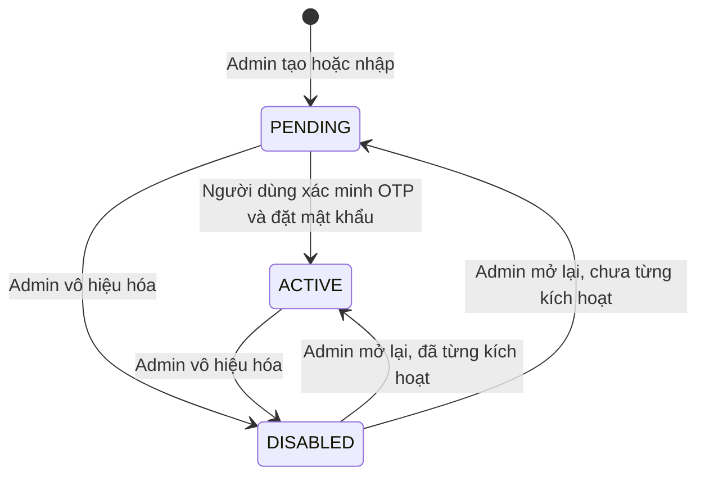

# U01 Account & Access — domain-entities

> Current Construction revision 2026-10-13: 66 active UC, 50 MVP stories + 1 extension, 15 logical units. Đồng bộ theo Inception, chỉ sửa tài liệu; chưa triển khai/kiểm runtime hoặc duyệt stage/code mới. Approval/checklist trước revision thuộc lịch sử.

**Primary UC:** 01, 02, 03, 04, 05, 06, 07, 59, 60, 61, 62, 63. **Primary stories:** US-IAM-001, US-IAM-002, US-IAM-003, US-IAM-004, US-IAM-005, US-IAM-006, US-IAM-007. **Requirements:** FR-001/002/015.

Nguồn: [shared contract](../../current-srs-contract.md), [Inception catalog](../../../inception/requirements/use-cases.md), [decisions](../../../inception/requirements/revision-decisions-2026-10-13.md). Baseline cũ: [snapshot](../../historical/baseline-before-66-uc-2026-10-13/README.md). Folder legacy `u01-account-and-access` không quyết định chức năng hiện hành.

Thiết kế độc lập công nghệ. Kiểu dữ liệu ghi ở mức nghiệp vụ; kiểu cột cuối cùng chốt ở Code Generation. Truy vết: `US-IAM-001`…`US-IAM-007`; UC 01–07, 59–63 theo `docs/use-cases-73.md`.

## 1. Tổng quan

| Entity | Loại | Lưu ở | Unit ghi |
|---|---|---|---|
| `Account` | Aggregate root | `accounts` | U01 |
| `PasswordCredential` | Value object của `Account` | `accounts` | U01 |
| `Profile` | Value object của `Account` | `accounts` | U01 |
| `LoginThrottle` | Value object của `Account` | `accounts` | U01 |
| `EmailPreferences` | Value object của `Account` | `accounts.email_preferences` | U16 |
| `OtpChallenge` | Entity tạm thời | Redis | U01 |
| `VerificationTicket` | Entity tạm thời (`otpTicket`) | Redis | U01 |
| `Session` | Entity tạm thời | Redis | U01 |
| `RequestThrottle` | Bộ đếm tạm thời | Redis | U01 |
| `AccountImportResult` | Kết quả trả về | Không lưu | U01 |
| `AuthorizationDecision` | Kết quả trả về | Không lưu | U01 |

U01 **không** sở hữu: phân công môn/lớp (U04), audit (U02), quota/usage (U07), AI connection secrets (U13).

## 2. `Account`

| Thuộc tính | Ý nghĩa | Ràng buộc |
|---|---|---|
| `accountId` | Định danh | Bất biến |
| `schoolEmail` | Email trường, dùng đăng nhập | Bắt buộc; chuẩn hóa chữ thường, bỏ khoảng trắng; duy nhất toàn hệ thống; thuộc tên miền trong biến triển khai `U01_ALLOWED_EMAIL_DOMAINS`; **không đổi sau khi tạo** |
| `role` | Vai trò cao nhất | `STUDENT`, `TEACHER`, `SUBJECT_MANAGER`, `ADMIN`; `ADMIN` không nhận phân công môn/lớp (BR-U01-60) |
| `status` | Trạng thái vòng đời | `PENDING`, `ACTIVE`, `DISABLED` |
| `credential` | `PasswordCredential` | Rỗng khi `PENDING` |
| `profile` | `Profile` | Bắt buộc có `displayName` |
| `throttle` | `LoginThrottle` | Mặc định không khóa |
| `credentialVersion` | Số phiên bản quyền | Tăng khi đổi hoặc đặt lại mật khẩu, đổi role, vô hiệu hóa; version cũ bị deny request tiếp theo và không refresh được |
| `createdAt`, `updatedAt`, `version` | Thời gian và khóa lạc quan | Hệ thống quản lý |

### Trạng thái

**Text alternative**: Tài khoản sinh ra ở `PENDING`. Người dùng xác minh OTP và đặt mật khẩu thì sang `ACTIVE`. Admin có thể chuyển `PENDING` hoặc `ACTIVE` sang `DISABLED`. Khi mở lại, tài khoản đã từng có mật khẩu về `ACTIVE`, chưa từng có mật khẩu về `PENDING`. Không có trạng thái `LOCKED`; khóa tạm do nhập sai là `LoginThrottle`.

## 3. `PasswordCredential`

| Thuộc tính | Ý nghĩa |
|---|---|
| `passwordHash` | Băm bằng thuật toán thích ứng; không bao giờ lưu hay ghi log bản rõ |
| `passwordChangedAt` | Lần đặt/đổi mật khẩu gần nhất |

## 4. `Profile`

| Thuộc tính | Ràng buộc |
|---|---|
| `displayName` | Bắt buộc, 1-150 ký tự sau khi cắt khoảng trắng |
| `phoneNumber` | Tùy chọn; chỉ chữ số, dấu `+` ở đầu, 8-15 chữ số; là dữ liệu cá nhân, không ghi log |

## 5. `LoginThrottle`

| Thuộc tính | Ý nghĩa |
|---|---|
| `failedLoginCount` | Số lần sai liên tiếp |
| `lockedUntil` | Mốc tự mở khóa; rỗng nếu không khóa |

## 6. AI access boundary

Không số dư credit hoặc ví trong Account. U07 lưu quota educator và usage riêng; U13 bảo vệ kết nối cá nhân/tổ chức. Student không shared quota. Admin được cấu hình/test synthetic API chung, không gọi AI học vụ.

## 7. Cấu hình U01

Không có bảng cấu hình (database chỉ gồm bảng của ERD). Tên miền email trường là biến triển khai `U01_ALLOWED_EMAIL_DOMAINS` (BR-U01-03).

## 8. `OtpChallenge`

| Thuộc tính | Ràng buộc |
|---|---|
| `purpose` | `ACTIVATION` hoặc `PASSWORD_RESET` |
| `accountId` | Tài khoản đích |
| `codeHash` | Băm của mã 6 chữ số; không lưu bản rõ |
| `expiresAt` | Tạo lúc + 10 phút |
| `attemptsLeft` | Bắt đầu 5; về 0 thì xóa challenge |

Mỗi `(accountId, purpose)` có tối đa **một** challenge còn hiệu lực. Tạo mã mới xóa mã cũ.

### `VerificationTicket`

| Thuộc tính | Ràng buộc |
|---|---|
| `kind` | `OTP_ACTIVATION` hoặc `OTP_PASSWORD_RESET` (cấp sau khi OTP đúng, 10 phút) |
| `accountId` | Tài khoản đích |
| `tokenHash` | Băm của ticket ngẫu nhiên trả cho client |

Dùng một lần; xóa khi đặt mật khẩu thành công (BR-U01-28).

## 9. `Session`

| Thuộc tính | Ý nghĩa |
|---|---|
| `sessionId` | Định danh phiên |
| `accountId` | Chủ phiên |
| `credentialVersion` | Version lúc tạo; lệch current `Account.credentialVersion` thì deny access/refresh |
| `refreshTokenHash` | Băm refresh token; phát hiện dùng lại thì thu hồi phiên |
| `issuedAt`, `lastUsedAt`, `expiresAt` | Idle 2 giờ tính từ `lastUsedAt`, tối đa 7 ngày tính từ `issuedAt`. Access token JWT sống 15 phút, không lưu phía server |

## 10. `RequestThrottle`

Bộ đếm theo `(hành động, email chuẩn hóa)` và `(hành động, client)` cho: đăng nhập, yêu cầu OTP kích hoạt, yêu cầu OTP đặt lại. Ngưỡng cụ thể ở NFR Requirements.

## 11. `AccountImportResult`

Không có use case xem lại lịch sử nhập nên kết quả không lưu. Bước kiểm tra trả kết quả ngay trong response; bước xác nhận gửi lại cùng file, hệ thống kiểm lại rồi tạo các dòng hợp lệ trong một transaction. Nhập lại cùng file không tạo trùng vì email đã tồn tại bị báo lỗi dòng (BR-U01-82). Mỗi lần xác nhận ghi một sự kiện audit (người nhập, checksum file, số dòng tạo/lỗi).

| Thuộc tính | Ý nghĩa |
|---|---|
| `fileChecksum` | SHA-256 của file, ghi vào audit |
| `rows` | Danh sách `ImportRowResult` |
| `createdCount`, `rejectedCount` | Tổng kết |

`ImportRowResult`:

| Thuộc tính | Ý nghĩa |
|---|---|
| `rowNumber` | Số dòng trong CSV |
| `schoolEmail`, `displayName`, `role` | Dữ liệu đọc được |
| `outcome` | `CREATED`, `REJECTED` |
| `reason` | Mã lỗi: `EMAIL_EXISTS`, `EMAIL_DOMAIN_NOT_ALLOWED`, `INVALID_EMAIL`, `INVALID_ROLE`, `DUPLICATE_IN_FILE`, `MISSING_FIELD` |

## 12. `AuthorizationDecision`

| Thuộc tính | Ý nghĩa |
|---|---|
| `allowed` | Có/không |
| `reasonCode` | Mã lý do an toàn cho log, không trả chi tiết cho client |
| `actorId`, `action`, `resourceRef` | Đầu vào đã đánh giá |

Phạm vi môn/lớp đến từ `SubjectScopePort`, `ClassScopePort` (U04 cài). U01 kết hợp role và phạm vi để ra quyết định.

## 13. Contract

### Port U01 cung cấp

| Port | Dùng bởi | Ghi chú |
|---|---|---|
| `AuthorizationPort.authorize(actor, action, resourceRef)` | Mọi unit | Mặc định từ chối; kết hợp role và phạm vi U04 |
| `AccountLookupPort` | U02, U04, U16 | Tìm người học theo email/tên (≤ 20 kết quả), tra theo danh sách email, lấy email/tên hiển thị/role/trạng thái (U02 dùng để hiện email người thực hiện trên Audit Log); `countByRoleAndStatus()` trả số đếm cho UC 58 View Admin Dashboard (U16); không trả mật khẩu hay số điện thoại |

### Port U01 dùng

| Port | Cung cấp bởi | Cạnh | Dùng để |
|---|---|---|---|
| `AuditPort.record` | U02 | `H` | Ghi sự kiện bảo mật/nghiệp vụ (U02 code trước U01) |
| `JobPort.enqueue` | U03 | `H` | Gửi việc `OTP_DELIVERY` sang worker sau commit qua durable job/outbox U03 (U01 không sở hữu bảng job); handler gửi mail do U01 sở hữu, chạy ở worker, retry hữu hạn |
| `SubjectScopePort`, `ClassScopePort` | U01 khai báo, U04 cài | `C` (U04 code sau U01) | Đọc phạm vi phân công khi quyết định quyền và khi chặn hạ role |

U03 và U02 code trước U01; chỉ phạm vi môn/lớp (U04, code sau) dùng adapter tạm (xem code generation plan).

## 14. API tài khoản và phiên

| API | UC | Ghi chú |
|---|---|---|
| `POST /api/v1/auth/login` | 02 | Trả `SessionInfo { accountId, displayName, role, homePath }`; `homePath` theo BR-U01-48: Class Dashboard, Manager Dashboard hoặc Admin Dashboard |
| `GET`, `PATCH /api/v1/me/profile` | 06, 07 | Chỉ `displayName`, `phoneNumber`; không có avatar |
| `GET /api/v1/admin/accounts` | 59 | Lọc role, trạng thái, email; phân trang |
| `POST /api/v1/admin/accounts` | 60 | Tạo một tài khoản `PENDING` |
| `GET /api/v1/admin/accounts/{id}` | 61 | Không trả hash, OTP, token |
| `PATCH /api/v1/admin/accounts/{id}` | 62 | `displayName`, `phoneNumber`, `version`; không email/role/status |
| `PUT /api/v1/admin/accounts/{id}/role` | 62 | Đổi role theo F11 |
| `PUT /api/v1/admin/accounts/{id}/status` | 63 | Vô hiệu hóa hoặc mở lại theo F12 |
| `POST /api/v1/admin/accounts/imports:validate`, `imports:commit` | Luồng phụ của 60 | Kiểm rồi xác nhận nhập CSV theo F10 |

Không có API ảnh đại diện. Cột avatar cũ nếu đã tồn tại có thể giữ tương thích, không đưa vào DTO; không tự xóa dữ liệu/schema đang có.

## Quy tắc tích hợp revision hiện hành

- Tài khoản trường cấp, không public registration. Admin tạo/import không gửi OTP hoặc đặt mật khẩu; người dùng yêu cầu activation ở login đầu và tự đặt mật khẩu sau OTP.
- Account role cao nhất trong STUDENT/TEACHER/SUBJECT_MANAGER/ADMIN; authorization theo action/resource/current state, không chỉ role JWT. Admin chỉ quản trị, không học vụ.
- Profile cá nhân chỉ displayName/phoneNumber, email định danh/role/status bất biến trong /me. Reset không tiết lộ account tồn tại.
- MCP credentials xác thực actor qua U13 và cùng AuthorizationPort; không dùng provider API key làm ALAP authentication. Student không shared quota.
- Authorization current actor/resource on every web/API/MCP call, fail closed; CSRF protections for cookie-session state-changing routes; no user-supplied actor trusted.
- expectedVersion on edits and idempotency on repeatable commands/events; conflicts do not overwrite current state, retry bounded, reference returned not secrets.
- Unit repository private; cross-unit read/write through public ports. DB ownership is logical within one Spring Boot monolith; no 15 service deploys.
- No fabricated survey/implementation evidence. D01 Quiz Practice, D02 Group Graded, D03 own-editable group AI context retained provisionally; numeric quota D04 and backup/activity retention require settings confirmation.

## Kiểm tra revision bắt buộc

- Tạo/import không gửi OTP, activation hợp lệ/sai/hết hạn/rate limit; recovery không lộ account.
- Đăng nhập/đăng xuất/phiên revoked; R1 own profile; Admin bị chặn học vụ; Student shared quota bị từ chối.
