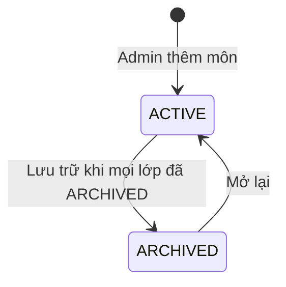

# U04 Subject Administration — domain-entities

**AS-BUILT sync 2026-10-30:** [as-built-baseline.md](../code/as-built-baseline.md); source-observed, không phải fresh test/runtime acceptance.

> Current source baseline 2026-10-30, staging@794a4053; ownership theo unit-of-work hiện hành. Có implementation source; chưa chạy lại runtime acceptance trong đợt sync. Ước lượng và kết quả có ngày cũ giữ theo phạm vi lịch sử.

**Primary UC:** 16, 17, 18, 19. **Primary stories:** US-CAT-001 (phần môn). **Requirements:** FR-002, FR-003.

Nguồn: [Inception catalog](../../../inception/requirements/use-cases.md), [stories](../../../inception/user-stories/stories.md).

Thiết kế độc lập công nghệ.

## 1. Tổng quan

| Entity | Loại | Lưu ở | Unit ghi |
|---|---|---|---|
| `Subject` | Aggregate root | `subjects` | U04 |

U04 không sở hữu: tài khoản và role (U01), lớp, giảng viên lớp và ghi danh (U05), tài nguyên cấp môn (U07, U10, U13), audit (U02).

## 2. `Subject`

| Thuộc tính | Kiểu | Ràng buộc |
|---|---|---|
| `id` | UUID | Khóa |
| `code` | chuỗi ≤ 20 | Chữ hoa, số, `-`; duy nhất; không đổi sau khi tạo |
| `name` | chuỗi ≤ 200 | Bắt buộc |
| `description` | chuỗi ≤ 2.000 | Tùy chọn |
| `status` | enum | `ACTIVE`, `ARCHIVED` |
| `managerId` | UUID | Cột `manager_id` → `accounts`; `SUBJECT_MANAGER` đang `ACTIVE` lúc gán; có thể rỗng |
| `createdAt`, `updatedAt`, `version` | | Khóa lạc quan |

### Trạng thái

**Text alternative**: Môn tạo ra ở `ACTIVE`. Chỉ lưu trữ được khi mọi lớp của môn đã `ARCHIVED`; môn `ARCHIVED` có thể mở lại về `ACTIVE`. Không xóa môn.

## 3. Contract

### Interface U04 cung cấp

| Interface | Phương thức | Dùng bởi | Dùng để |
|---|---|---|---|
| `ISubjectScope` (contract của U01, U04 cài) | `isSubjectManager(accountId, subjectId)`, `listManagedSubjects(accountId)`, `releaseManagerAssignments(accountId, actor)` | U01 | Kiểm quyền R2 theo phân công hiện thời; chặn đổi role người đang là Chủ nhiệm môn; gỡ Chủ nhiệm khỏi mọi môn khi tài khoản bị vô hiệu hóa (BR-U04-12) |
| `ISubjectQuery` | `getSubject(subjectId)` → `SubjectRef`, `isActive(subjectId)`, `listManagedSubjects(accountId)` → `List<SubjectRef>`, `countSubjectsByStatus()` | U05, U07, U10, U13, U15 | Đọc mã, tên, trạng thái, Chủ nhiệm môn; kiểm môn còn `ACTIVE`; số đếm cho Admin Dashboard |
| `ISubjectMutationGuard` | `lockActive(subjectId, timeout)` → `SubjectRef` | U05 | Khóa dòng môn tới cuối transaction của U05 (chờ tối đa 1 giây), môn không `ACTIVE` thì từ chối `SUBJECT_ARCHIVED`. U05 gọi trước mọi thao tác ghi lớp và ghi danh; lưu trữ môn khóa cùng dòng nên hai bên chạy lần lượt (BR-U04-04, BR-U05-22) |
| `NavEntry` (contract frontend của U01, U04 cài) | - | U01 | Mục Môn học trên menu bên của Admin |

`SubjectRef`: `subjectId`, `code`, `name`, `status`, `managerId`.

### Contract U04 cung cấp (unit khác cài)

| Contract | Phương thức | Unit cài | Dùng để |
|---|---|---|---|
| `ISubjectClasses` | `listClassesOfSubject(subjectId)` → `List<SubjectClassSummary>`, `countClasses(subjectIds)` → số lớp theo môn, `countUnarchivedClasses(subjectId)`, `archiveClassesOfSubject(subjectId, actor)` | U05 | Hiện lớp của môn chỉ đọc trên Subject Detail và số lớp trên Subject List; chặn lưu trữ môn khi còn lớp chưa lưu trữ, mà U04 không phụ thuộc ngược U05 |

`SubjectClassSummary`: `classId`, `code`, `name`, `term`, `status`, `teacherName`, `activeStudentCount`.

### Interface U04 dùng

| Interface | Unit | Dùng để |
|---|---|---|
| `IAuthorization`, `IAccountLookup` | U01 | Kiểm quyền Admin; kiểm và hiện Chủ nhiệm môn |
| `IAudit` | U02 | Audit |

## 4. API

| API | UC |
|---|---|
| `GET /api/v1/admin/subjects` | 16 |
| `POST /api/v1/admin/subjects` | 17 |
| `GET /api/v1/admin/subjects/{id}` | 18 |
| `GET /api/v1/admin/subjects/{id}/classes` | 18 |
| `PATCH /api/v1/admin/subjects/{id}` | 19 |
| `PUT /api/v1/admin/subjects/{id}/manager` | 17, 19 |
| `PUT /api/v1/admin/subjects/{id}/status` | 19 |
