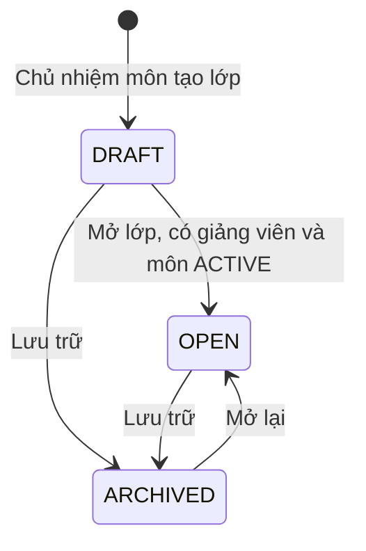
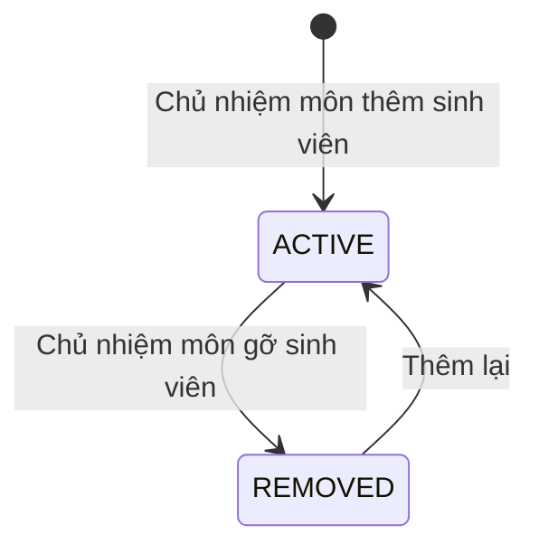

# U05 Class & Enrollment — domain-entities

> Revision 2026-10-15 theo [unit-of-work](../../../inception/application-design/unit-of-work.md): U05 Class & Enrollment thuộc Iter 1, người code: Người 5; UC 20–30. Tách phần lớp và ghi danh từ U04 cũ; mã `BR-U05-xx` ứng với `BR-U04-xx` cũ cùng số. Chỉ sửa tài liệu; chưa triển khai hoặc kiểm runtime.

**Primary UC:** 20, 21, 22, 23, 24, 25, 26, 27, 28, 29, 30. **Primary stories:** US-CAT-002, US-CAT-003, US-LRN-001; phần lớp của US-CAT-001. **Requirements:** FR-002, FR-003, FR-005.

Nguồn: [shared contract](../../current-srs-contract.md), [Inception catalog](../../../inception/requirements/use-cases.md), [stories](../../../inception/user-stories/stories.md).

Thiết kế độc lập công nghệ.

## 1. Tổng quan

| Entity | Loại | Lưu ở | Unit ghi |
|---|---|---|---|
| `CourseClass` | Aggregate root | `course_classes` | U05 |
| `Enrollment` | Bảng nối tài khoản–lớp | `enrollments` (khóa chính `class_id`, `account_id`) | U05 |

U05 không sở hữu: tài khoản và role (U01), môn và Chủ nhiệm môn (U04), học liệu (U13), bài tập (U07, U08), nhóm (U12), thông báo (U14), audit (U02).

## 2. `CourseClass`

| Thuộc tính | Kiểu | Ràng buộc |
|---|---|---|
| `id` | UUID | Khóa |
| `subjectId` | UUID | FK `subjects`; không đổi |
| `code` | chuỗi ≤ 30 | Duy nhất trong môn; không đổi |
| `name` | chuỗi ≤ 200 | Bắt buộc |
| `description` | chuỗi ≤ 2.000 | Tùy chọn |
| `term` | chuỗi ≤ 20 | Học kỳ, ví dụ `2026-1` |
| `status` | enum | `DRAFT`, `OPEN`, `ARCHIVED` |
| `teacherId` | UUID | FK `accounts`; `TEACHER` hoặc `SUBJECT_MANAGER`; bắt buộc trước khi `OPEN` |
| `showGradeDistribution` | bool | Mặc định `false` |
| `createdAt`, `updatedAt`, `version` | | Khóa lạc quan |

**Text alternative**: Lớp tạo ra ở `DRAFT`. Mở lớp cần có giảng viên chính và môn `ACTIVE`. `DRAFT` hoặc `OPEN` đều lưu trữ được; lớp `ARCHIVED` mở lại về `OPEN` và bị từ chối nếu có sinh viên đang học lớp chưa lưu trữ khác cùng môn.

## 3. `Enrollment`

| Thuộc tính | Kiểu | Ràng buộc |
|---|---|---|
| `classId` | UUID | Khóa chính cùng `accountId` |
| `accountId` | UUID | Tài khoản role `STUDENT` |
| `status` | enum | `ACTIVE`, `REMOVED` |
| `source` | enum | `MANUAL`, `LIST` |
| `enrolledAt`, `removedAt` | thời gian | |

**Text alternative**: Ghi danh tạo ra ở `ACTIVE`; gỡ thì sang `REMOVED` nhưng giữ bản ghi và lịch sử; thêm lại dùng đúng bản ghi đó.

## 4. Contract

### Port U05 cung cấp

| Port | Phương thức | Dùng bởi | Dùng để |
|---|---|---|---|
| `ClassScopePort` (contract của U01, U05 cài) | `isTeacherOf(accountId, classId)`, `isEnrolledStudent(accountId, classId)`, `subjectOfClass(classId)`, `listTaughtClasses(accountId)` | U01 | Kiểm R3/R4, R5 theo phân công và ghi danh hiện thời; chặn hạ role người đang dạy |
| `SubjectClassesPort` (contract của U04, U05 cài) | `listClassesOfSubject(subjectId)`, `countClasses(subjectIds)`, `countUnarchivedClasses(subjectId)` | U04 | Lớp của môn trên Subject Detail và Subject List; chặn lưu trữ môn |
| `ClassAccessPort` | `getClassRef(classId)` → `ClassRef`, `isActiveStudent(accountId, classId)`, `listActiveStudents(classId)`, `isClassManager(accountId, classId)`, `listOpenClassesOf(accountId)`, `listOpenClassesOfSubject(subjectId)`, `countClassesByStatus()`, `countActiveEnrollments()` | U07–U15 | Thông tin lớp, sinh viên đang học, Chủ nhiệm môn của lớp, lớp đang mở của một người hoặc một môn, số đếm |
| Sự kiện `enrollment.activated` | - | U14 | Thông báo ghi danh trong app và email |

`ClassRef`: `classId`, `subjectId`, `code`, `name`, `status`, `teacherId`, `showGradeDistribution`. `isClassManager` chỉ đúng với Chủ nhiệm môn của môn chứa lớp; Admin không có quyền này.

### Contract U05 cung cấp (unit khác cài, phía frontend)

| Contract | Unit cài | Dùng để |
|---|---|---|
| `StudentClassSection` | U08 (bài tập của lớp), U12 (nhóm của tôi), U13 (học liệu), U14 (thông báo lớp) | Gắn phần nội dung vào Student Class Detail |
| `TeacherClassTab` | U13 (tab Materials), U07, U09, U10 (tab Evals), U12 (phần nhóm trong tab Students) | Gắn tab hoặc phần vào Teacher Class Detail |
| `StudentDetailSection` | U12 (nhóm của sinh viên) | Gắn phần nhóm vào popup Student Detail |
| `DashboardNavEntry` | U08 (Student Assignments), U11 (Quiz Practice History), U14 (Class Announcements) trên Class Dashboard; U07 (Assignment List), U10 (Question List, Quiz List), U13 (Material List) trên Manager Dashboard | Gắn lối vào màn của unit khác lên hai dashboard |

### Port U05 dùng

| Port | Unit | Dùng để |
|---|---|---|
| `AuthorizationPort`, `AccountLookupPort` | U01 | Kiểm quyền; tìm sinh viên, giảng viên |
| `SubjectQueryPort` | U04 | Môn còn `ACTIVE`, môn được giao quản lý |
| `AuditPort` | U02 | Audit |
| `EventPublisherPort` | U03 | Sự kiện `enrollment.activated` |

## 5. API

| API | UC |
|---|---|
| `GET /api/v1/me/classes`, `GET /api/v1/me/classes/{id}` | 20, 21 |
| `GET /api/v1/teaching/classes`, `GET /api/v1/teaching/classes/{id}`, `GET .../{id}/students`, `GET .../{id}/students/{accountId}` | 22, 23 |
| `GET /api/v1/manager/subjects`, `GET /api/v1/manager/subjects/{id}` | 30 |
| `GET /api/v1/manager/classes`, `POST /api/v1/manager/classes` | 24, 26 |
| `GET /api/v1/manager/classes/{id}` | 25 |
| `PUT /api/v1/manager/classes/{id}/teacher`, `GET /api/v1/manager/teacher-candidates` | 26, 27 |
| `GET .../{id}/student-candidates`, `POST .../{id}/enrollments`, `POST .../{id}/enrollments:batch`, `PUT .../{id}/enrollments/{accountId}/status` | 28 |
| `PATCH /api/v1/manager/classes/{id}`, `PUT .../{id}/grade-distribution`, `PUT .../{id}/status` | 29 |
