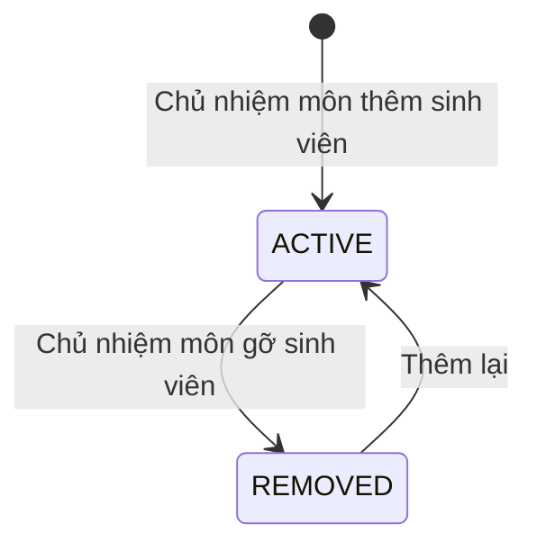

# U05 Class & Enrollment — domain-entities

**AS-BUILT sync 2026-10-30:** [as-built-baseline.md](../code/as-built-baseline.md); source-observed, không phải fresh test/runtime acceptance.

> Current source baseline 2026-10-30, staging@794a4053; ownership theo unit-of-work hiện hành. Có implementation source; chưa chạy lại runtime acceptance trong đợt sync. Ước lượng và kết quả có ngày cũ giữ theo phạm vi lịch sử.

**Primary UC:** 20, 21, 22, 23, 24, 25, 26, 27, 28, 29, 30. **Primary stories:** US-CAT-002, US-CAT-003, US-LRN-001; phần lớp của US-CAT-001. **Requirements:** FR-002, FR-003, FR-005.

Nguồn: [Inception catalog](../../../inception/requirements/use-cases.md), [stories](../../../inception/user-stories/stories.md).

Thiết kế độc lập công nghệ.

## 1. Tổng quan

| Entity | Loại | Lưu ở | Unit ghi |
|---|---|---|---|
| `CourseClass` | Aggregate root | `course_classes` | U05 |
| `Enrollment` | Bảng nối tài khoản–lớp | `enrollments` (khóa chính `class_id`, `account_id`) | U05 |

U05 không sở hữu: tài khoản và role (U01), môn và Chủ nhiệm môn (U04), học liệu (U13), bài tập (U07, U08), nhóm (U12), thông báo (U14), audit (U02).

## 2. `CourseClass`

| Thuộc tính | Kiểu | Ràng buộc |
|---|---|---|
| `id` | UUID | Khóa |
| `subjectId` | UUID | FK `subjects`; không đổi |
| `code` | chuỗi ≤ 30 | Duy nhất trong môn; không đổi |
| `name` | chuỗi ≤ 200 | Bắt buộc |
| `description` | chuỗi ≤ 2.000 | Tùy chọn |
| `term` | chuỗi ≤ 20 | Học kỳ, ví dụ `2026-1` |
| `status` | enum | `DRAFT`, `OPEN`, `ARCHIVED` |
| `teacherId` | UUID | FK `accounts`; `TEACHER` hoặc `SUBJECT_MANAGER`; nullable, kể cả khi OPEN; nếu có phải ACTIVE/đúng role |
| `showGradeDistribution` | bool | Mặc định `false` |
| `createdAt`, `updatedAt`, `version` | | Khóa lạc quan |

```mermaid
stateDiagram-v2
    [*] --> DRAFT: Chủ nhiệm môn tạo lớp
    DRAFT --> OPEN: Mở lớp, môn ACTIVE; teacher tùy chọn
    DRAFT --> ARCHIVED: Lưu trữ
    OPEN --> ARCHIVED: Lưu trữ
    ARCHIVED --> OPEN: Mở lại
```

**Text alternative**: Lớp tạo ra ở `DRAFT`. Mở lớp cần môn `ACTIVE`; teacher có thể chưa gán. `DRAFT` hoặc `OPEN` đều lưu trữ được; lớp `ARCHIVED` mở lại về `OPEN` và bị từ chối nếu có sinh viên đang học lớp chưa lưu trữ khác cùng môn.

## 3. `Enrollment`

| Thuộc tính | Kiểu | Ràng buộc |
|---|---|---|
| `classId` | UUID | Khóa chính cùng `accountId` |
| `accountId` | UUID | Tài khoản role `STUDENT` |
| `status` | enum | `ACTIVE`, `REMOVED` |
| `source` | enum | `MANUAL`, `LIST` |
| `enrolledAt`, `removedAt` | thời gian | |

**Text alternative**: Ghi danh tạo ra ở `ACTIVE`; gỡ thì sang `REMOVED` nhưng giữ bản ghi và lịch sử; thêm lại dùng đúng bản ghi đó.

## 4. Contract

### Interface U05 cung cấp

| Interface | Phương thức | Dùng bởi | Dùng để |
|---|---|---|---|
| `IClassScope` (contract của U01, U05 cài) | `isTeacherOf(accountId, classId)`, `isEnrolledStudent(accountId, classId)`, `subjectOfClass(classId)`, `listTaughtClasses(accountId)` | U01 | Kiểm R3/R4, R5 theo phân công và ghi danh hiện thời; chặn hạ role người đang dạy |
| `ISubjectClasses` (contract của U04, U05 cài) | `listClassesOfSubject(subjectId)`, `countClasses(subjectIds)`, `countUnarchivedClasses(subjectId)`, `archiveClassesOfSubject(subjectId, actor)` | U04 | Lớp của môn trên Subject Detail và Subject List; chặn lưu trữ môn |
| `IClassAccess` | `getClassRef(classId)` → `ClassRef`, `isActiveStudent(accountId, classId)`, `listActiveStudents(classId)`, `isClassManager(accountId, classId)`, `listOpenClassesOf(accountId)`, `listOpenClassesOfSubject(subjectId)`, `countClassesByStatus()`, `countActiveEnrollments()` | U07–U15 | Thông tin lớp, sinh viên đang học, Chủ nhiệm môn của lớp, lớp đang mở của một người hoặc một môn, số đếm |
| Sự kiện `enrollment.activated` | - | U14 | Thông báo ghi danh trong app và email |
| `NavEntry` (contract frontend của U01, U05 cài) | - | U01 | Mục Tổng quan, Môn học của tôi, Lớp học (Subject Manager); Lớp được phân công (Teacher, Subject Manager); Lớp của tôi (Student) trên menu bên |

`ClassRef`: `classId`, `subjectId`, `code`, `name`, `status`, `teacherId`, `showGradeDistribution`. `isClassManager` chỉ đúng với Chủ nhiệm môn của môn chứa lớp; Admin không có quyền này.

### Contract U05 cung cấp (unit khác cài, phía frontend)

| Contract | Unit cài | Dùng để |
|---|---|---|
| `StudentClassSection` | U13 (học liệu), U08 (bài tập sắp đến hạn), U14 (thông báo lớp), U12 (nhóm của tôi) | Gắn phần nội dung vào Student Class Detail |
| `TeacherClassTab` | Tab Thông tin lớp: U12 (số nhóm), U09 (tiến độ nộp, phân bố điểm); tab Sinh viên: U12 (nhóm); tab Học liệu: U13; tab Đánh giá: U07, U10; tab Sổ điểm: U09 | Gắn tab hoặc phần vào Teacher Class Detail |
| `StudentDetailSection` | U12 (nhóm của sinh viên), U09 (bài nộp và điểm trong lớp) | Gắn phần vào popup Student Detail |
| `SubjectSummarySection` | U13 (học liệu), U10 (câu hỏi, Quiz), U07 (bài tập của môn) | Số liệu theo môn trên Manager Dashboard và My Subject |
| `ClassCardSection` | U08 (bài sắp đến hạn của Student) | Dòng tóm tắt trên thẻ lớp ở Class Dashboard |

### Interface U05 dùng

| Interface | Unit | Dùng để |
|---|---|---|
| `IAuthorization`, `IAccountLookup` | U01 | Kiểm quyền; tìm sinh viên, giảng viên |
| `ISubjectQuery` | U04 | Môn được giao quản lý, thông tin môn |
| `ISubjectMutationGuard` | U04 | Khóa dòng môn và kiểm môn còn `ACTIVE` trước khi ghi lớp hoặc ghi danh |
| `IAudit` | U02 | Audit |
| `IEventPublisher` | U03 | Sự kiện `enrollment.activated` |

## 5. API

| API | UC |
|---|---|
| `GET /api/v1/me/classes`, `GET /api/v1/me/classes/{id}` | 20, 21 |
| `GET /api/v1/teaching/classes`, `GET /api/v1/teaching/classes/{id}`, `GET .../{id}/students`, `GET .../{id}/students/{accountId}` | 22, 23 |
| `GET /api/v1/manager/subjects`, `GET /api/v1/manager/subjects/{id}` | 30 |
| `GET /api/v1/manager/classes`, `POST /api/v1/manager/classes` | 24, 26 |
| `GET /api/v1/manager/classes/{id}` | 25 |
| `PUT /api/v1/manager/classes/{id}/teacher`, `GET /api/v1/manager/teacher-candidates` | 26, 27 |
| `GET .../{id}/student-candidates`, `POST .../{id}/enrollments`, `POST .../{id}/enrollments:batch`, `PUT .../{id}/enrollments/{accountId}/status` | 28 |
| `PATCH /api/v1/manager/classes/{id}`, `PUT .../{id}/grade-distribution`, `PUT .../{id}/status` | 29 |

## Source behavior delta — 2026-10-30

CourseClass.create tạo DRAFT. OPEN không bắt buộc teacher: domain, AcademicsService và migration 27/10 đã bỏ guard. Nếu có teacher thì account vẫn phải ACTIVE và đúng role. Scope teaching dựa teacher_id hiện hành, manager dựa subject ownership, Student dựa enrollment/status; không tự cấp teaching cho manager chưa được giao.

[Source/API/schema/test inventory](../code/as-built-baseline.md). Các rule và test cũ trái delta này là thiết kế trước baseline; không tiếp tục áp điều kiện cũ vào AS-BUILT.
