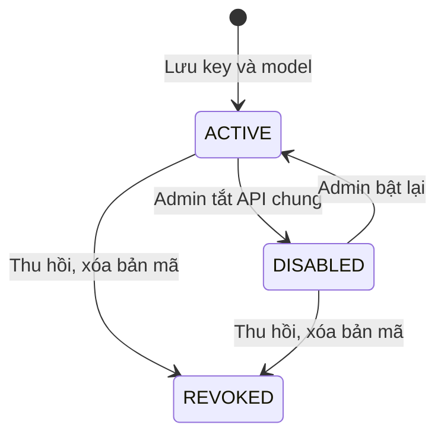
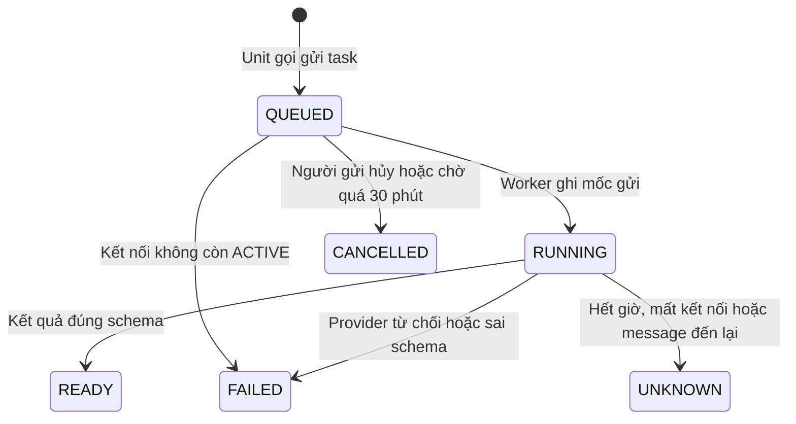

# U06 AI Connections — domain-entities

> Revision 2026-10-15 theo [unit-of-work](../../../inception/application-design/unit-of-work.md): U06 AI Connections thuộc Iter 2, người code: Người 5; UC 31–33 và phần API chung, quota của UC 14–15 (màn do U03). Gộp U07 cũ (AI Usage & Teacher Quota) và U13 cũ (AI Connections & MCP); bỏ mua credit và chạy code. Chỉ sửa tài liệu; chưa triển khai hoặc kiểm runtime.

**Primary UC:** 31, 32, 33; hỗ trợ 14, 15. **Primary stories:** US-AIC-001, US-AIC-002, US-AIC-003, US-AIC-004, US-AIG-001, US-AIG-002, US-AIG-003. **Requirements:** FR-012, FR-021, FR-033, FR-034, FR-035, FR-036, FR-037.

Nguồn: [shared contract](../../current-srs-contract.md), [Inception catalog](../../../inception/requirements/use-cases.md), [stories](../../../inception/user-stories/stories.md), [requirements](../../../inception/requirements/requirements.md).

Thiết kế độc lập công nghệ.

## 1. Tổng quan

| Entity | Loại | Lưu ở |
|---|---|---|
| `AiConnection` | Aggregate root | `ai_connections` |
| `AiTask` | Aggregate root | `ai_tasks` |
| `AiUsageRecord` | Bản ghi chỉ thêm | `ai_usage_records` |
| `AiQuotaPolicy` | Một dòng cấu hình | `ai_quota_policy` |
| `AiTeacherQuota` | Mức riêng theo giảng viên | `ai_teacher_quotas` |
| `AiQuotaWindow` | Bộ đếm theo cửa sổ | `ai_quota_windows` |
| `McpCredential` | Aggregate root | `mcp_credentials` |

U06 không sở hữu: tài khoản và role (U01), cài đặt khóa–giá trị và việc nền (U03), bài, bài làm, điểm, câu hỏi (U07–U10, U12), học liệu (U13), audit (U02).

## 2. `AiConnection`

| Thuộc tính | Kiểu | Ràng buộc |
|---|---|---|
| `id` | UUID | Khóa |
| `scope` | enum | `INSTITUTIONAL`, `PERSONAL` |
| `ownerId` | UUID | FK `accounts`; rỗng với `INSTITUTIONAL` |
| `provider` | enum | `GEMINI`, `OPENAI`, `CLAUDE` |
| `model` | chuỗi ≤ 100 | Thuộc danh sách cho phép của provider |
| `keyCiphertext`, `keyIv`, `keyVersion` | bytes, bytes, số | Không bao giờ trả qua API |
| `keyHint` | chuỗi 4 | 4 ký tự cuối |
| `status` | enum | `ACTIVE`, `DISABLED` (chỉ `INSTITUTIONAL`), `REVOKED` |
| `lastTestAt`, `lastTestResult` | thời gian, chuỗi | Kết quả đã làm sạch |
| `createdAt`, `updatedAt`, `version` | | Khóa lạc quan |

Duy nhất: một kết nối chưa `REVOKED` cho mỗi `(ownerId, provider)` với `PERSONAL`, cho mỗi `provider` với `INSTITUTIONAL`.

**Text alternative**: Kết nối tạo ra ở `ACTIVE`. Chỉ API chung có `DISABLED`, là công tắc tắt mà vẫn giữ key. Thu hồi từ `ACTIVE` hoặc `DISABLED` xóa bản mã và kết thúc kết nối; thêm lại tạo kết nối mới.

## 3. `AiTask`

| Thuộc tính | Kiểu | Ràng buộc |
|---|---|---|
| `id` | UUID | Khóa |
| `requestRef` | chuỗi ≤ 100 | Duy nhất |
| `fingerprint` | chuỗi | Băm của người gọi, loại task, đích, `inputVersion`, nguồn |
| `actorId` | UUID | Người yêu cầu |
| `source` | enum | `SHARED`, `PERSONAL` |
| `connectionId`, `provider`, `model` | | Chốt lúc tạo |
| `taskType` | chuỗi ≤ 50 | Do unit gọi đặt, phải có handler |
| `targetRef`, `inputVersion` | chuỗi, số | Đích của unit gọi |
| `state` | enum | `QUEUED`, `RUNNING`, `READY`, `FAILED`, `UNKNOWN`, `CANCELLED` |
| `inputPayload`, `outputSchema`, `resultPayload` | JSON | Xóa khi task kết thúc và đã chuyển cho handler |
| `maxOutputTokens` | số | Không quá trần model |
| `reservedTokens`, `quotaDay` | số, ngày | Chỉ với `SHARED` |
| `dispatchedAt`, `providerRequestId` | | Mốc gửi |
| `applyResult` | enum | `APPLIED`, `STALE`, `REJECTED` |
| `safeError` | chuỗi ≤ 500 | Không chứa key hay prompt |
| `createdAt`, `finishedAt`, `version` | | |

**Text alternative**: Task tạo ra ở `QUEUED` sau khi đã giữ chỗ quota nếu dùng API chung. Worker ghi mốc gửi rồi mới gọi provider (`RUNNING`). Kết quả đúng schema thì `READY`; provider từ chối hoặc kết quả sai schema thì `FAILED`; không biết kết quả thì `UNKNOWN` và không gọi lại. Task chưa gửi có thể bị hủy, quá hạn hoặc thất bại vì kết nối đã tắt.

## 4. Usage và quota

| Entity | Thuộc tính chính |
|---|---|
| `AiUsageRecord` | `accountId`, `source` (`SHARED`, `PERSONAL`, `MCP`), `taskId` hoặc `mcpCredentialId`, `provider`, `model`, `taskType` hoặc `toolName`, `outcome`, `inputTokens`, `outputTokens`, `cachedTokens`, `reasoningTokens` (có thể rỗng), `provenance` (`PROVIDER_MEASURED`, `ESTIMATED`, `EXTERNALLY_REPORTED`, `UNAVAILABLE`), `createdAt` |
| `AiQuotaPolicy` | `defaultDayTokens`, `globalDayTokens` (rỗng là chưa cấu hình), `version`, `updatedBy`, `updatedAt` |
| `AiTeacherQuota` | `accountId` (khóa), `dayTokens`, `version`, `updatedBy`, `updatedAt` |
| `AiQuotaWindow` | `scopeKey` (`accountId` hoặc `GLOBAL`), `day`; `reservedTokens`, `usedTokens`; khóa `(scopeKey, day)` |

## 5. `McpCredential`

| Thuộc tính | Kiểu | Ràng buộc |
|---|---|---|
| `id` | UUID | Khóa |
| `accountId` | UUID | FK `accounts`; role Student, Teacher, Subject Manager |
| `label` | chuỗi ≤ 60 | Tên agent do người dùng đặt |
| `access` | enum | `READ_ONLY`, `READ_WRITE` |
| `tokenHash` | chuỗi | SHA-256, duy nhất |
| `tokenHint` | chuỗi 4 | 4 ký tự cuối |
| `credentialVersion` | số | Của tài khoản lúc tạo |
| `expiresAt`, `revokedAt`, `lastUsedAt`, `createdAt` | thời gian | Hạn tối đa 90 ngày |

## 6. Contract

### Port U06 cung cấp

| Port | Phương thức | Dùng bởi | Dùng để |
|---|---|---|---|
| `AiTaskPort` | `submit(AiTaskRequest)` → `AiTaskView`, `get(taskId)`, `cancel(actor, taskId)` | U07, U08, U09, U10 | Gửi task AI theo nguồn người dùng chọn, giữ chỗ quota, chạy nền, trả trạng thái |
| `SettingsSectionProvider` (contract của U03, U06 cài: `AiConnectionsSection`, `TeacherQuotaSection`) | `sectionKey()`, `title()`, `summary()` | U03 | Hiện phần API AI của trường và quota giảng viên trên Setting List |
| `JobHandler` (`AI_TASK`), `PendingSweeper`, `ScheduledScanner` (contract của U03, U06 cài) | theo U03 | U03 | Chạy task trong worker, gửi lại message bị mất, dọn task quá hạn |
| `AccountMenuEntry` (contract của U01, U06 cài) | - | U01 | Mục AI Connection trong menu tài khoản cho Student, Teacher, Subject Manager |
| Component `AiSourcePicker`, `AiTaskStatus` | - | Frontend U07, U08, U09, U10 | Popup chọn nguồn AI có quota và ước tính; theo dõi trạng thái task |
| Panel `AiConnectionsPanel`, `TeacherQuotaPanel` (đăng ký vào `settingsSectionRegistry` của U03) | - | U03 | Sửa API chung, quota và xem tổng hợp usage trong Setting Detail |
| MCP server `/mcp` | `initialize`, `tools/list`, `tools/call` | Agent của người dùng | Cho agent đọc và ghi bản nháp đúng quyền |

`AiTaskRequest`: `actor`, `source` (`SHARED` hoặc `PERSONAL` kèm `provider`), `taskType`, `targetRef`, `inputVersion`, `requestRef`, `prompt` (system, user), `outputSchema`, `maxOutputTokens`. `AiTaskView`: `taskId`, `state`, `source`, `provider`, `model`, `applyResult`, `safeError`, usage tóm tắt.

### Contract U06 khai báo (unit khác cài)

| Contract | Phương thức | Unit cài | Dùng để |
|---|---|---|---|
| `AiTaskResultHandler` | `taskType()`, `onReady(AiTaskResult)` → `APPLIED`, `STALE`, `REJECTED`; `onFailed(AiTaskFailure)` | U07 (soạn Assignment), U08 (phản hồi AI bài luyện tập, UC 41), U09 (đề xuất chấm, UC 43), U10 (soạn câu hỏi, Quiz) | Nhận kết quả task, kiểm quyền và phiên bản đích rồi áp dụng, để U06 không phụ thuộc ngược unit gọi |
| `McpToolProvider` | `tools()` → `McpToolDefinition` (tên, mô tả, schema tham số, loại `READ` hoặc `WRITE`, role được dùng); `call(actor, toolName, args)` → `McpToolResult` | U07, U08, U09, U10, U12, U13 | Đăng ký tool MCP trên dữ liệu của mình; tự kiểm quyền và `expectedVersion` |
| `ReferenceMaterialPort` | `listSelectable(actor, scopeRef)`, `extractText(actor, materialIds, maxChars)` | U13 | Cho người soạn chọn tài liệu tham khảo được phép và lấy chữ đưa vào prompt; U07, U10 gọi khi AI soạn bài, soạn câu. Chưa có U13 thì trả rỗng |

Tool giai đoạn đầu theo FR-035:

| Tool | Loại | Unit cài |
|---|---|---|
| `read_assignment_context` (đề, rubric) | READ | U07 |
| `save_assignment_draft` (`expectedVersion`) | WRITE | U07 |
| `read_own_work` | READ | U08 |
| `read_authorized_submission` (giảng viên được giao) | READ | U08 |
| `record_private_feedback` | WRITE | U08 |
| `read_authorized_group_submission` (giảng viên được giao) | READ | U12 |
| `record_grading_proposal` | WRITE | U09 |
| `read_quiz_context`, `save_quiz_draft` (`expectedVersion`) | READ, WRITE | U10 |
| `read_authorized_material` | READ | U13 |

### Port U06 dùng

| Port | Unit | Dùng để |
|---|---|---|
| `AuthorizationPort`, `AccountLookupPort` | U01 | Kiểm quyền, kể cả actor từ MCP; tìm giảng viên khi đặt quota |
| `AuditPort` | U02 | Audit |
| `JobPort` | U03 | Gửi job `AI_TASK` |

## 7. API

| API | UC |
|---|---|
| `GET /api/v1/ai/providers` | 14, 31 |
| `GET /api/v1/me/ai-connections`, `PUT /api/v1/me/ai-connections/{provider}`, `POST .../{provider}:test`, `DELETE .../{provider}` | 31 |
| `GET /api/v1/me/mcp-credentials`, `POST /api/v1/me/mcp-credentials`, `DELETE /api/v1/me/mcp-credentials/{id}` | 32 |
| `POST /mcp` | 32 |
| `GET /api/v1/me/ai-usage` | 33 |
| `GET /api/v1/ai/sources`, `GET /api/v1/ai/tasks/{id}`, `POST /api/v1/ai/tasks/{id}:cancel` | UC của U07–U10; 33 |
| `GET /api/v1/admin/ai/connections`, `PUT /api/v1/admin/ai/connections/{provider}`, `POST .../{provider}:test`, `PUT .../{provider}/status`, `DELETE .../{provider}` | 14, 15 |
| `GET`, `PUT /api/v1/admin/ai/quota-policy`; `GET /api/v1/admin/ai/teacher-quotas`, `PUT`, `DELETE /api/v1/admin/ai/teacher-quotas/{accountId}` | 14, 15 |
| `GET /api/v1/admin/ai/usage-summary` | 33 |
