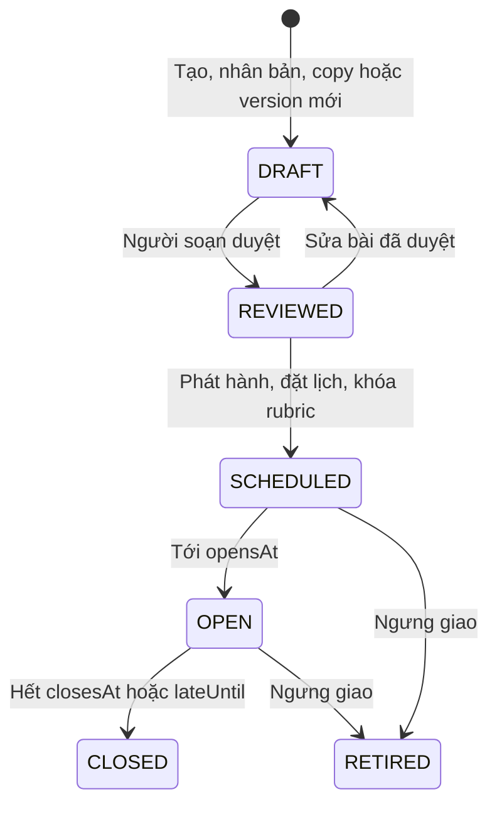

# U07 Assignment Authoring — domain-entities

> Revision 2026-10-15 theo [unit-of-work](../../../inception/application-design/unit-of-work.md): U07 Assignment Authoring thuộc Iter 2, người code: Người 4; UC 34–36. Lấy phần Assignment của U08 cũ (vòng đời, phát hành), U09 cũ (tài liệu, khung, DOCX) và rubric của U06 cũ. Quiz và ngân hàng thuộc U10. Chỉ sửa tài liệu; chưa triển khai hoặc kiểm runtime.

**Primary UC:** 34, 35, 36. **Primary stories:** US-ASM-001 (phần Assignment), US-ASM-004, US-ASM-008, US-ASM-009, US-ASM-010, US-QBK-001. **Requirements:** FR-006, FR-007, FR-016, FR-017, FR-027, FR-028.

Nguồn: [Inception catalog](../../../inception/requirements/use-cases.md), [stories](../../../inception/user-stories/stories.md), [requirements](../../../inception/requirements/requirements.md).

Thiết kế độc lập công nghệ.

## 1. Tổng quan

| Entity | Loại | Lưu ở |
|---|---|---|
| `Assignment` | Aggregate root, một dòng là một version của bài | `assignments` |
| `AssignmentRubric` | Rubric của một phần | `assignment_rubrics` |
| `AssignmentAiDraft` | Đề xuất từ AI hoặc MCP | `assignment_ai_drafts` |
| `DocumentModel`, `Block`, `Part` | Value object | Trong `assignments` (khung); U08, U12 dùng lại cho bài làm |

U07 không sở hữu: Quiz và ngân hàng (U10), lượt làm và bài nộp (U08), nhóm và tài liệu nhóm (U12), điểm (U09), học liệu (U13), kết nối AI (U06), tệp (U03).

## 2. `Assignment`

| Thuộc tính | Kiểu | Ràng buộc |
|---|---|---|
| `id` | UUID | Khóa |
| `scope` | enum | `CLASS`, `SUBJECT` |
| `classId` | UUID | Chỉ với `CLASS`; FK `course_classes` |
| `subjectId` | UUID | Luôn có (với `CLASS` là môn của lớp); FK `subjects` |
| `sourceAssignmentId`, `origin`, `versionNo` | UUID, enum, số | `origin`: `MANUAL`, `CLONE`, `NEW_VERSION`, `CLASS_COPY` |
| `submissionMode` | enum | `INDIVIDUAL`, `GROUP` (chỉ `CLASS`) |
| `diagramEnabled` | bool | |
| `gradingMode` | enum | `GRADED`, `PRACTICE` (`GROUP` chỉ `GRADED`) |
| `title`, `instructions` | chuỗi | ≤ 200; ≤ 20.000 |
| `skeleton` | `DocumentModel` | Khung của người soạn |
| `parts` | danh sách `Part` | Tự tính từ khung |
| `requiredDiagrams` | map loại → số | Chỉ khi bật sơ đồ |
| `referenceMaterialIds` | danh sách ≤ 10 | Tùy chọn; tài liệu của U13 trong phạm vi bài |
| `activityMonitoringEnabled`, `activityNotice` | bool, chuỗi ≤ 1.000 | Mặc định tắt |
| `status` | enum | `DRAFT`, `REVIEWED`, `SCHEDULED`, `OPEN`, `CLOSED`, `RETIRED` |
| `opensAt`, `closesAt`, `lateUntil`, `maxAttempts` | | Đặt khi phát hành |
| `retiredReason` | chuỗi ≤ 500 | |
| `createdBy`, `createdAt`, `updatedAt`, `version` | | Khóa lạc quan |



**Text alternative**: Bài tạo ra ở `DRAFT`. Duyệt thì thành `REVIEWED`; sửa bài đã duyệt đưa về `DRAFT`. Phát hành đặt lịch, khóa rubric và chuyển `SCHEDULED`; từ đây nội dung không sửa được. Tới giờ mở thì `OPEN`, hết hạn (hoặc hạn nộp trễ) thì `CLOSED`. Bài `SCHEDULED` hoặc `OPEN` có thể bị ngưng giao (`RETIRED`). Muốn đổi nội dung sau khi `CLOSED` hoặc `RETIRED` thì tạo version mới.

## 3. `DocumentModel`, `Block`, `Part`

```text
DocumentModel
  blocks[]                 thứ tự trong tài liệu
    id                     UUID, duy nhất trong tài liệu
    origin                 TEACHER | STUDENT
    type                   HEADING | PARAGRAPH | LIST | TABLE | IMAGE | DIAGRAM
    HEADING    style TITLE | SUBTITLE | H1-H6, text
    PARAGRAPH  runs[] (text, bold, italic, underline, code)
    LIST       ordered, items[] (runs, level 0-4)
    TABLE      rows[][] (runs), headerRow
    IMAGE      fileId (U03 DOCUMENT_IMAGE), alt, width
    DIAGRAM    diagramType, xml (mxfile đầy đủ), svgPreview, alt
Part
  partId                   id của block heading nhỏ nhất (DOCUMENT nếu khung không có heading)
  headingBlockId
  ancestorHeadingIds[]     heading cha trên nhánh, từ Tiêu đề 1 xuống
  title                    đường dẫn, ví dụ "H1 › H2.1 › H3.1"
```

**Text alternative**: Tài liệu là danh sách block theo thứ tự. Mỗi block có id, nguồn (người soạn hay người học) và loại: heading, đoạn văn, danh sách, bảng, ảnh (tham chiếu tệp U03) hoặc sơ đồ (loại, XML Draw.io đầy đủ, ảnh SVG xem trước). Phần là heading nhỏ nhất của mỗi nhánh; mỗi phần ghi heading cha để U12 hiện đúng nhánh khi giao phần.

`DiagramType`: `USE_CASE`, `CLASS`, `SEQUENCE`, `ACTIVITY`, `ER`, `COMPONENT`, `STATE`, `OTHER`.

## 4. `AssignmentRubric` và `AssignmentAiDraft`

| Entity | Thuộc tính chính |
|---|---|
| `AssignmentRubric` | `id`, `assignmentId`, `partId` (duy nhất cùng `assignmentId`), `criteria[]` (`id`, `title`, `description`, `kind` `TEXT` hoặc `DIAGRAM`, `items[]` gồm `id`, `text`, `points`), `totalPoints` (tự tính), `lockedAt`, `version` |
| `AssignmentAiDraft` | `id`, `assignmentId`, `origin` (`AI_TASK`, `MCP`), `taskId`, `status` (`PENDING`, `READY`, `APPLIED`, `DISCARDED`, `FAILED`), `proposal` (hướng dẫn, cây heading kèm đoạn hướng dẫn, gợi ý rubric theo heading), `provenance` (người yêu cầu, nguồn, provider, model, tài liệu và version, nhãn agent), `baseVersion`, `createdBy`, `createdAt`, `decidedAt` |

## 5. Contract

### Interface U07 cung cấp

| Interface | Phương thức | Dùng bởi | Dùng để |
|---|---|---|---|
| `IAssignmentQuery` | `get(assignmentId)` → `AssignmentView`; `getContent(assignmentId)` → khung, phần, `requiredDiagrams`, rubric; `listForClass(classId)`; `submissionWindow(assignmentId, now)` → `ON_TIME`, `LATE`, `CLOSED`; `listClosingBetween(from, to)` | U08, U09, U12, U14 | Đọc bài, lịch, nội dung đã khóa; biết còn nhận bài không; nhắc hạn |
| `IRubric` | `listRubrics(assignmentId)`, `score(rubricId, checkedItemIds)`, `maxPoints(assignmentId)` | U08 (hiện rubric), U09 (chấm), U12 | Đọc rubric đã khóa, tính điểm theo mục đạt |
| `IDocumentModel` | `validateSkeleton`, `validateForSave(skeleton, document)`, `validateForSubmit(skeleton, document, requiredDiagrams)`, `computeParts(skeleton)`, `toPlainText(document)`, `compactDiagramXml(xml)`, `sanitize(document)` | U08, U09, U12 | Kiểm bài làm không đụng khung, đủ sơ đồ khi nộp; chữ và XML rút gọn cho AI chấm; làm sạch SVG xem trước trước khi lưu. Kèm lớp tiện ích `DocumentFiles` (`hideFiles`, `fileId`, `resolveFiles`): frontend không thấy `fileId` của ảnh, ảnh mới mang `fileRef` và được gắn khi lưu |
| `IDocx` | `export(document, title, diagramLinker)`, `importPreview(actor, docx, origin, diagramEnabled, diagramResolver)`; `IDiagramLinker` có `linkFor(blockId)` và `viewUrlFor(blockId)` (link trang xem sơ đồ, mặc định không có) | U08, U12 | Xuất, nhập DOCX cho bài làm, cùng cách giữ sơ đồ như đề; ảnh trong DOCX được lưu tạm qua U03 dưới tên `actor` |
| Sự kiện `assignment.opened` | - | U14 | Báo bài mới mở cho người học của lớp hoặc của mọi lớp `OPEN` thuộc môn |
| `TeacherClassTab`, `SubjectSummarySection` (contract của U05, U07 cài); `NavEntry` (contract của U01, U07 cài) | - | U05, U01 | Phần Bài tập trong tab Đánh giá; số bài tập của môn trên Manager Dashboard, My Subject; mục Bài tập trên menu bên của Subject Manager |
| `IAiTaskResultHandler` cho `ASSIGNMENT_DRAFT`, `IMcpToolProvider` (contract của U06, U07 cài) | - | U06 | Nhận đề xuất AI; tool `read_assignment_context`, `save_assignment_draft` |
| `IScheduledScanner` (contract của U03, U07 cài) | - | U03 | Mở, đóng bài theo lịch |
| Component `DocumentEditor`, `DiagramBlock`, `DocumentViewer`, `RubricViewer` | - | Frontend U08, U09, U12 | Trình soạn và xem tài liệu dùng chung, sơ đồ Draw.io, xem rubric |

### Contract U07 khai báo (unit khác cài)

| Contract | Phương thức | Unit cài | Dùng để |
|---|---|---|---|
| `IAssignmentLifecycleListener` | `onOpened(assignmentId)`, `onRetired(assignmentId)` | U08 (tự nộp lượt đang làm khi ngưng giao), U12 (tạo tài liệu nhóm khi mở, tự nộp khi ngưng giao) | Phản ứng bắt buộc trong cùng transaction mở bài, ngưng giao mà U07 không phụ thuộc ngược |
| `IGroupAssignmentSupport` | `checkReadiness(classId)` → lỗi, cảnh báo | U12 | Bật `GROUP`; kiểm lớp có nhóm, mỗi nhóm có thành viên và trưởng nhóm trước khi phát hành. Chưa có U12 thì bản tạm trả lỗi `GROUP_SUPPORT_UNAVAILABLE` (hằng `UNAVAILABLE`) và U07 không cho tạo, duyệt, phát hành bài nhóm |
| Slot frontend `AssignmentRowAction` | - | U09 | Lối vào bài nộp (Submission Detail) trên từng dòng bài |
| Slot frontend `AssignmentFormSection` | - | U12 | Phần nhóm trên Assignment Form của bài `GROUP` |

Chưa có U08, U12 thì listener rỗng và `GROUP` không chọn được. Chưa có U13 thì `IReferenceMaterial` của U06 trả rỗng, AI soạn chỉ từ yêu cầu.

### Interface U07 dùng

| Interface | Unit | Dùng để |
|---|---|---|
| `IAuthorization` | U01 | Kiểm R2, R3/R4, R5 |
| `IAudit` | U02 | Audit |
| `IArtifact`, `IEventPublisher`, `ISettings` | U03 | Ảnh trong khung; sự kiện `assignment.opened`; kiểm `activity.retentionDays` khi bật theo dõi |
| `ISubjectQuery` | U04 | Môn còn `ACTIVE` |
| `IClassAccess` | U05 | Trạng thái lớp, lớp của môn |
| `IAiTask`, `IReferenceMaterial` | U06 | Gửi task AI soạn bản nháp; lấy chữ tài liệu tham khảo (U13 cài) |

## 6. API

| API | UC |
|---|---|
| `GET`, `POST /api/v1/classes/{classId}/assignments` | 34, 35 |
| `GET`, `POST /api/v1/subjects/{subjectId}/assignments` | 34, 35 |
| `GET /api/v1/classes/{classId}/assignment-copy-sources`, `POST /api/v1/classes/{classId}/assignments:copy` | 35 |
| `GET`, `PATCH`, `DELETE /api/v1/assignments/{id}`; `GET .../selectable-materials` | 35 |
| `PUT /api/v1/assignments/{id}/skeleton`, `POST .../skeleton:import-docx`, `GET .../docx`, `GET .../diagrams/{blockId}` | 35 |
| `GET`, `PUT /api/v1/assignments/{id}/parts/{partId}/rubric` | 36 |
| `POST /api/v1/assignments/{id}/ai-drafts`, `GET .../ai-drafts/{draftId}`, `POST .../ai-drafts/{draftId}:apply`, `POST .../ai-drafts/{draftId}:discard` | 35 |
| `POST /api/v1/assignments/{id}/review`, `/publish`, `/retire`, `/clone`, `/versions`; `PATCH .../schedule` | 34, 35 |
