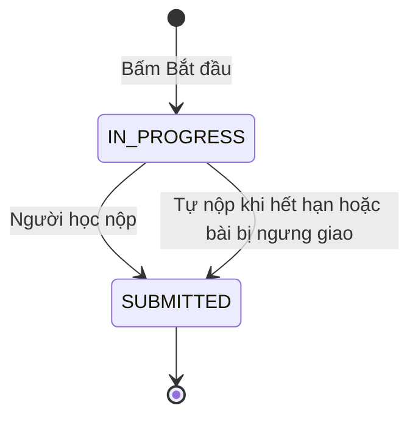

# U08 Assignment Work — domain-entities

> Revision 2026-10-15 theo [unit-of-work](../../../inception/application-design/unit-of-work.md): U08 Assignment Work thuộc Iter 2, người code: Người 3; UC 37–41. Lấy phần Assignment cá nhân, phản hồi Practice và dữ liệu hoạt động của U11 cũ. Lượt Quiz thuộc U11 mới, bài nhóm thuộc U12. Chỉ sửa tài liệu; chưa triển khai hoặc kiểm runtime.

**Primary UC:** 37, 38, 39, 40, 41. **Primary stories:** US-ASM-003 (phần Assignment cá nhân), US-ASM-012; dữ liệu hoạt động của US-INT-001. **Requirements:** FR-007, FR-008, FR-018, FR-030, FR-039.

Nguồn: [Inception catalog](../../../inception/requirements/use-cases.md), [stories](../../../inception/user-stories/stories.md), [requirements](../../../inception/requirements/requirements.md).

Thiết kế độc lập công nghệ.

## 1. Tổng quan

| Entity | Loại | Lưu ở |
|---|---|---|
| `AssignmentAttempt` | Aggregate root, một dòng là một lượt làm bài cá nhân | `assignment_attempts` |
| `PracticeFeedback` | Phản hồi AI cho lượt `PRACTICE` | `practice_feedback` |
| `ActivityEvent` | Sự kiện chỉ thêm | `activity_events` |
| `ActivitySummary` | Kết quả tính khi đọc | Không lưu |

U08 không sở hữu: bài, khung, rubric (U07), lượt Quiz (U11), tài liệu nhóm (U12), điểm và nhận xét chính thức (U09), kết nối AI (U06), tệp (U03).

## 2. `AssignmentAttempt`

| Thuộc tính | Kiểu | Ràng buộc |
|---|---|---|
| `id` | UUID | Khóa |
| `assignmentId` | UUID | FK `assignments`; một version đã khóa |
| `classId`, `accountId` | UUID | Lớp người học làm bài; người học |
| `attemptNo` | số | Duy nhất theo (`assignmentId`, `accountId`) |
| `snapshot` | JSON | `versionNo`, `gradingMode`, `closesAt`, `lateUntil`, `requiredDiagrams`, chính sách theo dõi (bật hay tắt, phiên bản thông báo) |
| `content` | `DocumentModel` của U07 | Bản nháp khi đang làm, bài nộp sau khi nộp |
| `contentVersion` | số | Tăng mỗi lần lưu |
| `status` | enum | `IN_PROGRESS`, `SUBMITTED` |
| `submitMode` | enum | `MANUAL`, `AUTO_DEADLINE`, `AUTO_RETIRED` |
| `late` | bool | |
| `startedAt`, `deadlineAt`, `lastSavedAt`, `submittedAt` | thời gian | |
| `receiptHash` | chuỗi | SHA-256 nội dung lúc nộp |
| `submitWarnings` | JSON | Cảnh báo khi tự nộp |

**Text alternative**: Bấm Bắt đầu tạo lượt ở `IN_PROGRESS`. Người học nộp, hoặc hệ thống tự nộp khi hết hạn hay khi bài bị ngưng giao, thì lượt sang `SUBMITTED` và nội dung không đổi nữa; làm lại là tạo lượt mới nếu còn lượt.

## 3. `PracticeFeedback` và `ActivityEvent`

| Entity | Thuộc tính chính |
|---|---|
| `PracticeFeedback` | `id`, `attemptId`, `accountId`, `origin` (`AI_TASK`, `MCP`), `taskId`, `requestRef`, `status` (`PENDING`, `READY`, `FAILED`), `submissionHash`, `feedback` (nhận xét từng phần, gợi ý, đánh giá ước tính từng mục rubric, điểm ước tính), `provenance` (nguồn, provider, model khi biết, nhãn agent), `createdAt`, `completedAt` |
| `ActivityEvent` | `id`, `accountId`, `classId`, `workKind` (`ASSIGNMENT_ATTEMPT`, `QUIZ_ATTEMPT`, `GROUP_DOCUMENT`), `workId`, `sessionId`, `clientEventId`, `sequence`, `kind` (`SESSION_START`, `HIDDEN`, `VISIBLE`, `HEARTBEAT`, `SESSION_END`), `clientTime`, `serverTime`, `policyVersion`; duy nhất (`accountId`, `workKind`, `workId`, `clientEventId`) |
| `ActivitySummary` | `policyState` (`DISABLED`, `NO_DATA`, `AVAILABLE`, `EXPIRED`), `awayCount`, `knownAwayDuration`, `intervals[]` (bắt đầu, kết thúc, `KNOWN` hoặc `UNKNOWN`), `unknownGaps`, ghi chú độ tin cậy |

## 4. Contract

### Port U08 cung cấp

| Port | Phương thức | Dùng bởi | Dùng để |
|---|---|---|---|
| `SubmissionQueryPort` | `listSubmissions(assignmentId, classId)` → trạng thái từng sinh viên và lượt được chấm; `getSubmission(attemptId)` → nội dung, `receiptHash`, `submittedAt`, `late`, `classId`, `accountId`; `listStudentsWithoutSubmission(assignmentId, classId)` | U09, U14 | Chấm và theo dõi nộp bài; nhắc hạn người chưa nộp |
| `ActivityWritePort` | `record(actor, workRef, events)` | U11, U12 | Ghi sự kiện rời trang của lượt Quiz và tài liệu nhóm sau khi unit đó đã kiểm quyền |
| `ActivityQueryPort` | `summary(workRef, accountId)` → `ActivitySummary` | U09 | Hiện dữ liệu rời trang trong UC 42 sau khi U09 kiểm phân công |
| `AssignmentLifecycleListener` (contract của U07, U08 cài) | `onRetired` (tự nộp lượt đang làm), `onOpened` (không làm gì) | U07 | Tự nộp khi bài bị ngưng giao |
| `StudentClassSection`, `DashboardNavEntry` (contract của U05, U08 cài) | - | U05 | Phần Bài tập trên Student Class Detail; lối vào Student Assignments trên Class Dashboard |
| `AiTaskResultHandler` cho `PRACTICE_FEEDBACK`, `McpToolProvider` (contract của U06, U08 cài) | - | U06 | Nhận phản hồi AI; tool `read_own_work`, `read_authorized_submission`, `record_private_feedback` |
| `ScheduledScanner`, `SettingDefinition` (contract của U03, U08 cài) | - | U03 | Tự nộp khi hết hạn, xóa dữ liệu hoạt động quá hạn; khai báo `activity.retentionDays` |
| Hook `useActivityTracker`, component `ActivityTimeline` | - | Frontend U09, U11, U12 | Gửi sự kiện rời trang từ trình duyệt; hiện dòng thời gian cho giảng viên |

### Contract U08 khai báo (unit khác cài)

| Contract | Phương thức | Unit cài | Dùng để |
|---|---|---|---|
| `SubmissionListener` | `onSubmitted(attemptId)` | U09 | Tạo dòng chờ chấm trong cùng transaction nộp bài `GRADED` mà U08 không phụ thuộc ngược U09 |
| `GroupWorkStatusPort` | `statusFor(accountId, assignmentIds)` | U12 | Trạng thái bài nhóm của người học trên Student Assignments |
| Slot frontend `StudentAssignmentResult` | - | U09 | Điểm đã công bố và phân bố ẩn danh trên từng dòng Student Assignments |
| Slot frontend `SubmissionResultSection` | - | U09 | Điểm và nhận xét đã công bố của lượt được chấm trên Submission History |
| Slot frontend `GroupWorkEntry` | - | U12 | Nút mở bài nhóm trên Assignment Detail |
| Slot frontend `AssignmentMaterialSection` | - | U13 | Tài liệu tham khảo gắn kèm trên Assignment Detail |

Chưa có U09, U12, U13 thì: không tạo dòng chờ chấm, không hiện điểm; bài nhóm chỉ có nhãn, không có nút; không hiện tài liệu gắn kèm.

### Port U08 dùng

| Port | Unit | Dùng để |
|---|---|---|
| `AuthorizationPort` | U01 | Kiểm R5, R3/R4 |
| `AuditPort` | U02 | Audit |
| `ArtifactPort`, `SettingsPort` | U03 | Ảnh trong bài làm; thời hạn giữ dữ liệu hoạt động |
| `ClassAccessPort` | U05 | Ghi danh, lớp đang mở của người học |
| `AiTaskPort` | U06 | Gửi task phản hồi Practice |
| `AssignmentQueryPort`, `RubricPort`, `DocumentModelPort`, `DocxPort` | U07 | Bài, lịch, khung, rubric; kiểm và chuyển đổi tài liệu |

## 5. API

| API | UC |
|---|---|
| `GET /api/v1/me/assignments`, `GET /api/v1/me/assignments/{assignmentId}` | 37, 38 |
| `POST /api/v1/assignments/{assignmentId}/attempts`, `GET /api/v1/attempts/{attemptId}`, `PUT .../content`, `POST .../docx:preview`, `POST .../submit` | 39 |
| `GET /api/v1/assignments/{assignmentId}/attempts/mine`, `GET /api/v1/attempts/{attemptId}/export.docx` | 40 |
| `POST`, `GET /api/v1/attempts/{attemptId}/feedback` | 41 |
| `POST /api/v1/attempts/{attemptId}/activity` | 39 |
