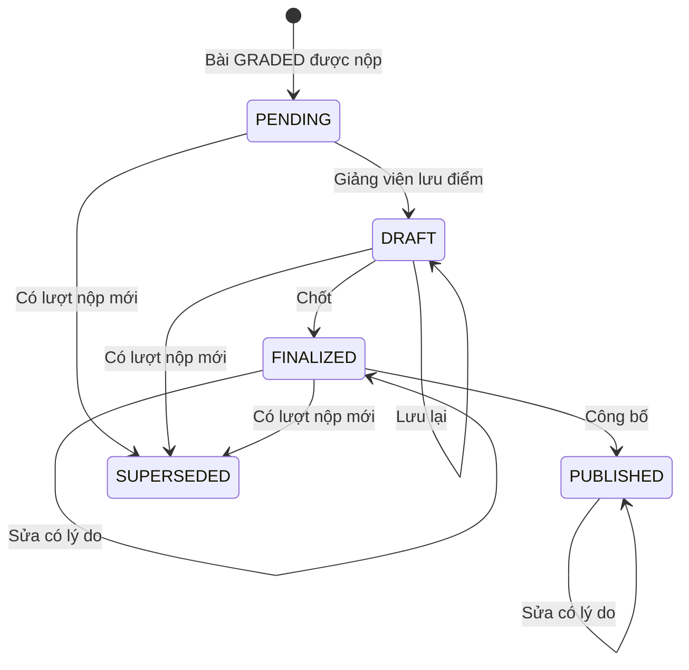

# U09 Assignment Grading — domain-entities

**AS-BUILT sync 2026-10-30:** [as-built-baseline.md](../code/as-built-baseline.md); source-observed, không phải fresh test/runtime acceptance.

> Current source baseline 2026-10-30, staging@794a4053; ownership theo unit-of-work hiện hành. Có implementation source; chưa chạy lại runtime acceptance trong đợt sync. Ước lượng và kết quả có ngày cũ giữ theo phạm vi lịch sử.

**Primary UC:** 42, 43, 44, 45. **Primary stories:** US-GRD-002, US-GRD-003, US-GRD-004, US-GRD-005, US-RPT-001, US-RPT-003, US-INT-001. **Requirements:** FR-008, FR-009, FR-019, FR-020, FR-024, FR-039.

Nguồn: [Inception catalog](../../../inception/requirements/use-cases.md), [stories](../../../inception/user-stories/stories.md), [requirements](../../../inception/requirements/requirements.md).

Thiết kế độc lập công nghệ.

## 1. Tổng quan

| Entity | Loại | Lưu ở |
|---|---|---|
| `Evaluation` | Aggregate root | `evaluations` |
| `EvaluationHistory` | Phần tử chỉ thêm | `evaluations.history` |
| `GradingProposal` | Đề xuất từ AI hoặc MCP, có version | `grading_proposals` |
| `GradebookView`, `GradeDistributionView` | Kết quả tính khi đọc | Không lưu |

U09 không sở hữu: bài nộp (U08, U12), bài và rubric (U07), lượt Quiz và kết quả luyện tập (U11), phản hồi Practice (U08), dữ liệu hoạt động (U08), thông báo (U14).

## 2. `Evaluation`

| Thuộc tính | Kiểu | Ràng buộc |
|---|---|---|
| `id` | UUID | Khóa |
| `kind` | enum | `ATTEMPT`, `GROUP_DOCUMENT`, `MEMBER` |
| `assignmentId`, `classId` | UUID | Bài; lớp của lượt hoặc của nhóm |
| `attemptId` | UUID | Với `ATTEMPT`; duy nhất |
| `groupDocumentId` | UUID | Với `GROUP_DOCUMENT`, `MEMBER` |
| `accountId` | UUID | Chủ lượt (`ATTEMPT`) hoặc thành viên (`MEMBER`); duy nhất cùng `groupDocumentId` với `MEMBER` |
| `submissionHash` | chuỗi | Hash của bài nộp được chấm |
| `maxScore` | số (6,2) | Tổng điểm rubric |
| `rubricChecks` | JSON | Theo phần: mục đạt, điểm phần |
| `adjustment`, `adjustmentReason` | số, chuỗi | Tùy chọn; có điều chỉnh thì bắt buộc lý do |
| `score` | số (6,2) | 0 ≤ `score` ≤ `maxScore` |
| `feedback` | chuỗi ≤ 10.000 | |
| `status` | enum | `PENDING`, `DRAFT`, `FINALIZED`, `PUBLISHED`, `SUPERSEDED` |
| `gradedBy`, `gradedAt`, `publishedAt` | | |
| `history` | danh sách `EvaluationHistory` | Người sửa, thời điểm, trước, sau, lý do |
| `version` | số | Khóa lạc quan |

**Text alternative**: Bài `GRADED` được nộp tạo đánh giá `PENDING`. Giảng viên lưu điểm thì `DRAFT`; chốt thì `FINALIZED`; công bố thì `PUBLISHED`. Sửa điểm đã chốt hoặc đã công bố cần lý do, giữ trạng thái và thêm lịch sử. Người học nộp lượt mới thì đánh giá chưa công bố của lượt cũ thành `SUPERSEDED`; đánh giá đã công bố giữ nguyên. Với bài nhóm, nhóm nộp lại thì đánh giá đưa về `PENDING` và điểm cũ vào lịch sử.

## 3. `GradingProposal`

| Thuộc tính | Ràng buộc |
|---|---|
| `id`, `evaluationId`, `versionNo` | `versionNo` tăng theo đánh giá |
| `origin` | `AI_TASK`, `MCP` |
| `taskId`, `requestRef` | Với `AI_TASK`; `requestRef` duy nhất |
| `status` | `PENDING`, `READY`, `FAILED`, `STALE` |
| `submissionHash` | Phải khớp đánh giá khi dùng |
| `proposal` | Mục đạt theo phần, nhận xét theo phần, nhận xét chung, điểm đề xuất |
| `provenance` | Người yêu cầu, nguồn, provider, model khi biết, nhãn agent |
| `createdAt`, `completedAt`, `usedAt` | |

## 4. Contract

### Interface U09 cung cấp

| Interface | Phương thức | Dùng bởi | Dùng để |
|---|---|---|---|
| `IGroupEvaluation` | `onGroupSubmitted(groupDocumentId, submissionHash, assignmentId, classId, memberIds)` | U12 | Tạo hoặc đưa về chờ chấm đánh giá tài liệu nhóm và thành viên trong transaction nộp |
| Sự kiện `grade.published` | - | U14 | Báo người học vừa có điểm (bài, lớp, danh sách người học) |
| `ISubmissionListener` (contract của U08, U09 cài) | `onSubmitted(attemptId)` | U08 | Tạo đánh giá chờ chấm khi nộp bài `GRADED` |
| `IAiTaskResultHandler` cho `GRADING_PROPOSAL`, `IMcpToolProvider` (contract của U06, U09 cài) | - | U06 | Nhận đề xuất AI; tool `record_grading_proposal` |
| `TeacherClassTab`, `StudentDetailSection` (contract của U05, U09 cài) | - | U05 | Tab Sổ điểm; tiến độ nộp, phân bố điểm trên tab Thông tin lớp; bài nộp và điểm trong popup Student Detail |
| Slot `AssignmentRowAction` (của U07, U09 cài) | - | U07 | Lối vào Submission Detail kèm số đã nộp, chờ chấm trên dòng bài |
| Slot `StudentAssignmentResult`, `SubmissionResultSection` (của U08, U09 cài) | - | U08 | Điểm đã công bố, phân bố ẩn danh; điểm và nhận xét của lượt được chấm |

### Contract U09 khai báo (unit khác cài)

| Contract | Phương thức | Unit cài | Dùng để |
|---|---|---|---|
| `IGroupSubmissionSource` | `getGroupSubmission(groupDocumentId)` → nội dung, thành viên, người làm từng phần, thời điểm nộp, trễ, hash; `listGroupSubmissions(assignmentId, classId)` → trạng thái từng nhóm | U12 | Hiện và chấm bài nhóm, tiến độ theo nhóm mà U09 không phụ thuộc ngược U12 |

Chưa có U12 thì không có đánh giá nhóm; Submission Detail chỉ có bài cá nhân.

### Interface U09 dùng

| Interface | Unit | Dùng để |
|---|---|---|
| `IAuthorization` | U01 | Kiểm R3/R4, R5 |
| `IAudit` | U02 | Audit |
| `IEventPublisher` | U03 | Sự kiện `grade.published` |
| `IClassAccess` | U05 | Sinh viên đang ghi danh, cờ `showGradeDistribution` |
| `IAiTask` | U06 | Task đề xuất chấm |
| `IAssignmentQuery`, `IRubric`, `IDocumentModel` | U07 | Bài, rubric đã khóa, tính điểm, chữ và XML rút gọn cho AI |
| `ISubmissionQuery`, `IActivityQuery` | U08 | Bài nộp, tiến độ, dữ liệu hoạt động |

## 5. API

| API | UC |
|---|---|
| `GET /api/v1/classes/{classId}/assignments/{assignmentId}/submissions` | 42 |
| `GET`, `PUT /api/v1/evaluations/{id}`; `PUT .../members/{accountId}` | 42, 44 |
| `POST`, `GET /api/v1/evaluations/{id}/ai-proposals`; `POST /api/v1/evaluations:ai-proposals` | 43 |
| `POST /api/v1/evaluations:finalize`, `POST /api/v1/evaluations:publish` | 43, 44 |
| `GET /api/v1/classes/{classId}/gradebook`, `GET .../gradebook/export` | 45 |
| `GET /api/v1/classes/{classId}/submission-progress`; `GET /api/v1/classes/{classId}/grade-distribution?assignmentId=` | 42, 45 (tab Thông tin lớp) |
| `GET /api/v1/classes/{classId}/students/{accountId}/grades` | 45 (popup Student Detail) |
| `GET /api/v1/me/grades`, `GET /api/v1/me/grades/attempts/{attemptId}`, `GET /api/v1/me/grade-distributions` | 37, 40 (U08) |
