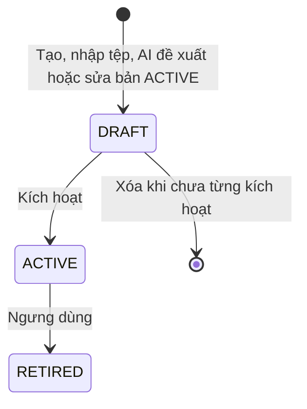
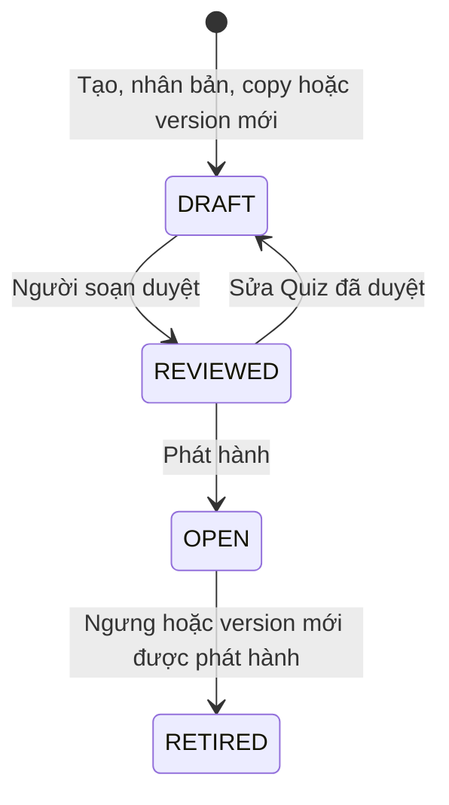

# U10 Quiz Authoring — domain-entities

> Revision 2026-10-15 theo [unit-of-work](../../../inception/application-design/unit-of-work.md): U10 Quiz Authoring thuộc Iter 2, người code: Người 1; UC 46–48. Lấy ngân hàng câu hỏi của U06 cũ, phần Quiz của U08 cũ và cài đặt Quiz của U09 cũ. Ngân hàng chỉ còn câu trắc nghiệm theo UC 46, 47. Làm Quiz thuộc U11. Chỉ sửa tài liệu; chưa triển khai hoặc kiểm runtime.

**Primary UC:** 46, 47, 48. **Primary stories:** US-ASM-006, US-QBK-002; phần Quiz của US-ASM-001. **Requirements:** FR-006, FR-007, FR-016, FR-017, FR-027, FR-028.

Nguồn: [Inception catalog](../../../inception/requirements/use-cases.md), [stories](../../../inception/user-stories/stories.md), [requirements](../../../inception/requirements/requirements.md).

Thiết kế độc lập công nghệ.

## 1. Tổng quan

| Entity | Loại | Lưu ở |
|---|---|---|
| `Question` | Aggregate root, một dòng là một phiên bản câu (ngân hàng hoặc câu riêng của Quiz) | `questions` |
| `Quiz` | Aggregate root, một dòng là một version của Quiz | `quizzes` |
| `QuizItem` | Câu trong Quiz (ghim phiên bản) | `quiz_items` |
| `QuizAiDraft` | Đề xuất câu từ AI hoặc MCP | `quiz_ai_drafts` |

U10 không sở hữu: lượt làm Quiz và kết quả (U11), tài liệu tham khảo (U13), môn, lớp (U04, U05), kết nối AI (U06).

## 2. `Question`

| Thuộc tính | Kiểu | Ràng buộc |
|---|---|---|
| `id`, `lineageId`, `versionNo` | | Duy nhất (`lineageId`, `versionNo`) |
| `scope` | enum | `BANK` (có `subjectId`), `QUIZ` (có `quizId`, câu riêng) |
| `type` | enum | `MCQ_SINGLE`, `MCQ_MULTI` |
| `stem`, `explanation` | markdown ≤ 20.000 | |
| `options` | danh sách | 2–6 mục (`id`, `text`), không trùng |
| `correctOptionIds` | danh sách | Đúng 1 với `MCQ_SINGLE`, ≥ 1 với `MCQ_MULTI` |
| `defaultPoints` | số (6,2) | > 0 |
| `difficulty`, `tags` | enum, danh sách | `EASY`, `MEDIUM`, `HARD`; ≤ 10 tag |
| `status` | enum | `DRAFT`, `ACTIVE`, `RETIRED` (câu riêng của Quiz chỉ `DRAFT`, khóa theo Quiz) |
| `createdBy`, `createdAt`, `updatedAt`, `version` | | Khóa lạc quan |

**Text alternative**: Câu ngân hàng tạo ra ở `DRAFT` (tạo tay, nhập tệp, chấp nhận đề xuất AI, hoặc sửa một bản đã kích hoạt). Kích hoạt thì `ACTIVE` và không sửa được nữa. Ngưng dùng thì `RETIRED`, Quiz đã ghim vẫn dùng. Bản nháp chưa từng kích hoạt thì xóa được.

## 3. `Quiz` và `QuizItem`

| Thuộc tính | Ràng buộc |
|---|---|
| `id`, `scope` (`CLASS`, `SUBJECT`), `classId` (chỉ `CLASS`), `subjectId` (luôn có) | |
| `sourceQuizId`, `origin` (`MANUAL`, `CLONE`, `NEW_VERSION`, `CLASS_COPY`), `versionNo` | |
| `title` (≤ 200), `instructions` (≤ 5.000) | |
| `settings` | `shuffleQuestions`, `shuffleOptions`, `timeLimitMinutes` (trống hoặc 1–300), `maxAttempts` (1–10 hoặc trống là không giới hạn), `showScoreAfterSubmit`, `showCorrectAnswers` (`NEVER`, `AFTER_SUBMIT`) |
| `activityMonitoringEnabled`, `activityNotice` | Mặc định tắt |
| `referenceMaterialIds` | ≤ 10, tùy chọn |
| `status` | `DRAFT`, `REVIEWED`, `OPEN`, `RETIRED` |
| `publishedAt`, `retiredAt`, `retiredReason`, `createdBy`, `version` | |
| `QuizItem` | `quizId`, `questionId` (phiên bản ghim), `position`, `points` (> 0); khóa (`quizId`, `questionId`) |

**Text alternative**: Quiz tạo ra ở `DRAFT`, duyệt thành `REVIEWED`, phát hành thì `OPEN` ngay (không có lịch). Quiz `OPEN` bị ngưng, hoặc có version mới được phát hành, thì `RETIRED`; lượt làm cũ vẫn xem được.

## 4. `QuizAiDraft`

`id`, `target` (`QUIZ` kèm `quizId`, hoặc `BANK` kèm `subjectId`), `origin` (`AI_TASK`, `MCP`), `taskId`, `status` (`PENDING`, `READY`, `ACCEPTED`, `DISCARDED`, `FAILED`), `proposal` (danh sách câu đề xuất), `provenance` (người yêu cầu, nguồn, provider, model, tài liệu và version, nhãn agent), `baseVersion`, `createdBy`, `createdAt`, `decidedAt`.

## 5. Contract

### Port U10 cung cấp

| Port | Phương thức | Dùng bởi | Dùng để |
|---|---|---|---|
| `QuizQueryPort` | `listForClass(classId)` → Quiz `OPEN` của lớp và của môn; `getStudentView(quizId)` → câu, lựa chọn, cài đặt, không có đáp án; `listByMaterial(materialId, classId)`; `get(quizId)` | U11, U13 | Hiện Quiz cho người học; Quiz gắn tài liệu trên Learning Material |
| `QuizScoringPort` | `score(quizId, answers)` → đúng sai và điểm từng câu, tổng; `answerReview(quizId)` → đáp án, giải thích | U11 | Chấm theo đáp án ghim mà đáp án không rời U10; hiện đáp án sau khi nộp theo cài đặt |
| Sự kiện `quiz.published` | - | U14 | Báo Quiz mới trong app |
| `TeacherClassTab`, `DashboardNavEntry` (contract của U05, U10 cài) | - | U05 | Phần Quiz trong tab Evals; lối vào Question List, Quiz List trên Manager Dashboard |
| `AiTaskResultHandler` cho `QUIZ_QUESTION_DRAFT`, `McpToolProvider` (contract của U06, U10 cài) | - | U06 | Nhận câu đề xuất; tool `read_quiz_context`, `save_quiz_draft` |
| Component `McqEditor` | - | Frontend U10 | Soạn câu trắc nghiệm, dùng ở Question Detail và câu riêng của Quiz |

### Contract U10 khai báo (unit khác cài)

| Contract | Phương thức | Unit cài | Dùng để |
|---|---|---|---|
| `QuizLifecycleListener` | `onRetired(quizId)` | U11 | Tự nộp lượt đang làm trong cùng transaction ngưng Quiz hoặc phát hành version mới |
| Slot frontend `QuizDetailSection` | - | U11 | Lượt làm và dữ liệu hoạt động của lượt trên Quiz Detail cho giảng viên |

Chưa có U11 thì listener rỗng và Quiz Detail không có phần lượt làm.

### Port U10 dùng

| Port | Unit | Dùng để |
|---|---|---|
| `AuthorizationPort` | U01 | Kiểm R2, R3/R4 |
| `AuditPort` | U02 | Audit |
| `EventPublisherPort`, `SettingsPort` | U03 | Sự kiện `quiz.published`; kiểm `activity.retentionDays` |
| `SubjectQueryPort` | U04 | Môn còn `ACTIVE`, môn được giao |
| `ClassAccessPort` | U05 | Lớp, giảng viên, môn của lớp |
| `AiTaskPort`, `ReferenceMaterialPort` | U06 | Task AI soạn câu; chữ tài liệu tham khảo (U13 cài) |

## 6. API

| API | UC |
|---|---|
| `GET`, `POST /api/v1/subjects/{subjectId}/questions`; `POST .../questions:import`; `POST .../question-ai-drafts` | 46, 47 |
| `GET`, `PATCH`, `DELETE /api/v1/questions/{id}`; `POST .../versions`, `/activate`, `/retire` | 46, 47 |
| `GET`, `POST /api/v1/subjects/{subjectId}/quizzes`; `GET`, `POST /api/v1/classes/{classId}/quizzes` | 48 |
| `GET /api/v1/classes/{classId}/quiz-copy-sources`, `POST .../quizzes:copy` | 48 |
| `GET`, `PATCH`, `DELETE /api/v1/quizzes/{id}`; `PUT .../items`; `POST .../items:random-preview`; `POST .../inline-questions`, `PATCH`, `DELETE .../inline-questions/{questionId}` | 48 |
| `POST /api/v1/quizzes/{id}/ai-drafts`, `GET .../ai-drafts/{draftId}`, `POST .../ai-drafts/{draftId}:accept`, `:discard` | 47, 48 |
| `POST /api/v1/quizzes/{id}/review`, `/publish`, `/retire`, `/clone`, `/versions` | 48 |
