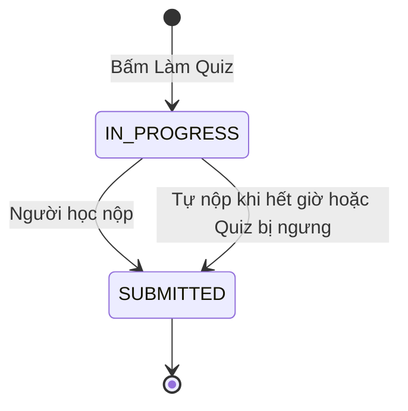

# U11 Quiz Practice — domain-entities

> Revision 2026-10-15 theo [unit-of-work](../../../inception/application-design/unit-of-work.md): U11 Quiz Practice thuộc Iter 3, người code: Người 1; UC 49–52. Lấy phần lượt Quiz của U11 cũ và chấm Quiz luyện tập của U15 cũ. Quiz chỉ có chế độ luyện tập (D01). Chỉ sửa tài liệu; chưa triển khai hoặc kiểm runtime.

**Primary UC:** 49, 50, 51, 52. **Primary stories:** US-ASM-003 (phần Quiz); dữ liệu hoạt động lượt Quiz của US-INT-001. **Requirements:** FR-007, FR-008, FR-018, FR-039.

Nguồn: [Inception catalog](../../../inception/requirements/use-cases.md), [stories](../../../inception/user-stories/stories.md), [requirements](../../../inception/requirements/requirements.md).

Thiết kế độc lập công nghệ.

## 1. Tổng quan

| Entity | Loại | Lưu ở |
|---|---|---|
| `QuizAttempt` | Aggregate root, một dòng là một lượt làm Quiz | `quiz_attempts` |

U11 không sở hữu: Quiz, câu, đáp án (U10), dữ liệu hoạt động (U08), tài liệu (U13).

## 2. `QuizAttempt`

| Thuộc tính | Kiểu | Ràng buộc |
|---|---|---|
| `id` | UUID | Khóa |
| `quizId`, `classId`, `accountId` | UUID | Quiz (một version), lớp người học làm, người học |
| `attemptNo` | số | Duy nhất theo (`quizId`, `accountId`) |
| `snapshot` | JSON | `versionNo`, cài đặt, chính sách theo dõi, seed, thứ tự câu và đáp án |
| `answers` | JSON | Câu → danh sách lựa chọn |
| `answerVersion` | số | Tăng mỗi lần lưu |
| `status` | enum | `IN_PROGRESS`, `SUBMITTED` |
| `submitMode` | enum | `MANUAL`, `AUTO_TIME_LIMIT`, `AUTO_RETIRED` |
| `startedAt`, `deadlineAt`, `lastSavedAt`, `submittedAt` | thời gian | `deadlineAt` trống khi Quiz không giới hạn giờ |
| `score`, `maxScore`, `correctCount` | số | Có sau khi nộp |
| `result` | JSON | Đúng sai, điểm từng câu |

**Text alternative**: Bấm Làm Quiz tạo lượt `IN_PROGRESS`. Người học nộp, hoặc hệ thống tự nộp khi hết giờ hay khi Quiz bị ngưng hoặc có version mới, thì lượt sang `SUBMITTED`, được chấm ngay và không đổi nữa; làm lại là tạo lượt mới nếu còn lượt.

## 3. Contract

### Interface U11 cung cấp

| Interface | Phương thức | Dùng bởi | Dùng để |
|---|---|---|---|
| `IQuizLifecycleListener` (contract của U10, U11 cài) | `onRetired(quizId)` | U10 | Tự nộp và chấm lượt đang làm khi Quiz bị ngưng hoặc có version mới |
| Slot `QuizDetailSection` (của U10, U11 cài) | - | U10 | Phần Lượt làm và hoạt động cho giảng viên trên Quiz Detail |
| Slot `LearningMaterialSection` (của U13, U11 cài) | - | U13 | Danh sách Quiz gắn tài liệu kèm nút Làm Quiz trên Learning Material |
| `DashboardNavEntry` (contract của U05, U11 cài) | - | U05 | Lối vào Quiz Practice History trên Class Dashboard |
| `IScheduledScanner` (contract của U03, U11 cài) | - | U03 | Tự nộp khi hết giờ |

### Contract U11 khai báo (unit khác cài)

| Contract | Unit cài | Dùng để |
|---|---|---|
| Slot frontend `QuizMaterialSection` | U13 | Tài liệu gắn kèm Quiz trên Quiz Practice Detail |

### Interface U11 dùng

| Interface | Unit | Dùng để |
|---|---|---|
| `IAuthorization` | U01 | Kiểm R5, R3/R4 |
| `IAudit` | U02 | Audit |
| `IClassAccess` | U05 | Ghi danh, lớp đang mở của người học |
| `IActivityWrite`, `IActivityQuery`; `useActivityTracker`, `ActivityTimeline` | U08 | Ghi và xem dữ liệu rời trang của lượt Quiz |
| `IQuizQuery`, `IQuizScoring` | U10 | Quiz, đề không có đáp án, chấm, đáp án sau khi nộp |

## 4. API

| API | UC |
|---|---|
| `GET /api/v1/me/quizzes`, `GET /api/v1/me/quizzes/{quizId}` | 49, 50 |
| `POST /api/v1/quizzes/{quizId}/attempts`, `GET /api/v1/quiz-attempts/{attemptId}`, `PUT .../answers`, `POST .../submit`, `POST .../activity` | 51 |
| `GET /api/v1/quiz-attempts/{attemptId}/result` | 52 |
| `GET /api/v1/classes/{classId}/quizzes/{quizId}/attempts`, `GET /api/v1/classes/{classId}/quiz-attempts/{attemptId}` | 42 |
