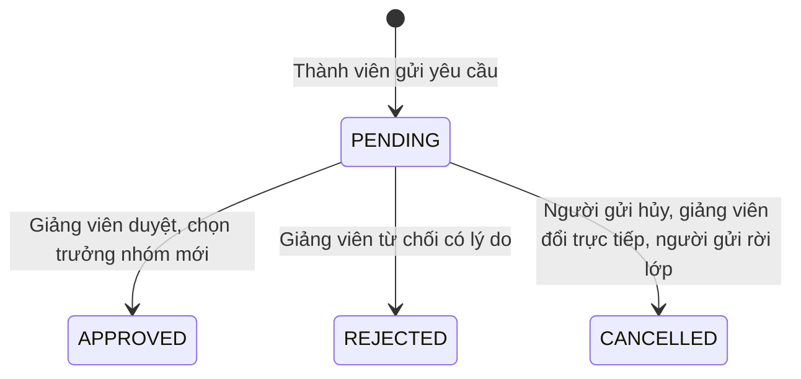
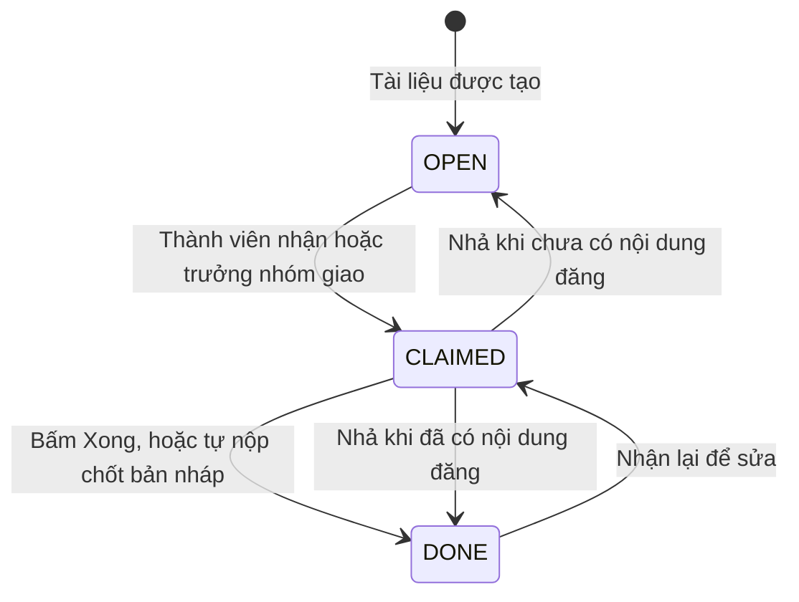

# U12 Group Assignment — domain-entities

> Revision 2026-10-15 theo [unit-of-work](../../../inception/application-design/unit-of-work.md): U12 Group Assignment thuộc Iter 3, người code: Người 2; UC 53–57. Gộp U12 cũ (nhóm và trưởng nhóm) và U14 cũ (tài liệu nhóm và nộp). Soạn đề, rubric dùng U07; chấm dùng U09. Chỉ sửa tài liệu; chưa triển khai hoặc kiểm runtime.

**Primary UC:** 53, 54, 55, 56, 57. **Primary stories:** US-GRP-001, US-GRP-002, US-GRP-003, US-GRP-004, US-GRP-005, US-GRP-006. **Requirements:** FR-025, FR-026, FR-018, FR-039.

Nguồn: [Inception catalog](../../../inception/requirements/use-cases.md), [stories](../../../inception/user-stories/stories.md), [requirements](../../../inception/requirements/requirements.md).

Thiết kế độc lập công nghệ.

## 1. Tổng quan

| Entity | Loại | Lưu ở |
|---|---|---|
| `ClassGroup`, `GroupMember` | Aggregate root nhóm của lớp, thành viên | `class_groups`, `class_group_members` |
| `LeaderChangeRequest` | Yêu cầu đổi trưởng nhóm | `leader_change_requests` |
| `GroupDocument` | Aggregate root, một nhóm cho một bài nhóm | `group_documents` |
| `GroupSection` | Mục của tài liệu nhóm | `group_document_sections` |
| `SectionRevision` | Bản lịch sử chỉ thêm | `group_document_revisions` |

U12 không sở hữu: bài, khung, rubric (U07), đánh giá và điểm (U09), dữ liệu hoạt động (U08), ghi danh (U05), thông báo (U14).

## 2. Nhóm và yêu cầu

| Entity | Thuộc tính chính |
|---|---|
| `ClassGroup` | `id`, `classId`, `name` (≤ 100, không trùng trong lớp), `leaderId`, `createdBy`, `createdAt`, `updatedAt`; bộ nhóm của lớp có `version` chung để lưu một lần |
| `GroupMember` | `groupId`, `classId`, `accountId`, `joinedAt`; duy nhất (`classId`, `accountId`) |
| `LeaderChangeRequest` | `id`, `groupId`, `requestedBy`, `proposedLeaderId` (có thể trống), `reason` (10–1.000), `status` (`PENDING`, `APPROVED`, `REJECTED`, `CANCELLED`), `newLeaderId`, `decidedBy`, `decidedAt`, `decisionReason`, `createdAt`; tối đa một `PENDING` mỗi nhóm |

**Text alternative**: Yêu cầu tạo ra ở `PENDING`. Giảng viên duyệt thì `APPROVED` và nhóm có trưởng nhóm mới; từ chối thì `REJECTED` kèm lý do; người gửi hủy, giảng viên đổi trưởng nhóm trực tiếp hoặc người gửi rời lớp thì `CANCELLED`.

## 3. Tài liệu nhóm

| Entity | Thuộc tính chính |
|---|---|
| `GroupDocument` | `id`, `groupId`, `assignmentId`, `classId` (duy nhất `groupId`, `assignmentId`), `status` (`IN_PROGRESS`, `CLOSED`), `sharedBlocks` (`DocumentModel` của U07, chỉ đọc), `activityPolicy` (chụp khi bài mở), bản nộp cuối (`submittedDocument`, `sectionAuthors`, `submittedBy`, `submitMode` `MANUAL`, `AUTO_DEADLINE`, `AUTO_RETIRED`, `submittedAt`, `late`, `receiptHash`, `warnings`), `lastChangedAt`, `version` |
| `GroupSection` | `id`, `groupDocumentId`, `partId`, `headingBlockId`, `ancestorHeadingIds`, `orderNo`, `title`, `status` (`OPEN`, `CLAIMED`, `DONE`), `claimedBy`, `claimedAt`, `assignedBy`, `publishedBlocks`, `draftBlocks`, `lastAuthorId`, `version` |
| `SectionRevision` | `id`, `sectionId`, `authorId`, `blocks` (bất biến), `createdAt` |

**Text alternative**: Mục tạo ra ở `OPEN`. Thành viên nhận hoặc trưởng nhóm giao thì `CLAIMED` và chỉ người giữ được sửa. Bấm Xong, hoặc hệ thống tự nộp chốt bản nháp, thì `DONE`. Nhả khóa thì bỏ bản nháp: mục về `DONE` nếu đã có nội dung đăng, không thì `OPEN`. Mục `DONE` nhận lại được để sửa tiếp. Tài liệu `IN_PROGRESS` chuyển `CLOSED` khi tự nộp lúc hết hạn hoặc khi bài bị ngưng giao.

## 4. Contract

### Port U12 cung cấp

| Port | Phương thức | Dùng bởi | Dùng để |
|---|---|---|---|
| `SseHub` | `publish(channelKey, event)`, `subscribe(channelKey)` | U12, U14 | Kênh realtime qua SSE cho mọi instance backend; U14 dùng cho chuông thông báo |
| Sự kiện `group.membership-changed`, `group.leader-change-requested`, `group.leader-changed`, `group.leader-request-rejected`, `group.submitted` | - | U14 | Báo trong app cho đúng người (sự kiện mang danh sách người nhận) |
| `GroupAssignmentSupport`, `AssignmentLifecycleListener` (contract của U07, U12 cài) | `checkReadiness(classId)`; `onOpened`, `onRetired` | U07 | Bật bài nhóm, kiểm sẵn sàng; tạo tài liệu khi mở, tự nộp khi ngưng giao |
| Slot `AssignmentFormSection` (của U07, U12 cài) | - | U07 | Phần Nhóm trên Assignment Form |
| `GroupWorkStatusPort` (contract của U08, U12 cài), slot `GroupWorkEntry` | `statusFor(accountId, assignmentIds)` | U08 | Trạng thái bài nhóm trên Student Assignments; nút mở bài nhóm trên Assignment Detail |
| `GroupSubmissionSource` (contract của U09, U12 cài) | `getGroupSubmission`, `listGroupSubmissions` | U09 | Hiện, chấm bài nhóm và tiến độ theo nhóm |
| `StudentClassSection`, `TeacherClassTab`, `StudentDetailSection` (contract của U05, U12 cài) | - | U05 | My Group; phần Nhóm trong tab Students; nhóm của sinh viên trong popup Student Detail |
| `McpToolProvider` (contract của U06, U12 cài) | tool `read_authorized_group_submission` | U06 | Agent của giảng viên đọc bản nộp nhóm để đề xuất chấm |
| `JobHandler` cho `GROUP_DOC_CREATE`, `PendingSweeper`, `ScheduledScanner` (contract của U03, U12 cài) | - | U03 | Tạo tài liệu nhóm khi bài mở; tự nộp khi hết hạn |

### Contract U12 khai báo

Không có.

### Port U12 dùng

| Port | Unit | Dùng để |
|---|---|---|
| `AuthorizationPort`, `AccountLookupPort` | U01 | Kiểm quyền; tên thành viên |
| `AuditPort` | U02 | Audit |
| `JobPort`, `EventPublisherPort`, `ArtifactPort` | U03 | Job tạo tài liệu; sự kiện nhóm; ảnh trong tài liệu |
| `ClassAccessPort` | U05 | Sinh viên đang học, trạng thái lớp, giảng viên |
| `AssignmentQueryPort`, `DocumentModelPort`, `DocxPort`; `DocumentEditor`, `DocumentViewer` | U07 | Khung, phần, hạn; kiểm và xuất tài liệu; trình soạn |
| `ActivityWritePort`; `useActivityTracker` | U08 | Dữ liệu rời trang của từng thành viên |
| `GroupEvaluationPort` | U09 | Tạo đánh giá khi nhóm nộp |

## 5. API

| API | UC |
|---|---|
| `GET`, `PUT /api/v1/classes/{classId}/groups`; `POST .../groups:random-preview` | 57 |
| `GET /api/v1/classes/{classId}/leader-requests`; `POST /api/v1/leader-requests/{id}:approve`, `:reject` | 57 |
| `GET /api/v1/me/classes/{classId}/group`; `POST /api/v1/groups/{groupId}/leader-requests`; `POST /api/v1/leader-requests/{id}:cancel` | 54, 55 |
| `GET /api/v1/assignments/{assignmentId}/my-group-doc`; `GET /api/v1/group-docs/{id}`; `GET .../events` (SSE); `POST .../activity` | 56 |
| `POST /api/v1/group-docs/{id}/sections/{sectionId}:claim`, `:assign`, `:release`, `:done`; `PUT .../sections/{sectionId}/draft` | 56 |
| `POST /api/v1/group-docs/{id}/submit`; `GET .../export.docx` | 56 |
| `GET /api/v1/classes/{classId}/group-assignments/{assignmentId}/progress` | 42, 57 |
