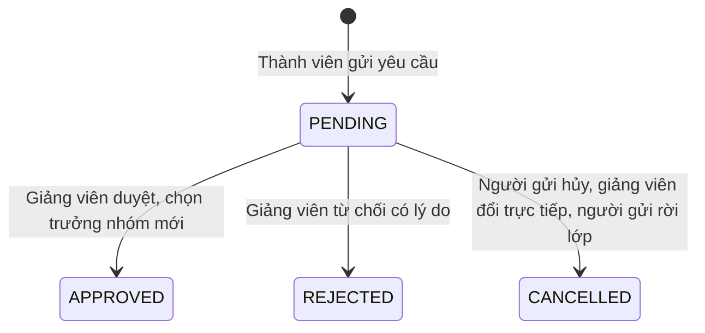
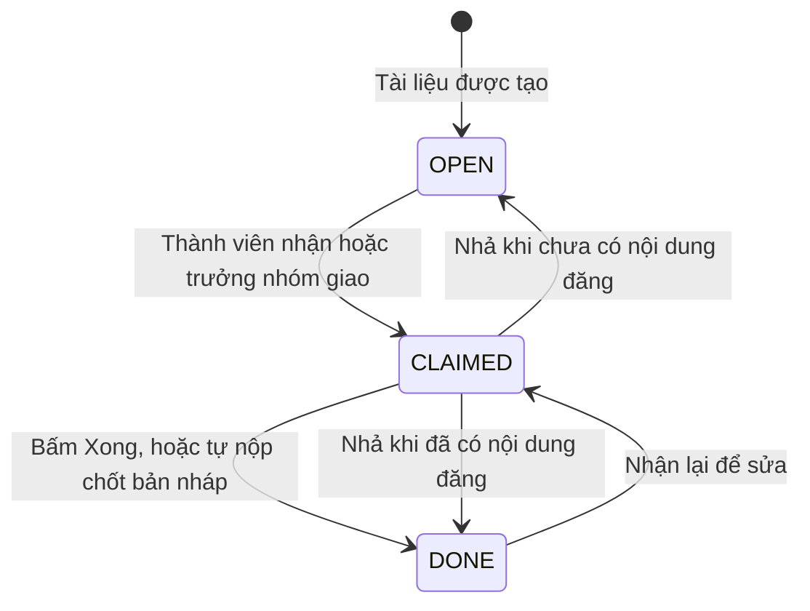
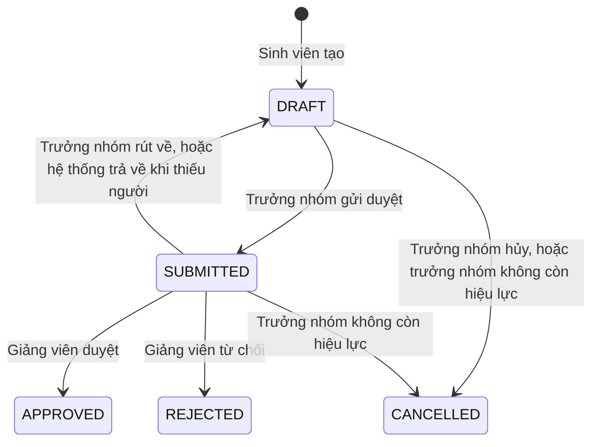
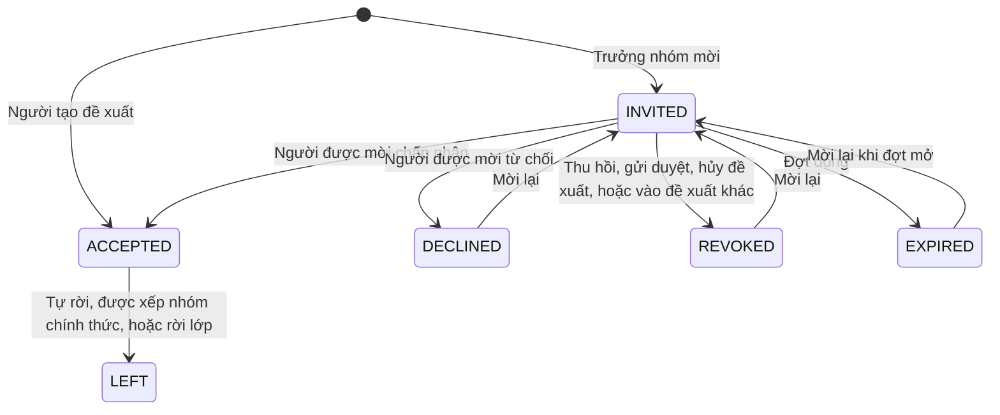

# U12 Group Assignment — domain-entities

**AS-BUILT sync 2026-10-30:** [as-built-baseline.md](../code/as-built-baseline.md); source-observed, không phải fresh test/runtime acceptance.

> Current source baseline 2026-10-30, staging@794a4053; ownership theo unit-of-work hiện hành. Có implementation source; chưa chạy lại runtime acceptance trong đợt sync. Ước lượng và kết quả có ngày cũ giữ theo phạm vi lịch sử.

**Primary UC:** 53, 54, 55, 56, 57. **Primary stories:** US-GRP-001, US-GRP-002, US-GRP-003, US-GRP-004, US-GRP-005, US-GRP-006, US-GRP-007, US-GRP-008, US-GRP-009, US-GRP-010. **Requirements:** FR-025, FR-026, FR-018, FR-039; SG-01…09 (2026-11-11).

Nguồn: [Inception catalog](../../../inception/requirements/use-cases.md), [stories](../../../inception/user-stories/stories.md), [requirements](../../../inception/requirements/requirements.md).

Thiết kế độc lập công nghệ.

## 1. Tổng quan

| Entity | Loại | Lưu ở |
|---|---|---|
| `ClassGroup`, `GroupMember` | Aggregate root nhóm của lớp, thành viên | `class_groups`, `class_group_members` |
| `LeaderChangeRequest` | Yêu cầu đổi trưởng nhóm | `leader_change_requests` |
| `GroupDocument` | Aggregate root, một nhóm cho một bài nhóm | `group_documents` |
| `GroupSection` | Mục của tài liệu nhóm | `group_document_sections` |
| `SectionRevision` | Bản lịch sử chỉ thêm | `group_document_revisions` |

U12 không sở hữu: bài, khung, rubric (U07), đánh giá và điểm (U09), dữ liệu hoạt động (U08), ghi danh (U05), thông báo (U14).

## 2. Nhóm và yêu cầu

| Entity | Thuộc tính chính |
|---|---|
| `ClassGroup` | `id`, `classId`, `name` (≤ 100, không trùng trong lớp), `leaderId`, `createdBy`, `createdAt`, `updatedAt`; bộ nhóm của lớp có `version` chung để lưu một lần |
| `GroupMember` | `groupId`, `classId`, `accountId`, `joinedAt`; duy nhất (`classId`, `accountId`) |
| `LeaderChangeRequest` | `id`, `groupId`, `requestedBy`, `proposedLeaderId` (có thể trống), `reason` (0–1.000), `status` (`PENDING`, `APPROVED`, `REJECTED`, `CANCELLED`), `newLeaderId`, `decidedBy`, `decidedAt`, `decisionReason`, `createdAt`; tối đa một `PENDING` mỗi nhóm |

**Text alternative**: Yêu cầu tạo ra ở `PENDING`. Giảng viên duyệt thì `APPROVED` và nhóm có trưởng nhóm mới; từ chối thì `REJECTED` kèm lý do; người gửi hủy, giảng viên đổi trưởng nhóm trực tiếp hoặc người gửi rời lớp thì `CANCELLED`.

## 3. Tài liệu nhóm

| Entity | Thuộc tính chính |
|---|---|
| `GroupDocument` | `id`, `groupId`, `assignmentId`, `classId` (duy nhất `groupId`, `assignmentId`), `status` (`IN_PROGRESS`, `CLOSED`), `sharedBlocks` (`DocumentModel` của U07, chỉ đọc), `activityPolicy` (chụp khi bài mở), bản nộp cuối (`submittedDocument`, `sectionAuthors`, `submittedBy`, `submitMode` `MANUAL`, `AUTO_DEADLINE`, `AUTO_RETIRED`, `submittedAt`, `late`, `receiptHash`, `warnings`), `lastChangedAt`, `version` |
| `GroupSection` | `id`, `groupDocumentId`, `partId`, `headingBlockId`, `ancestorHeadingIds`, `orderNo`, `title`, `status` (`OPEN`, `CLAIMED`, `DONE`), `claimedBy`, `claimedAt`, `assignedBy`, `publishedBlocks`, `draftBlocks`, `lastAuthorId`, `version` |
| `SectionRevision` | `id`, `sectionId`, `authorId`, `blocks` (bất biến), `createdAt` |

**Text alternative**: Mục tạo ra ở `OPEN`. Thành viên nhận hoặc trưởng nhóm giao thì `CLAIMED` và chỉ người giữ được sửa. Bấm Xong, hoặc hệ thống tự nộp chốt bản nháp, thì `DONE`. Nhả khóa thì bỏ bản nháp: mục về `DONE` nếu đã có nội dung đăng, không thì `OPEN`. Mục `DONE` nhận lại được để sửa tiếp. Tài liệu `IN_PROGRESS` chuyển `CLOSED` khi tự nộp lúc hết hạn hoặc khi bài bị ngưng giao.

## 4. Contract

### Interface U12 cung cấp

| Interface | Phương thức | Dùng bởi | Dùng để |
|---|---|---|---|
| `ISseHub` | `publish(channelKey, event)`, `subscribe(channelKey)` | U12, U14 | Kênh realtime qua SSE cho mọi instance backend; U14 dùng cho chuông thông báo |
| Sự kiện `group.membership-changed`, `group.leader-change-requested`, `group.leader-changed`, `group.leader-request-rejected`, `group.submitted` | - | U14 | Báo trong app cho đúng người (sự kiện mang danh sách người nhận) |
| `IGroupAssignmentSupport`, `IAssignmentLifecycleListener` (contract của U07, U12 cài) | `checkReadiness(classId)`; `onOpened`, `onRetired` | U07 | Bật bài nhóm, kiểm sẵn sàng; tạo tài liệu khi mở, tự nộp khi ngưng giao |
| Slot `AssignmentFormSection` (của U07, U12 cài) | - | U07 | Phần Nhóm trên Assignment Form |
| `IGroupWorkStatus` (contract của U08, U12 cài), slot `GroupWorkEntry` | `statusFor(accountId, assignmentIds)` | U08 | Trạng thái bài nhóm trên Student Assignments; nút mở bài nhóm trên Assignment Detail |
| `IGroupSubmissionSource` (contract của U09, U12 cài) | `getGroupSubmission`, `listGroupSubmissions` | U09 | Hiện, chấm bài nhóm và tiến độ theo nhóm |
| `StudentClassSection`, `TeacherClassTab`, `StudentDetailSection` (contract của U05, U12 cài) | - | U05 | Thẻ Nhóm của tôi trên Student Class Detail; phần Nhóm trong tab Sinh viên và số nhóm trên tab Thông tin lớp; nhóm của sinh viên trong popup Student Detail |
| `IMcpToolProvider` (contract của U06, U12 cài) | tool `read_authorized_group_submission` | U06 | Agent của giảng viên đọc bản nộp nhóm để đề xuất chấm |
| `IJobHandler` cho `GROUP_DOC_CREATE`, `IPendingSweeper`, `IScheduledScanner` (contract của U03, U12 cài) | - | U03 | Tạo tài liệu nhóm khi bài mở; tự nộp khi hết hạn |

### Contract U12 khai báo

Không có.

### Interface U12 dùng

| Interface | Unit | Dùng để |
|---|---|---|
| `IAuthorization`, `IAccountLookup` | U01 | Kiểm quyền; tên thành viên |
| `IAudit` | U02 | Audit |
| `IJob`, `IEventPublisher`, `IArtifact` | U03 | Job tạo tài liệu; sự kiện nhóm; ảnh trong tài liệu |
| `IClassAccess` | U05 | Sinh viên đang học, trạng thái lớp, giảng viên |
| `IAssignmentQuery`, `IDocumentModel`, `IDocx`; `DocumentEditor`, `DocumentViewer` | U07 | Khung, phần, hạn; kiểm và xuất tài liệu; trình soạn |
| `IActivityWrite`; `useActivityTracker` | U08 | Dữ liệu rời trang của từng thành viên |
| `IGroupEvaluation` | U09 | Tạo đánh giá khi nhóm nộp |

## 5. API

| API | UC |
|---|---|
| `GET`, `PUT /api/v1/classes/{classId}/groups`; `POST .../groups:random-preview` | 57 |
| `GET /api/v1/classes/{classId}/leader-requests`; `POST /api/v1/leader-requests/{id}:approve`, `:reject` | 57 |
| `GET /api/v1/me/classes/{classId}/group`; `POST /api/v1/groups/{groupId}/leader-requests`; `POST /api/v1/leader-requests/{id}:cancel` | 54, 55 |
| `GET /api/v1/assignments/{assignmentId}/my-group-doc`; `GET /api/v1/group-docs/{id}`; `GET .../events` (SSE); `POST .../activity` | 56 |
| `POST /api/v1/group-docs/{id}/sections/{sectionId}:claim`, `:assign`, `:release`, `:done`; `PUT .../sections/{sectionId}/draft` | 56 |
| `POST /api/v1/group-docs/{id}/submit`; `GET .../export.docx` | 56 |
| `GET /api/v1/classes/{classId}/group-assignments/{assignmentId}/progress` | 42, 57 |

## Source behavior delta — 2026-10-30

groups và groupdocs thuộc cùng U12. Leader request reason tùy chọn, null thành chuỗi rỗng, tối đa 1.000; reject reason tùy chọn, trống thành null. GroupRenameService cho đổi tên theo scope; editor hiển thị lỗi nhóm đã bị gỡ khỏi draft. Claims/locks/leader submit giữ theo SectionRules và services; không tự thêm peer assessment hay đổi AI Student GROUP.

[Source/API/schema/test inventory](../code/as-built-baseline.md). Các rule và test cũ trái delta này là thiết kế trước baseline; không tiếp tục áp điều kiện cũ vào AS-BUILT.

## Sinh viên tự chia nhóm — 2026-11-11

Thiết kế cho US-GRP-007…010, [yêu cầu SG-01…09](../../../inception/requirements/2026-11-11-student-self-grouping.md), [quyết định thiết kế](../../plans/functional-design-plan/2026-11-11-u12-student-self-grouping-functional-design-plan.md). Đề xuất nằm ngoài bộ nhóm chính thức; chỉ khi giảng viên duyệt mới thành `ClassGroup`.

### Entity

| Entity | Thuộc tính chính |
|---|---|
| `GroupFormationSettings` | `classId` (một dòng mỗi lớp), `enabled`, `minSize`, `maxSize` (2–20, min ≤ max), `deadline` (có thể trống), `updatedBy`, `updatedAt`, `version` |
| `GroupProposal` | `id`, `classId`, `name` (1–100), `leaderId`, `status` (`DRAFT`, `SUBMITTED`, `APPROVED`, `REJECTED`, `CANCELLED`), `submittedAt`, `decidedBy`, `decidedAt`, `decisionReason` (0–1.000, trống thành null), `approvedGroupId`, `endReason` (`LEADER_CANCELLED`, `LEADER_PLACED`, `LEADER_LEFT_CLASS`; chỉ khi `CANCELLED`), `createdAt`, `updatedAt`, `version` |
| `ProposalMember` | `proposalId`, `classId`, `accountId` (một dòng mỗi cặp đề xuất–sinh viên), `status` (`INVITED`, `ACCEPTED`, `DECLINED`, `REVOKED`, `EXPIRED`, `LEFT`), `active` (đúng khi `ACCEPTED` và đề xuất `DRAFT`/`SUBMITTED`), `invitedBy`, `createdAt`, `respondedAt` |

Trưởng nhóm có dòng `ProposalMember` `ACCEPTED` ngay khi tạo. Đề xuất **đang hoạt động** khi `DRAFT` hoặc `SUBMITTED`.

### Ràng buộc dữ liệu

- Duy nhất (`classId`, `accountId`) khi `active` (partial unique index): một sinh viên một đề xuất đang hoạt động, giữ đúng cả khi hai thao tác chạy cùng lúc.
- Khóa chính (`proposalId`, `accountId`): mời lại sau khi từ chối/thu hồi thì cập nhật dòng cũ về `INVITED`.
- Đề xuất kết thúc (`APPROVED`, `REJECTED`, `CANCELLED`) thì mọi dòng `active` thành không hoạt động; `status` thành viên giữ nguyên để làm lịch sử.
- Không đổi bảng hiện có; bản ghi đề xuất và lời mời được giữ (không xóa).

### Máy trạng thái đề xuất

**Text alternative**: Đề xuất tạo ra ở `DRAFT`. Trưởng nhóm gửi duyệt thì `SUBMITTED` và bị khóa. Từ `SUBMITTED`, trưởng nhóm rút về hoặc hệ thống trả về (dưới sĩ số tối thiểu, duyệt lỗi `PROPOSAL_INCOMPLETE`) thì `DRAFT`; giảng viên duyệt thì `APPROVED`, từ chối thì `REJECTED`. Trưởng nhóm hủy đề xuất nháp, hoặc trưởng nhóm được giảng viên xếp vào nhóm chính thức hay rời lớp, thì `CANCELLED`. `APPROVED`, `REJECTED`, `CANCELLED` là trạng thái cuối.

### Máy trạng thái lời mời và thành viên

**Text alternative**: Người tạo đề xuất vào thẳng `ACCEPTED`. Người được mời bắt đầu ở `INVITED`, rồi `ACCEPTED` khi chấp nhận, `DECLINED` khi từ chối, `REVOKED` khi trưởng nhóm thu hồi, khi đề xuất được gửi duyệt hay bị hủy, hoặc khi người đó chấp nhận lời mời khác, và `EXPIRED` khi đợt đóng. Thành viên `ACCEPTED` thành `LEFT` khi tự rời, được giảng viên xếp vào nhóm chính thức hoặc rời lớp. Người `DECLINED`, `REVOKED`, `EXPIRED` được mời lại.

### Sự kiện mới

| Sự kiện | Người nhận (trong payload) | U14 |
|---|---|---|
| `group.proposal-invited` | Người được mời | Thông báo "Bạn được mời vào nhóm" |
| `group.proposal-submitted` | Giảng viên chính của lớp | Thông báo "Có đề xuất nhóm chờ duyệt" |
| `group.proposal-approved` | Thành viên đề xuất | Thông báo "Đề xuất nhóm được duyệt" |
| `group.proposal-rejected` | Thành viên đề xuất | Thông báo "Đề xuất nhóm bị từ chối" kèm lý do |

Khi duyệt, `group.membership-changed` vẫn phát (SSE, các phần khác) với `reason = PROPOSAL_APPROVED`; U14 không tạo thông báo cho lý do này để thành viên chỉ nhận một thông báo.

### API mới

| API | Vai trò | Story |
|---|---|---|
| `GET`, `PUT /api/v1/classes/{classId}/group-formation` | Giảng viên chính | US-GRP-007 |
| `GET /api/v1/classes/{classId}/group-proposals` (đề xuất đang hoạt động, sinh viên chưa có nhóm kèm đề xuất của họ) | Giảng viên chính | US-GRP-010 |
| `POST /api/v1/classes/{classId}/group-proposals:approve` (danh sách id, kết quả từng đề xuất); `POST /api/v1/group-proposals/{id}:reject` | Giảng viên chính | US-GRP-010 |
| `GET /api/v1/me/classes/{classId}/group-proposal` (trạng thái đợt, đề xuất của tôi, lời mời đến tôi, đề xuất bị từ chối gần nhất, bạn mời được) | Sinh viên | US-GRP-008, 009 |
| `POST /api/v1/classes/{classId}/group-proposals`; `PUT /api/v1/group-proposals/{id}/name` | Sinh viên; trưởng nhóm | US-GRP-008 |
| `POST /api/v1/group-proposals/{id}/invitations`; `POST .../invitations/{accountId}:revoke` | Trưởng nhóm | US-GRP-008 |
| `POST /api/v1/group-proposals/{id}:accept`, `:decline` | Người được mời | US-GRP-008 |
| `POST /api/v1/group-proposals/{id}:leave` | Thành viên không phải trưởng nhóm | US-GRP-008 |
| `POST /api/v1/group-proposals/{id}:submit`, `:withdraw`, `:cancel` | Trưởng nhóm | US-GRP-008, 009 |

Thao tác của trưởng nhóm và cài đặt đợt gửi kèm `version`; duyệt không gửi `version` bộ nhóm, server tự đọc và tăng.
