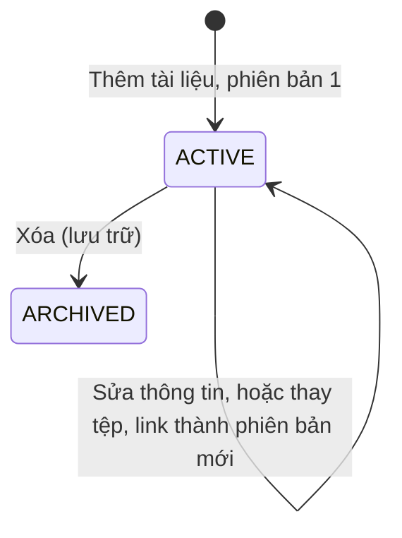

# U13 Reference Materials — domain-entities

**AS-BUILT sync 2026-10-30:** [as-built-baseline.md](../code/as-built-baseline.md); source-observed, không phải fresh test/runtime acceptance.

> Current source baseline 2026-10-30, staging@794a4053; ownership theo unit-of-work hiện hành. Có implementation source; chưa chạy lại runtime acceptance trong đợt sync. Ước lượng và kết quả có ngày cũ giữ theo phạm vi lịch sử.

**Primary UC:** 58, 59, 60, 61, 62. **Primary stories:** US-CNT-001, US-CNT-002; US-CNT-005 là phần mở rộng. **Requirements:** FR-004, FR-005, FR-013.

Nguồn: [Inception catalog](../../../inception/requirements/use-cases.md), [stories](../../../inception/user-stories/stories.md), [requirements](../../../inception/requirements/requirements.md).

Thiết kế độc lập công nghệ.

## 1. Tổng quan

| Entity | Loại | Lưu ở |
|---|---|---|
| `Material` | Aggregate root | `materials` |
| `MaterialVersion` | Phiên bản tệp hoặc link | `material_versions` |
| `MaterialModule` | Module của môn | `material_modules` |
| `MaterialModule.QuizLink` | Liên kết Quiz duy nhất tới một module | `material_module_quizzes` |
| `MaterialModule` | Module của môn | `material_modules` |
| `MaterialModule.QuizLink` | Liên kết Quiz duy nhất tới một module | `material_module_quizzes` |

U13 không sở hữu: tệp trên Drive (U03), Quiz (U10), Assignment (U07), thông báo lớp (U14).

## 2. `Material` và `MaterialVersion`

| Entity | Thuộc tính chính |
|---|---|
| `Material` | `id`, `scope` (`SUBJECT`, `CLASS`), `subjectId` (luôn có), `classId` (chỉ `CLASS`), `moduleId` (bắt buộc, FK material_modules cùng subject), `kind` (`FILE`, `YOUTUBE_LINK`), `title` (≤ 200), `description` (≤ 2.000), `orderNo`, `status` (`ACTIVE`, `ARCHIVED`), `currentVersionNo`, `createdBy`, `createdAt`, `updatedAt`, `version` |
| `MaterialVersion` | `materialId`, `versionNo` (khóa cùng `materialId`), `fileId`, `fileName`, `mimeType`, `byteSize` (với `FILE`), `videoUrl`, `videoId` (với `YOUTUBE_LINK`), `textStatus` (`PENDING`, `EXTRACTED`, `NO_TEXT`, `FAILED`; chỉ `FILE`), `extractedText` (≤ 1.000.000 ký tự), `createdBy`, `createdAt` |

**Text alternative**: Tài liệu tạo ra ở `ACTIVE` với phiên bản 1. Sửa tiêu đề, mô tả, thứ tự không đổi phiên bản; thay tệp hoặc link tạo phiên bản mới và giữ phiên bản cũ. Xóa chuyển `ARCHIVED`: ẩn với người học, tham chiếu cũ vẫn đọc được.

## 3. Contract

### Interface U13 cung cấp

| Interface | Phương thức | Dùng bởi | Dùng để |
|---|---|---|---|
| `IReferenceMaterial` (contract của U06, U13 cài) | `listSelectable(actor, scopeRef)`, `extractText(actor, materialIds, maxChars)` | U07, U10 | Người soạn chọn tài liệu và lấy chữ đưa vào prompt AI |
| `IMcpToolProvider` (contract của U06, U13 cài) | tool `read_authorized_material` | U06 | Agent đọc tài liệu đúng quyền |
| `StudentClassSection`, `TeacherClassTab`, `SubjectSummarySection` (contract của U05, U13 cài); `NavEntry` (contract của U01, U13 cài) | - | U05, U01 | Phần Học liệu trên Student Class Detail; tab Học liệu; số học liệu của môn trên Manager Dashboard, My Subject; mục Học liệu trên menu bên của Subject Manager |
| Slot `AssignmentMaterialSection` (của U08), `QuizMaterialSection` (của U11), U13 cài bằng `MaterialLinkList` | - | U08, U11 | Hiện tài liệu gắn kèm Assignment, Quiz đúng quyền |
| `IJobHandler` cho `MATERIAL_TEXT_EXTRACT`, `IPendingSweeper` (contract của U03, U13 cài) | - | U03 | Trích chữ nền, gửi lại message bị mất |

### Contract U13 khai báo (unit khác cài)

| Contract | Unit cài | Dùng để |
|---|---|---|
| Slot frontend `LearningMaterialSection` | U11 | Danh sách Quiz gắn tài liệu kèm nút Làm Quiz trên Learning Material |

### Interface U13 dùng

| Interface | Unit | Dùng để |
|---|---|---|
| `IAuthorization` | U01 | Kiểm R2, R3/R4, R5 |
| `IAudit` | U02 | Audit |
| `IArtifact`, `IJob` | U03 | Lưu, gắn, mở, cấp token tải tệp `MATERIAL`; job trích chữ |
| `ISubjectQuery` | U04 | Môn còn `ACTIVE`, Chủ nhiệm môn |
| `IClassAccess` | U05 | Lớp, giảng viên, ghi danh, môn của lớp |

## 4. API

| API | UC |
|---|---|
| `GET`, `POST /api/v1/subjects/{subjectId}/materials` | 58, 59 |
| `GET`, `POST /api/v1/classes/{classId}/materials` | 60, 61 |
| `PUT /api/v1/subjects/{subjectId}/materials:reorder`, `PUT /api/v1/classes/{classId}/materials:reorder` | 58, 60 (kéo sắp thứ tự) |
| `GET`, `PATCH /api/v1/materials/{id}`; `POST .../versions`; `POST .../archive` | 58–61 |
| `GET /api/v1/me/classes/{classId}/materials` (lọc được theo `ids`); `GET /api/v1/materials/{id}/view`; `POST .../download-token` | 62 |

## Source behavior delta — 2026-10-30

Module cơ bản của môn đã triển khai. Học liệu môn/lớp bắt buộc moduleId cùng môn; dữ liệu cũ backfill Module 1. Manager quản lý module; class viewers đọc theo scope. Quiz nằm tối đa một module, attach khác module chuyển link; phải kiểm quyền với Quiz. Delete chặn active materials; archived materials chuyển sang module khác, không xóa module cuối nếu cần giữ chúng. Version/reorder kiểm server; module không đồng nghĩa Lesson/RAG.

[Source/API/schema/test inventory](../code/as-built-baseline.md). Các rule và test cũ trái delta này là thiết kế trước baseline; không tiếp tục áp điều kiện cũ vào AS-BUILT.

## Module entity schema — 2026-10-30

| Entity | Fields and constraints |
|---|---|
| MaterialModule | id UUID PK; subjectId FK subjects; title nonblank max200; orderNo >=0; createdBy FK accounts; createdAt, updatedAt (>=createdAt); version >=0 |
| MaterialModule.QuizLink | Java projection moduleId, quizId, orderNo; DB composite PK(module_id,quiz_id), unique quiz_id, FK module ON DELETE CASCADE and FK quizzes. DB created_at records link creation. |
| Material.moduleId | Nonnull FK material_modules; service validates same subject; old records backfilled Module1 by migration 29/10 |

Module data and Quiz visibility are distinct from the Quiz aggregate owned by U10; U13 does not own questions/attempts. No Lesson/embedding/RAG entities are implied.
