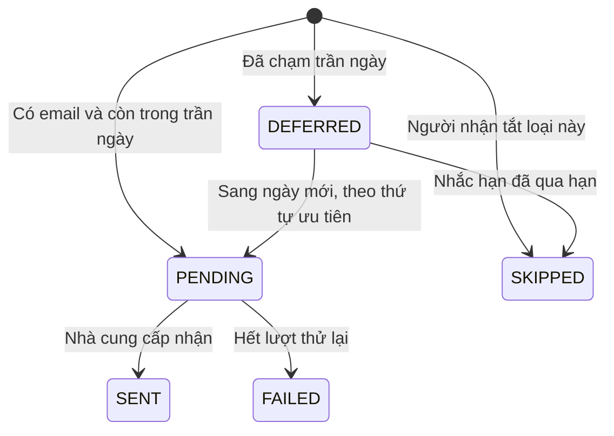

# U14 Announcements & Notifications — domain-entities

> Revision 2026-10-15 theo [unit-of-work](../../../inception/application-design/unit-of-work.md): U14 Announcements & Notifications thuộc Iter 3, người code: Người 3; UC 63–65. Lấy thông báo lớp của U05 cũ và thông báo, email, nhắc hạn của U16 cũ. Chỉ sửa tài liệu; chưa triển khai hoặc kiểm runtime.

**Primary UC:** 63, 64, 65. **Primary stories:** US-CNT-004, US-NTF-001; nhắc hạn của US-RPT-001. **Requirements:** FR-011, FR-019, FR-023.

Nguồn: [Inception catalog](../../../inception/requirements/use-cases.md), [stories](../../../inception/user-stories/stories.md), [requirements](../../../inception/requirements/requirements.md).

Thiết kế độc lập công nghệ.

## 1. Tổng quan

| Entity | Loại | Lưu ở |
|---|---|---|
| `Announcement` | Aggregate root | `announcements` |
| `Notification` | Thông báo trong app | `notifications` |
| `EmailDelivery` | Một email của một thông báo | `email_deliveries` |
| `NotificationPreference` | Tùy chọn email theo loại | `notification_preferences` |
| `DeadlineReminder` | Dấu đã nhắc theo (bài, lớp, hạn) | `deadline_reminders` |

U14 không sở hữu: tài khoản, gửi SMTP (U01), sự kiện nguồn (U03, U05, U07, U09, U10, U12), lớp, ghi danh (U05), bài, bài nộp (U07, U08).

## 2. Thuộc tính

| Entity | Thuộc tính chính |
|---|---|
| `Announcement` | `id`, `classId`, `title` (≤ 200), `body` (≤ 5.000), `important`, `sendEmail`, `status` (`ACTIVE`, `DELETED`), `createdBy`, `createdAt`, `updatedBy`, `updatedAt`, `deletedBy`, `deletedAt`, `version` |
| `Notification` | `id`, `recipientId`, `type`, `sourceEventId`, `title`, `summary`, `link`, `readAt`, `createdAt`; duy nhất (`sourceEventId`, `recipientId`, `type`) |
| `EmailDelivery` | `id`, `notificationId` (duy nhất), `recipientId`, `type`, `status` (`PENDING`, `SENT`, `FAILED`, `SKIPPED`, `DEFERRED`), `priority`, `scheduledFor`, `attempts`, `lastError`, `createdAt`, `sentAt` |
| `NotificationPreference` | `accountId`, `type`, `emailEnabled`; khóa (`accountId`, `type`); không có dòng nghĩa là bật |
| `DeadlineReminder` | `assignmentId`, `classId`, `closesAt`, `status` (`SENT`, `SKIPPED`), `processedAt`; khóa (`assignmentId`, `classId`, `closesAt`) |

**Text alternative**: Email của một thông báo bắt đầu ở `PENDING` nếu được gửi trong trần ngày, `SKIPPED` nếu người nhận tắt loại đó, hoặc `DEFERRED` nếu đã chạm trần. Email hoãn sang ngày mới thành `PENDING` theo thứ tự ưu tiên; nhắc hạn đã qua hạn thì `SKIPPED`. Email `PENDING` thành `SENT` khi nhà cung cấp nhận, hoặc `FAILED` khi hết lượt thử lại.

## 3. Contract

### Interface U14 cung cấp

| Interface | Phương thức | Dùng bởi | Dùng để |
|---|---|---|---|
| Sự kiện `class.announcement-posted` | - | U14 | Tạo thông báo lớp sau commit |
| `StudentClassSection`, `DashboardNavEntry` (contract của U05, U14 cài) | - | U05 | Phần Thông báo trên Student Class Detail; lối vào Class Announcements trên Class Dashboard |
| Slot `HeaderWidget` (của U01, U14 cài) | - | U01 | Chuông và popup thông báo cho mọi vai trò |
| `IJobHandler` cho `EMAIL_SEND`, `IPendingSweeper`, `IScheduledScanner` (contract của U03, U14 cài) | - | U03 | Gửi email; gửi lại message bị mất; nhắc hạn, gửi email đã hoãn, dọn thông báo cũ |

### Contract U14 khai báo

Không có.

### Interface U14 dùng

| Interface | Unit | Dùng để |
|---|---|---|
| `IAuthorization`, `IAccountLookup`, `IMail` | U01 | Kiểm quyền; địa chỉ, tên, danh sách Admin; gửi email |
| `IAudit` | U02 | Audit |
| `IJob`, `IEventPublisher`; sự kiện trên `platform.events` | U03 | Job email; phát và nhận sự kiện |
| `IClassAccess` | U05 | Người học, giảng viên, lớp mở của môn |
| `IAssignmentQuery` | U07 | Bài sắp hết hạn |
| `ISubmissionQuery` | U08 | Người chưa nộp |
| `ISseHub` | U12 | Đẩy thông báo realtime |

Sự kiện nhận: `enrollment.activated` (U05), `assignment.opened` (U07), `grade.published` (U09), `quiz.published` (U10), `group.*` (U12), `backup.failed` (U03), `class.announcement-posted` (U14).

## 4. API

| API | UC |
|---|---|
| `GET /api/v1/me/announcements`; `GET /api/v1/classes/{classId}/announcements` | 63 |
| `POST /api/v1/classes/{classId}/announcements`; `PATCH`, `DELETE /api/v1/announcements/{id}` | 64 |
| `GET /api/v1/me/notifications`, `/unread-count`, `/events` (SSE); `POST .../{id}:read`, `POST .../notifications:read-all` | 65 |
| `GET`, `PUT /api/v1/me/notification-preferences` | 65 |
