# Main Business Flows — code-aligned source view

**Source synchronization 2026-10-30, staging@794a4053** — reviewed against the unit business rules (`aidlc-docs/construction/*/functional-design/business-rules.md`). Twelve swimlane diagrams follow the current scope: SWR/SWD focus, two assessment types (ASSIGNMENT with INDIVIDUAL/GROUP mode and optional Draw.io; QUIZ for practice), 66 active use cases ([docs/usecase_table.md](../../../docs/usecase_table.md)), 15 units, roles `STUDENT`, `TEACHER`, `SUBJECT_MANAGER`, `ADMIN`. AI uses an institution-sponsored educator quota, personal API keys or the user's own MCP agent; AI credits are **not** sold. There is no Code Lab, Judge0, payment or PayOS. Sources: [requirements.md](../requirements/requirements.md), [council-features-2026-10-13.md](../requirements/council-features-2026-10-13.md) and the unit business rules.

Changes since the 2026-10-15 revision: new BF-11 (accounts) and BF-12 (class groups); every flow now shows its time triggers, failure branches and end events; BF-01 checks students row by row; BF-03 and BF-06 include the REVIEWED step; BF-04 covers the late window, auto-submission and Practice feedback; BF-05 runs assign and claim in parallel with lock release; BF-07 separates finalize and publish; BF-08 uses daily quotas only and shows the MCP agent as its own lane; BF-09 backs up the database only with a fixed 7-day retention; BF-10 has a retry limit, daily email cap and an event table.

These flow revisions align selected implementation deltas with code; source-observed is not runtime acceptance. The AS-IS process (how SWR/SWD teachers and students work today) is a separate deliverable that must come from a real survey; nothing here claims survey evidence or implemented runtime behaviour.

Files: one draw.io file per flow, a combined 12-page file `AI-Powered-Learning-Platform-Main-Business-Flows.drawio`, and PNG exports at 2x in `exports/` for the report.

## Modeling convention

The same note is printed under every diagram.

- **Lanes are responsibilities.** Each lane is one role. A lane holds only the work that role is responsible for.
- **System lane = automated processing only.** It is included to make ALAP's automatic work visible: checking conditions, validating data, evaluating eligibility or validity, saving information, updating status, and sending notifications/emails. The System never makes a human judgement (for example it never concludes that a student cheated).
- **Actor lanes = human work only.** Entering data, selecting information, viewing results and making decisions that need human judgement (for example "Ready to submit?", "Use AI proposal?", "Needs follow-up?").
- **External lanes** (purple) are services outside ALAP that take part in the flow: AI provider, the user's own MCP agent, Google Drive backup folder, email provider.
- **Decisions** (diamonds) sit in the lane of whoever decides: a System diamond is an automatic check, an actor diamond is a human decision. Every outgoing branch is labelled, and every refusal or failure ends in a labelled End event or loops back.
- **Numbering.** Every activity and decision has a number, in left-to-right order, that matches the activity table of the flow. Start (green) and End (red) events are not numbered; every End states its business outcome. An extra Start marks another trigger: a time trigger (deadline, schedule) in the System lane, or a later action by an actor.
- Connectors never pass through a shape and never cross or touch an unrelated connector; loop-backs run along the top or bottom edge of a lane.

## Flow overview

| ID | Business flow | Lanes | Use cases | Units |
|---|---|---|---|---|
| [BF-01](#bf-01) | Subject and Class Setup, Staff Assignment and Enrollment | Administrator, Subject Manager, System, Student | 17, 19, 26, 27, 28, 29, 20, 21, 65 | U04, U05, U14, U02 |
| [BF-02](#bf-02) | Reference Material Management and Access | Subject Manager / Teacher, System, Student | 58, 59, 60, 61, 62 | U13, U03, U02 |
| [BF-03](#bf-03) | Assignment Authoring, Review and Publication | Teacher / Subject Manager, System, Student | 34, 35, 36, 53, 37, 38, 65 | U07, U06, U12, U14, U02 |
| [BF-04](#bf-04) | Individual Assignment Work, Activity Recording and Submission | Student, System | 37, 38, 39, 40, 41 | U08, U09, U06, U02 |
| [BF-05](#bf-05) | Group Assignment Collaboration, Activity Recording and Submission | Group Leader, Group Member, System | 54, 56 | U12, U08, U09, U02 |
| [BF-06](#bf-06) | Quiz Creation and Practice | Subject Manager, Teacher / Subject Manager, System, Student | 46, 47, 48, 49, 50, 51, 52 | U10, U11, U06, U14, U02 |
| [BF-07](#bf-07) | Grading, Activity Review and Grade Publication | Teacher, System, Student | 42, 43, 44, 45, 40, 65 | U09, U08, U12, U06, U14, U02 |
| [BF-08](#bf-08) | AI Request with Source Selection and Usage Transparency | Administrator, Teacher / Student, System, AI Provider, User's MCP Agent | 14, 15, 31, 32, 33, 35, 41, 43, 48, 53 | U06, U03, U02 |
| [BF-09](#bf-09) | Scheduled Database Backup to Google Drive and Restore Verification | Admin / Operator, System, Google Drive | 14, 15, 66, 65 | U03, U15, U14, U02 |
| [BF-10](#bf-10) | Important-Event Notification and Email | Teacher, Recipient, System, Email Provider | 63, 64, 65 | U14, U01 (mail sender), U03, U02 |
| [BF-11](#bf-11) | Account Provisioning and Activation | Administrator, User, System, Email Provider | 08, 09, 10, 11, 12, 01, 02 | U01, U02 |
| [BF-12](#bf-12) | Class Group Setup and Leader Change | Teacher, System, Student (Group Member) | 57, 54, 55, 23 | U12, U05, U02 |

Use cases not drawn as a flow are single-screen viewing or profile functions without a multi-role process: UC 03, 05, 06, 07 (session and profile), 13 (audit log), 16, 18 (subject list and detail), 22, 24, 25, 30 (class and subject lists and details).

## Council feedback coverage

| Council comment | Where it is addressed |
|---|---|
| Separate System and actor responsibilities; System only for automated processing | Every flow; see the convention above and the "Lane" column of each table |
| Add a note or modeling convention when System is included | Convention note printed under each diagram and repeated above |
| Number activities and describe them | Numbers in every diagram; activity tables below |
| Back up data to Google Drive | BF-09 (daily encrypted database backup, verification and retries steps 5–6, failure alert step 7, 7-day retention, restore test) |
| Detect switching screens during work (cheating) | BF-03 step 1 (policy), BF-04 step 5, BF-05 step 7, BF-06 step 10 (recording), BF-07 steps 4–6 (human review) |
| Send email for important activities | BF-10 (event table, preferences, daily cap, retry limit); email is triggered in BF-01 step 13, BF-03 step 11, BF-07 step 13, BF-09 step 7; activation OTP in BF-11 step 5 |
| Transparent AI credit so it cannot become a disguised credit business | BF-08 (no purchase; source, payer, daily quota and token provenance shown; Admin-set quotas with audit) |

## BF-01

**Subject and Class Setup, Staff Assignment and Enrollment**

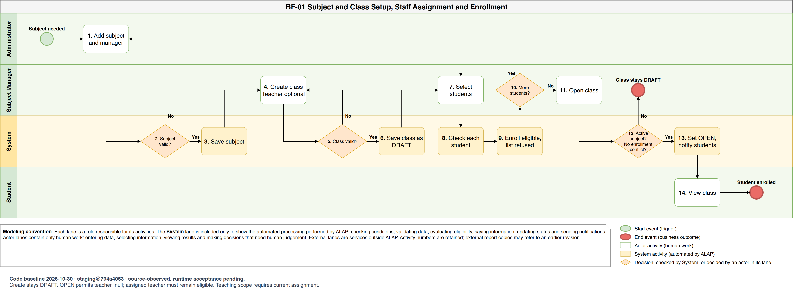

- **Diagram**: [BF-01-Subject-Class-Setup-and-Enrollment.drawio](BF-01-Subject-Class-Setup-and-Enrollment.drawio)
- **Trigger**: An administrator creates a subject and assigns its Subject Manager. Student and staff accounts already exist (BF-11).
- **End condition**: The class is OPEN with its teacher and enrolled students, who are notified; refused students are listed with a reason.
- **Use cases**: UC 17, 19, 26, 27, 28, 29, 20, 21, 65 — **Units**: U04, U05, U14, U02

| No. | Lane | Type | Activity | Description | UC |
|---|---|---|---|---|---|
| 1 | Administrator | Human | Add subject and manager | The Administrator enters the subject code, name and description and selects one Subject Manager for the subject. | 17 |
| 2 | System | Automatic check | Subject valid? | The System checks required fields, a unique subject code and that the selected manager is an ACTIVE account with the SUBJECT_MANAGER role. If not, it shows the reasons and the Administrator corrects the input (back to 1). | 17 |
| 3 | System | Automated | Save subject | The System saves the subject as ACTIVE, stores the manager assignment and writes an audit entry. | 17, 19 |
| 4 | Subject Manager | Human | Create class, add teacher | The Subject Manager enters the class information and selects the primary teacher (an ACTIVE Teacher or Subject Manager). The teacher can be changed later from the same screen (UC 27). | 26, 27 |
| 5 | System | Automatic check | Class valid? | The System checks the class data (class code unique in the subject), that the subject is ACTIVE and managed by this user, and that the teacher is ACTIVE with an allowed role. Invalid input returns to 4 with the reasons. | 26, 27 |
| 6 | System | Automated | Save class as DRAFT | The System saves the class in DRAFT status with its teacher assignment and writes an audit entry. | 26, 27 |
| 7 | Subject Manager | Human | Select students | The Subject Manager searches student accounts or pastes a list of emails (up to 200 rows) for a DRAFT or OPEN class. There is no invitation code or self-enrollment. Removing a student (UC 28) sets the enrollment to REMOVED and keeps the learning history. | 28 |
| 8 | System | Automated | Check each student | For every selected student the System checks a STUDENT account that is ACTIVE or PENDING (not yet activated, not DISABLED) and no ACTIVE enrollment in another non-archived class of the same subject. Each row gets its own result; there is no class capacity limit. | 28 |
| 9 | System | Automated | Enroll eligible, list refused | The System creates or restores one ACTIVE enrollment per eligible student, records audit and returns a reason for every refused row (not found, not a student, disabled, already in another class). Refused rows never block eligible ones. If the class is already OPEN, each new student is notified at once (BF-10). | 28, 65 |
| 10 | Subject Manager | Human decision | More students? | Human decision: the Subject Manager reviews the refused rows and either selects other students (back to 7) or continues. | 28 |
| 11 | Subject Manager | Human | Open class | The Subject Manager changes the class status to OPEN when it is ready to run. A class may open before students are added; students added later are notified on enrollment. | 29 |
| 12 | System | Automatic check | Can open? | The System checks that the subject is ACTIVE and an ACTIVE primary teacher is assigned. If not, the class stays DRAFT and the Subject Manager is told what to fix (for example assign a teacher in 4). | 29 |
| 13 | System | Automated | Set OPEN, notify students | The System sets the class to OPEN, records audit and, for every ACTIVE enrollment, queues an in-app notification and an enrollment email (BF-10). | 29, 65 |
| 14 | Student | Human | View class | The student opens the notification or Class Dashboard and views the class detail, materials, assignments, announcements and group. | 20, 21, 65 |

Notes:

- Accounts are created and activated in BF-11; a PENDING student can be enrolled and receives the enrollment email, but signs in only after activation.
- Archiving a class (UC 29) keeps enrollments and learning data read-only; reopening is refused while a student is ACTIVE in another non-archived class of the subject.

## BF-02

**Reference Material Management and Access**

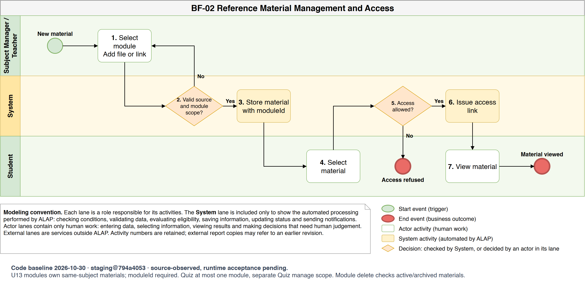

- **Diagram**: [BF-02-Reference-Material-Management-and-Access.drawio](BF-02-Reference-Material-Management-and-Access.drawio)
- **Trigger**: A Subject Manager or teacher adds a learning file or a YouTube video link.
- **End condition**: The material is stored privately and enrolled students can view it; invalid input or unauthorized access is refused.
- **Use cases**: UC 58, 59, 60, 61, 62 — **Units**: U13, U03, U02

| No. | Lane | Type | Activity | Description | UC |
|---|---|---|---|---|---|
| 1 | Subject Manager / Teacher | Human | Add file or YouTube link | A Subject Manager adds a subject material shared with all classes of the subject (UC 59); a Teacher adds a class material for an assigned class (UC 61). The material is one file (PDF, DOCX, PPTX) or one YouTube video link with a title and description. | 58, 59, 60, 61 |
| 2 | System | Automatic check | Input valid? | The System checks the user's scope (Subject Manager of the subject, or primary teacher of the class), that the subject or class is not archived, the file type by content and the configured size limit (default 50 MB), or that the link is a single YouTube video (no playlist). Invalid input is refused with a reason and the user corrects it (back to 1). | 59, 61 |
| 3 | System | Automated | Store and save material | The System uploads file bytes to the private Google Drive storage (no public link) or stores the YouTube link, saves the material as ACTIVE in its subject or class scope and records audit. Text is extracted from files in the background for later AI use; no AI is called. No notification is sent: students find the material on the class detail. | 59, 61 |
| 4 | Student | Human | Select material | A student opens the class detail, or a material attached to an Assignment or Quiz, and selects it. | 21, 62 |
| 5 | System | Automatic check | Access allowed? | The System checks an ACTIVE enrollment in an OPEN class of the scope and that the material is ACTIVE (not archived). | 62 |
| 6 | System | Automated | Issue access link | The System creates a 5-minute, user-bound token to stream the file, or returns the YouTube link for the embedded privacy-enhanced player. | 62 |
| 7 | Student | Human | View material | The student previews the PDF or downloads the file, or watches the video in the embedded player. | 62 |

Notes:

- Update and delete (UC 59, 61): editing title, description or order needs no new version; replacing the file or link creates a new version and students always see the latest; delete archives the material (hidden from students, old references kept).
- Teachers of the subject's classes see subject materials read-only; a Subject Manager who does not teach a class does not see that class's own materials.

## BF-03

**Assignment Authoring, Review and Publication**

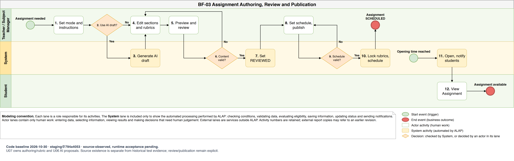

- **Diagram**: [BF-03-Assignment-Authoring-Review-and-Publication.drawio](BF-03-Assignment-Authoring-Review-and-Publication.drawio)
- **Trigger**: A teacher creates a class Assignment, or a Subject Manager creates a subject-level individual Assignment.
- **End condition**: The Assignment is SCHEDULED, then opens at its opening time and students are notified; invalid content or schedule is refused with the reasons.
- **Use cases**: UC 34, 35, 36, 53, 37, 38, 65 — **Units**: U07, U06, U12, U14, U02

| No. | Lane | Type | Activity | Description | UC |
|---|---|---|---|---|---|
| 1 | Teacher / Subject Manager | Human | Set mode and instructions | The author creates a DRAFT Assignment, chooses INDIVIDUAL or GROUP submission (group only for class Assignments of a teacher), GRADED or PRACTICE (group work is always GRADED), turns the Draw.io option on or off, turns activity monitoring on or off (off by default) and enters the instructions. | 34, 35, 53 |
| 2 | Teacher / Subject Manager | Human decision | Use AI draft? | Human decision: the author decides whether to ask AI for a draft. Writing everything manually is always possible. | 35, 53 |
| 3 | System | Automated | Generate AI draft | The System runs the AI request through the source the author selects as described in BF-08. The result is only a proposal with provenance; applying it replaces the skeleton and suggested rubrics. | 35, 53 |
| 4 | Teacher / Subject Manager | Human | Edit sections and rubrics | The author writes or edits the document skeleton and one rubric per section (checklist items with points), including diagram requirements when Draw.io is enabled. | 36 |
| 5 | Teacher / Subject Manager | Human | Preview and review | The author previews the Assignment as a student would see it and marks it as reviewed (self-review). | 34 |
| 6 | System | Automatic check | Content valid? | The System checks the title, the skeleton, that every rubric is valid, that diagram blocks and criteria match the Draw.io option, and that group support is available for GROUP mode. Failures are listed per section and the author corrects them (back to 4). | 34, 36 |
| 7 | System | Automated | Set REVIEWED | The System sets the Assignment to REVIEWED. Editing a REVIEWED Assignment returns it to DRAFT. | 34 |
| 8 | Teacher / Subject Manager | Human | Set schedule, publish | The author sets the opening time, closing time, optional late-until time (at most 30 days after closing), the number of attempts (1–10) and selects Publish. | 34 |
| 9 | System | Automatic check | Schedule valid? | The System checks opening before closing, the late window, that the class is OPEN (or the subject ACTIVE for a subject Assignment) and, for GROUP mode, that every class group has a leader and at least one member (BF-12); students without a group need the author's confirmation. Problems return to 8. | 34, 53 |
| 10 | System | Automated | Lock rubrics, schedule | In one transaction the System locks the content and rubrics, stores the schedule and monitoring policy, sets SCHEDULED and records audit. | 34 |
| 11 | System | Automated | Open, notify students | At the opening time the System sets the Assignment OPEN, creates one group document per class group in GROUP mode (BF-05) and queues an in-app notification and an email for the enrolled students (BF-10). A deadline reminder is sent 24 hours before closing to students who have not submitted. | 34, 65 |
| 12 | Student | Human | View Assignment | Students see the instructions, rubric, deadline, submission mode, attempts and, when monitoring is on, which activity data is recorded and why. | 37, 38 |

Notes:

- After publication the content and rubrics cannot change. A SCHEDULED Assignment may be rescheduled; an OPEN one may only extend its closing or late-until time. Retire stops new work and auto-submits work in progress; a new version is created from a CLOSED or RETIRED Assignment and published again through this flow.
- Only DRAFT or REVIEWED Assignments that were never published can be deleted. Clone and copy to another class create a new DRAFT.

## BF-04

**Individual Assignment Work, Activity Recording and Submission**

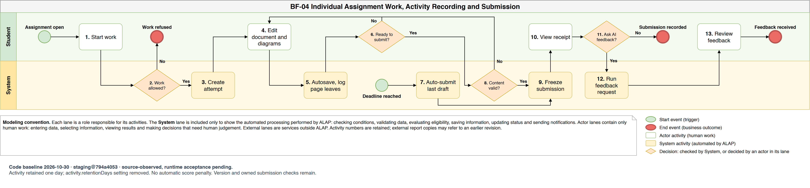

- **Diagram**: [BF-04-Individual-Assignment-Work-and-Submission.drawio](BF-04-Individual-Assignment-Work-and-Submission.drawio)
- **Trigger**: A student starts work on an open individual Assignment.
- **End condition**: The submission is frozen with a receipt, manually or automatically at the final deadline; GRADED work goes to grading and PRACTICE work can get private AI feedback.
- **Use cases**: UC 37, 38, 39, 40, 41 — **Units**: U08, U09, U06, U02

| No. | Lane | Type | Activity | Description | UC |
|---|---|---|---|---|---|
| 1 | Student | Human | Start work | The student opens the Assignment from the Assignment list and selects Start or Continue. | 37, 38, 39 |
| 2 | System | Automatic check | Work allowed? | The System checks an ACTIVE enrollment, an OPEN class, that the Assignment accepts work (on time, or within the late window when one is set) and the remaining attempts. | 39 |
| 3 | System | Automated | Create attempt | The System reopens the attempt in progress or creates a new one (counted against the attempt limit) with a snapshot of the Assignment version, deadlines and monitoring policy. The policy cannot change during the attempt. | 39 |
| 4 | Student | Human | Edit document and diagrams | The student writes the sections and, when enabled, draws diagrams in the embedded Draw.io editor. A monitoring notice is shown when monitoring is on. | 39 |
| 5 | System | Automated | Autosave, log page leaves | The System autosaves the draft with a version check. When monitoring is on it records page hidden/visible events with server time, without double counting and without treating work inside Draw.io as leaving the page. | 39 |
| 6 | Student | Human decision | Ready to submit? | Human decision: the student continues editing (back to 4) or submits. | 39 |
| 7 | System | Automated | Auto-submit last draft | When the final deadline passes (late-until time if set, otherwise closing time, plus 30 seconds of network grace) or the Assignment is retired, the System submits the last saved draft as it is, even if empty or incomplete, without the submit checks of 8, and marks it auto-submitted for the teacher. Leaving the page never triggers auto-submission or penalties. | 39 |
| 8 | System | Automatic check | Content valid? | For a manual submission the System validates the skeleton blocks, the required diagrams and that every Draw.io diagram is complete and not empty. Invalid content is reported and the student corrects it (back to 4). | 39 |
| 9 | System | Automated | Freeze submission | The System freezes the content snapshot and stores server time, the late flag (after closing time), the receipt hash and audit. GRADED work is queued for grading (BF-07); the last submitted attempt is the one graded. PRACTICE work is never graded. | 39, 40 |
| 10 | Student | Human | View receipt | The student sees the receipt and the submission in Submission History. A new attempt can be started while attempts remain and the Assignment is open. | 40 |
| 11 | Student | Human decision | Ask AI feedback? | Human decision, offered only for PRACTICE Assignments: the student may ask for private AI feedback on this submitted attempt. | 41 |
| 12 | System | Automated | Run feedback request | The System checks a PRACTICE Assignment, the student's own submitted attempt, an ACTIVE enrollment, one pending request per attempt and 20 requests per day, then runs the request through the student's personal API or MCP agent (BF-08; students have no shared quota). A refusal or AI error is reported and the submission is unchanged. | 41 |
| 13 | Student | Human | Review feedback | The student reads the comments and the estimated rubric check labelled "AI estimate, not an official grade". Feedback is never added to the gradebook. | 41 |

Notes:

- Late work: between the closing time and the late-until time a submission is accepted and flagged late; the System never deducts points (the teacher may adjust with a reason in BF-07).

## BF-05

**Group Assignment Collaboration, Activity Recording and Submission**

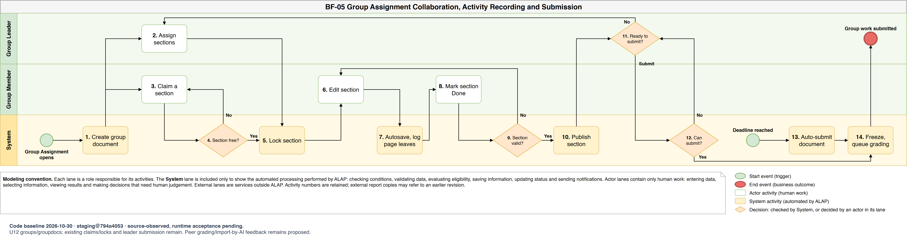

- **Diagram**: [BF-05-Group-Assignment-Collaboration-and-Submission.drawio](BF-05-Group-Assignment-Collaboration-and-Submission.drawio)
- **Trigger**: A group Assignment opens for the class groups created in BF-12.
- **End condition**: The leader's last submission, or the automatic submission at the deadline, is frozen with section authors and queued for grading.
- **Use cases**: UC 54, 56 — **Units**: U12, U08, U09, U02

| No. | Lane | Type | Activity | Description | UC |
|---|---|---|---|---|---|
| 1 | System | Automated | Create group document | The System creates one shared document per class group from the skeleton; every section becomes an item with a fixed rubric. A group created after opening also gets its document. | 56 |
| 2 | Group Leader | Human | Assign sections | Optional: the leader assigns a section to a member; a section held by someone else is released first, with a warning. | 54, 56 |
| 3 | Group Member | Human | Claim a section | In parallel, a member (the leader is also a member) opens the group document from View My Group and claims an open or finished section. One member may hold several sections. | 54, 56 |
| 4 | System | Automatic check | Section free? | The System checks group membership, that the document is IN_PROGRESS and the Assignment still accepts work, and that no other member holds the section. A held section is refused (back to 3). | 56 |
| 5 | System | Automated | Lock section | The System gives the member an exclusive edit lock. The holder, the leader or the class teacher can release a lock (the unfinished draft is discarded), so an abandoned section never blocks the group; a member who leaves the group releases it automatically. | 56 |
| 6 | Group Member | Human | Edit section | The member writes the section and, when enabled, draws diagrams. A monitoring notice is shown when monitoring is on. | 56 |
| 7 | System | Automated | Autosave, log page leaves | The System autosaves the member's draft and, when monitoring is on, records activity for that member only, so signals are never attributed to the whole group. | 56 |
| 8 | Group Member | Human | Mark section Done | The member marks the section as Done when it is finished. | 56 |
| 9 | System | Automatic check | Section valid? | The System validates the blocks and Draw.io XML. Invalid content is reported and the member corrects it (back to 6). | 56 |
| 10 | System | Automated | Publish section | The System publishes the section into the shared document, records a revision with its author, releases the lock and pushes the change to members who have the document open. | 56 |
| 11 | Group Leader | Human decision | Ready to submit? | Human decision: the leader reviews the shared document and either submits it (a warning is shown when sections are unfinished; unfinished drafts are not included) or lets members continue (back to 2). | 56 |
| 12 | System | Automatic check | Can submit? | The System checks that the leader is the current leader, the Assignment still accepts work and the document passes the submit checks (required diagrams present and not empty). Problems are shown to the leader (back to 11). | 56 |
| 13 | System | Automated | Auto-submit document | When the final deadline plus 30 seconds passes, or the Assignment is retired, and the document changed since the last submission, the System closes held sections with their last saved drafts and submits the document. Activity signals never trigger submission or penalties. | 56 |
| 14 | System | Automated | Freeze, queue grading | The System freezes the shared part, published sections and section authors with a receipt hash and late flag, records audit and queues grading (BF-07). A new submission before the deadline replaces the previous one; members can keep editing until the deadline. | 56 |

Notes:

- The class teacher sees progress per group, can release locks but never edits, assigns or submits for the group.

## BF-06

**Quiz Creation and Practice**

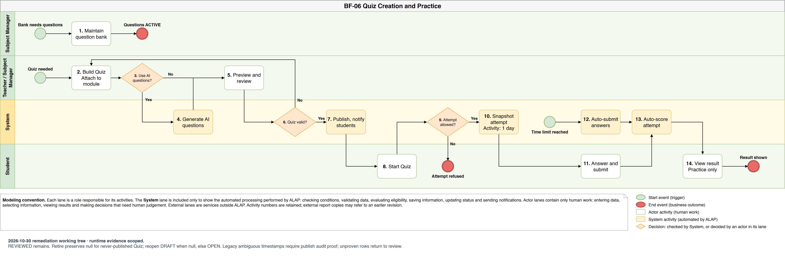

- **Diagram**: [BF-06-Quiz-Creation-and-Practice.drawio](BF-06-Quiz-Creation-and-Practice.drawio)
- **Trigger**: A Subject Manager maintains the subject question bank; a teacher (class Quiz) or Subject Manager (subject Quiz) builds a practice Quiz.
- **End condition**: The student sees the automatic score, or the attempt is refused. Quiz results never enter the gradebook.
- **Use cases**: UC 46, 47, 48, 49, 50, 51, 52 — **Units**: U10, U11, U06, U14, U02

| No. | Lane | Type | Activity | Description | UC |
|---|---|---|---|---|---|
| 1 | Subject Manager | Human | Maintain question bank | The Subject Manager creates, imports (xlsx/csv) or edits multiple-choice questions and activates them; editing an ACTIVE question creates a new version, and Quizzes keep the version they pinned. | 46, 47 |
| 2 | Teacher / Subject Manager | Human | Build Quiz | The author picks ACTIVE bank questions (manually or randomly by filter) or writes own questions, and sets scoring, shuffling, time limit, attempts, answer review and activity monitoring (off by default). | 48 |
| 3 | Teacher / Subject Manager | Human decision | Use AI questions? | Human decision: the author may ask AI to draft questions from selected reference materials. Writing questions manually is always possible. | 48 |
| 4 | System | Automated | Generate AI questions | The System runs the AI request through the source the author selects (BF-08). Suggested questions, keys and explanations are proposals that the author edits and accepts. | 48 |
| 5 | Teacher / Subject Manager | Human | Preview and review | The author previews the Quiz and marks it as reviewed. | 48 |
| 6 | System | Automatic check | Quiz valid? | The System checks 1–200 questions, a valid answer key for every own question, bank questions still ACTIVE, valid points and settings, and that the author teaches the class or manages the subject. Errors return to 2. | 48 |
| 7 | System | Automated | Publish, notify students | On Publish the System stores the snapshot, makes the Quiz OPEN as PRACTICE (no schedule, no gradebook entry), retires a previous version in the same transaction and queues an in-app notification for enrolled students (no email, BF-10). | 48, 65 |
| 8 | Student | Human | Start Quiz | The student opens the Quiz detail and starts a practice attempt. | 49, 50, 51 |
| 9 | System | Automatic check | Attempt allowed? | The System checks an ACTIVE enrollment in an OPEN class, that the Quiz is OPEN and the remaining attempts. | 51 |
| 10 | System | Automated | Create attempt, log page leaves | The System creates the attempt with the version, settings, monitoring policy and shuffle seed, and, when monitoring is on, records page hidden/visible events. | 51 |
| 11 | Student | Human | Answer and submit | The student answers (autosaved) and submits; unanswered questions count as wrong. | 51 |
| 12 | System | Automated | Auto-submit answers | When the time limit plus 30 seconds passes, or the Quiz is retired or replaced by a new version, the System submits the saved answers. | 51 |
| 13 | System | Automated | Auto-score attempt | The System scores the attempt immediately with the pinned answer keys (a multi-answer question scores only when exactly right) and saves the result. Activity signals never change the score. | 51 |
| 14 | Student | Human | View result | The student views the answers, the score if the Quiz shows scores and, if the policy allows, correct answers and explanations. | 52 |

Notes:

- The class teacher sees the attempts, scores and activity timeline of the class's students on the Quiz detail; Quiz results never enter the gradebook.

## BF-07

**Grading, Activity Review and Grade Publication**

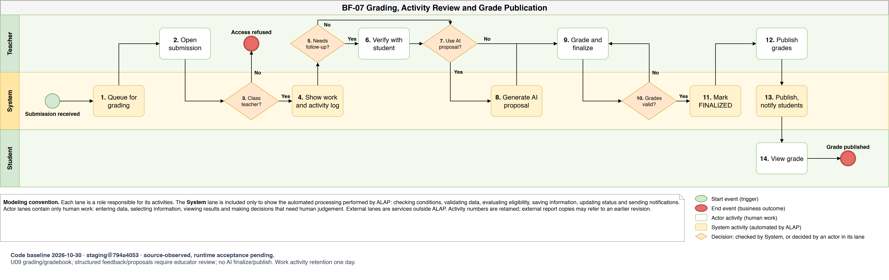

- **Diagram**: [BF-07-Grading-Activity-Review-and-Grade-Publication.drawio](BF-07-Grading-Activity-Review-and-Grade-Publication.drawio)
- **Trigger**: A student or group submits GRADED work (BF-04, BF-05).
- **End condition**: The teacher publishes the grade and the student sees the score and feedback; access by anyone other than the class teacher is refused.
- **Use cases**: UC 42, 43, 44, 45, 40, 65 — **Units**: U09, U08, U12, U06, U14, U02

| No. | Lane | Type | Activity | Description | UC |
|---|---|---|---|---|---|
| 1 | System | Automated | Queue for grading | The System creates a PENDING evaluation for the submission; a newer attempt replaces an unpublished evaluation (SUPERSEDED). Group work gets one document evaluation and one member evaluation per member. | 42 |
| 2 | Teacher | Human | Open submission | The teacher opens the class submissions list (progress, status, late flags) and selects a submission. | 42 |
| 3 | System | Automatic check | Class teacher? | The System checks that the user is the current primary teacher of the submission's class. Anyone else, including the Subject Manager without that class and the Administrator, is refused and the attempt is audited. | 42 |
| 4 | System | Automated | Show work and activity log | The System shows the frozen content (group work by section with authors), the rubric, earlier AI proposals and, if monitoring was on, the count and duration of leave-page events and offline gaps per student. | 42 |
| 5 | Teacher | Human decision | Needs follow-up? | Human decision: activity signals are evidence to compare, not proof of cheating. The teacher decides whether follow-up is needed. | 42 |
| 6 | Teacher | Human | Verify with student | The teacher clarifies the situation with the student outside automatic scoring; ALAP never deducts points or concludes cheating by itself. | 42 |
| 7 | Teacher | Human decision | Use AI proposal? | Human decision: grade manually or ask for an AI proposal (one submission or a selected batch). | 43, 44 |
| 8 | System | Automated | Generate AI proposal | The System runs the request through the source the teacher selects (BF-08) without student names, and checks the result against the locked rubric and the submission hash. An error or stale result produces no proposal and no score; the teacher grades manually or tries again. | 43 |
| 9 | Teacher | Human | Grade and finalize | The teacher ticks the rubric items (or starts from the proposal and changes it), adds an optional adjustment with a reason (for example a late penalty, never applied automatically), enters feedback and finalizes. For group work each member's score starts from the document score and can be changed per member. | 43, 44 |
| 10 | System | Automatic check | Grades valid? | The System checks rubric items against the locked rubric, the final score between 0 and the maximum, a reason for every adjustment and the evaluation version. Problems are returned (back to 9). | 44 |
| 11 | System | Automated | Mark FINALIZED | The System saves the evaluation as FINALIZED and records audit. Students do not see it yet. | 44 |
| 12 | Teacher | Human | Publish grades | The teacher selects one or many FINALIZED grades (for example "all finalized") and publishes them. | 45 |
| 13 | System | Automated | Publish, notify students | The System publishes the grades, records audit and queues in-app notifications and emails without the score (BF-10). | 45, 65 |
| 14 | Student | Human | View grade | The student views the published score, rubric items and feedback in Submission History. | 40 |

Notes:

- Changing a FINALIZED or PUBLISHED grade requires a reason, keeps the status and adds an entry to the grade history; the student sees the new grade marked "updated". Appeals, individual extensions and similarity checks are out of scope.
- The gradebook (UC 45) shows GRADED Assignments only and can be exported to CSV or XLSX.

## BF-08

**AI Request with Source Selection and Usage Transparency**

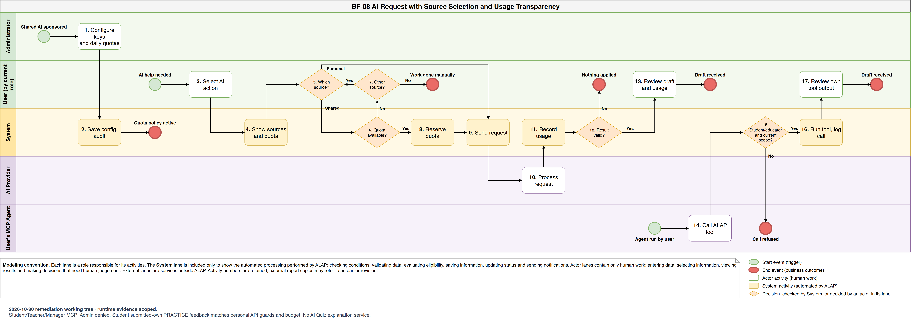

- **Diagram**: [BF-08-AI-Request-Source-Selection-and-Usage-Transparency.drawio](BF-08-AI-Request-Source-Selection-and-Usage-Transparency.drawio)
- **Trigger**: Precondition: the Administrator has set the institutional API and daily quotas. A teacher or student requests AI help, or runs their own MCP agent.
- **End condition**: The user receives a draft with its source and token usage recorded, or a clear refusal or failure; no credit is ever charged.
- **Use cases**: UC 14, 15, 31, 32, 33, 35, 41, 43, 48, 53 — **Units**: U06, U03, U02

| No. | Lane | Type | Activity | Description | UC |
|---|---|---|---|---|---|
| 1 | Administrator | Human | Configure API and quotas | The Administrator configures the institutional API key and model per provider, the on/off switch and daily token quotas: a default per educator, overrides per educator (0 blocks) and a system-wide daily cap. Quotas are allowances, not purchases; Students and Administrators receive none. | 14, 15 |
| 2 | System | Automated | Save config, audit | The System stores the key encrypted and shows only its last 4 characters, saves the quotas with a version check and records audit without secrets. | 15 |
| 3 | Teacher / Student | Human | Select AI action | The user selects an AI action: draft an Assignment or Quiz, propose a grade, or request feedback on a submitted Practice Assignment. The calling feature first checks the user's right on the target. | 35, 41, 43, 48, 53 |
| 4 | System | Automated | Show sources and quota | The System lists only the sources the user may use: the shared quota (Teachers and Subject Managers only) and the user's own personal API connections; it shows who bears the cost, the remaining daily quota and a labelled token estimate. | 31, 33 |
| 5 | Teacher / Student | Human decision | Which source? | Human decision: the user chooses the shared quota or a personal API key. Nothing is switched automatically. | 31 |
| 6 | System | Automatic check | Quota available? | For the shared quota the System checks the educator role, that the institutional connection is ON, and the user's and the system-wide daily quota against the estimate. Students are always refused shared quota. | 15, 31 |
| 7 | Teacher / Student | Human decision | Other source? | The user sees why the request was refused and when the quota resets. Human decision: choose another source (back to 5) or work manually. ALAP never falls back to a personal key by itself. | 33 |
| 8 | System | Automated | Reserve quota | The System atomically reserves the estimated tokens in the user's and the system-wide daily windows (shared quota only; personal keys and MCP never use the shared quota). | 43 |
| 9 | System | Automated | Send request | The System sends the request with only the data the user may share (no keys, no other students' data), with a 120-second timeout. | 43 |
| 10 | AI Provider | External | Process request | The provider processes the request and returns output and usage data. | — |
| 11 | System | Automated | Record usage | The System records source, provider/model, time, status and tokens with their provenance (measured, estimated or unavailable, never 0 for unknown); the reservation is replaced by real usage or released when the provider charged nothing. | 33 |
| 12 | System | Automatic check | Result valid? | The System checks the response against the expected schema and the target version; errors, timeouts and stale results are not applied and never overwrite newer work. | 41, 43 |
| 13 | Teacher / Student | Human | Review draft and usage | The user accepts, edits or discards the draft and can open the AI usage history at any time. Results never publish or finalize anything by themselves. | 33 |
| 14 | User's MCP Agent | External | Call ALAP tool | The user's own agent (connected with a personal MCP credential, UC 32) calls an ALAP tool with its own model; ALAP does not call AI for the agent. | 32 |
| 15 | System | Automatic check | Access allowed? | For every tool call the System checks the credential (not expired or revoked, READ_WRITE for writing tools), the account is ACTIVE, the user's current right on the target and the rate limit. | 32 |
| 16 | System | Automated | Run tool, log call | The System returns the allowed data or saves the agent's output as a proposal only, and logs the tool call; tokens are UNAVAILABLE unless the agent reports them. | 32, 33 |
| 17 | Teacher / Student | Human | Review agent draft | The user reviews the saved proposal and applies or discards it, as for an API draft. | 32, 33 |

Notes:

- Each user sees their own usage; the Administrator sees only aggregated shared-quota usage per educator, day, provider and model, never content, keys or personal/MCP usage of individuals.

## BF-09

**Scheduled Database Backup to Google Drive and Restore Verification**

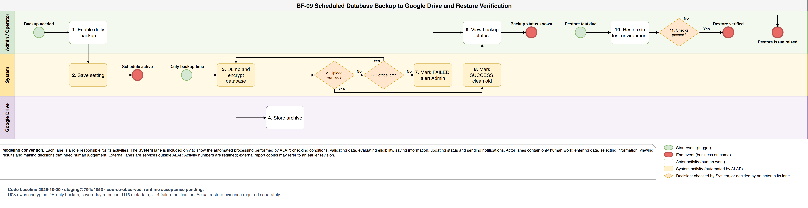

- **Diagram**: [BF-09-Scheduled-Backup-and-Restore-Verification.drawio](BF-09-Scheduled-Backup-and-Restore-Verification.drawio)
- **Trigger**: The administrator enables the daily backup; each day at the set time a backup run starts. Restore tests are run by the operator on a planned cycle.
- **End condition**: An encrypted, verified database backup is stored on Google Drive, a failed run alerts the administrators, and restore tests are recorded with evidence.
- **Use cases**: UC 14, 15, 66, 65 — **Units**: U03, U15, U14, U02

| No. | Lane | Type | Activity | Description | UC |
|---|---|---|---|---|---|
| 1 | Admin / Operator | Human | Enable daily backup | The Administrator enables backup and sets the daily time (Asia/Ho_Chi_Minh) in Settings. Retention is fixed at 7 days and is not a setting. | 14, 15 |
| 2 | System | Automated | Save setting | The System validates the values (a time is required before enabling), saves them with a version check and records audit. | 15 |
| 3 | System | Automated | Dump and encrypt database | The System makes a consistent PostgreSQL dump with the schema and application version and encrypts it with a public key; the decryption key is kept outside the server and the archive. User files on Google Drive (materials, document images) are not part of the backup. | — |
| 4 | Google Drive | External | Store archive | Google Drive stores the archive in a private backup folder separate from the active learning files. | — |
| 5 | System | Automatic check | Upload verified? | The System compares the stored size and checksum with the local archive. | — |
| 6 | System | Automatic check | Retries left? | For a temporary failure (Drive, network, checksum mismatch) the System removes the partial upload and retries the run a limited number of times (back to 3). A permanent error or the last retry goes to 7. | — |
| 7 | System | Automated | Mark FAILED, alert Admin | The System marks the run FAILED with a sanitized error, keeps the last good backup, records audit and sends an in-app alert and email to Administrators (BF-10). Email failure does not change the result. | 65, 66 |
| 8 | System | Automated | Mark SUCCESS, clean old | The System marks the run SUCCESS with time, size and checksum and deletes SUCCESS backups older than 7 days, never deleting the latest good one. | 66 |
| 9 | Admin / Operator | Human | View backup status | The Administrator views the last successful backup, status history, size, time and errors on the Admin Dashboard. Viewing does not allow downloading the archive. | 66 |
| 10 | Admin / Operator | Human | Restore in test environment | Following the runbook, the operator decrypts the archive and restores the database into an isolated environment (never production first), then checks record counts, permissions, documents and Draw.io XML, submissions, grades, quota and usage, and audit rows. | — |
| 11 | Admin / Operator | Human decision | Checks passed? | Human decision based on the checks. Yes: the operator records the evidence and the measured RPO/RTO. No: the failure is recorded as an issue. ALAP has no in-app production restore button or MCP restore tool. | — |

Notes:

- A failed restore check is recorded as an issue; the operator fixes the cause (backup job, key handling or runbook) and repeats the test. No zero-data-loss guarantee is made.

## BF-10

**Important-Event Notification and Email**

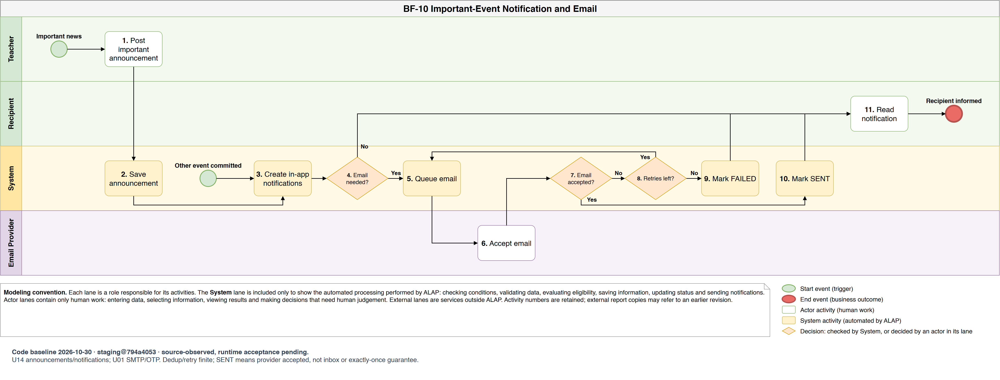

- **Diagram**: [BF-10-Important-Event-Notification-and-Email.drawio](BF-10-Important-Event-Notification-and-Email.drawio)
- **Trigger**: A teacher posts an important announcement, or another important event is committed (see the event table below).
- **End condition**: Recipients receive an in-app notification and, when required, an email; an email failure never undoes the action.
- **Use cases**: UC 63, 64, 65 — **Units**: U14, U01 (mail sender), U03, U02

| No. | Lane | Type | Activity | Description | UC |
|---|---|---|---|---|---|
| 1 | Teacher | Human | Post important announcement | The teacher creates a class announcement for an OPEN class, marks it important and selects email delivery. Editing it later does not resend notifications or email. | 64 |
| 2 | System | Automated | Save announcement | The System validates and saves the announcement and records audit. | 64 |
| 3 | System | Automated | Create in-app notifications | After the business transaction commits, the System resolves the current recipients and creates exactly one in-app notification per event, recipient and type. | 65 |
| 4 | System | Automatic check | Email needed? | The System checks whether the event type sends email (see the table below), for an announcement whether the teacher selected email, and the recipient's email preference for that learning type. BACKUP_FAILED to Administrators is always emailed. Activation OTP emails are sent by BF-11 and are not part of this flow. | 65 |
| 5 | System | Automated | Queue email | The System queues one email per event, recipient and type (duplicates are ignored) with minimal content and a sign-in link; no grades, submissions, secrets or attachments. Above the daily cap of 300 emails, lower-priority emails are DEFERRED to the next day. | — |
| 6 | Email Provider | External | Accept email | The email provider accepts or rejects the message. | — |
| 7 | System | Automatic check | Email accepted? | The System reads the provider response. | — |
| 8 | System | Automatic check | Retries left? | A rejected or failed send is retried with backoff up to 5 times (back to 5). | — |
| 9 | System | Automated | Mark FAILED | After the last retry the System marks the email FAILED. The in-app notification stays and the business action is never rolled back. | — |
| 10 | System | Automated | Mark SENT | The System marks the email SENT, meaning accepted by the provider, not guaranteed in the inbox. | — |
| 11 | Recipient | Human | Read notification | The recipient reads the in-app notification or the email and signs in from the link; the target screen checks the current permission. | 63, 65 |

**Events that notify** (in-app for all; email as listed; students can switch off email per learning type, the in-app notification stays):

| Event | Recipients | Email | Raised in |
|---|---|---|---|
| ENROLLED | Enrolled student | Yes | BF-01 |
| ASSIGNMENT_OPENED | Enrolled students of the class (all OPEN classes for a subject Assignment) | Yes | BF-03 |
| DEADLINE_REMINDER (24 h before closing) | Students or group members without a submission | Yes | BF-03 |
| QUIZ_PUBLISHED | Enrolled students | No | BF-06 |
| GRADE_PUBLISHED | Students who just received a grade | Yes | BF-07 |
| ANNOUNCEMENT / ANNOUNCEMENT_IMPORTANT | Enrolled students of the class | Only if important and email selected | BF-10 |
| BACKUP_FAILED | Administrators | Always | BF-09 |

Daily email priority when the cap is reached: BACKUP_FAILED > DEADLINE_REMINDER > ANNOUNCEMENT_IMPORTANT > ASSIGNMENT_OPENED > GRADE_PUBLISHED > ENROLLED. Account OTP emails (BF-11) do not count toward the cap.

## BF-11

**Account Provisioning and Activation**

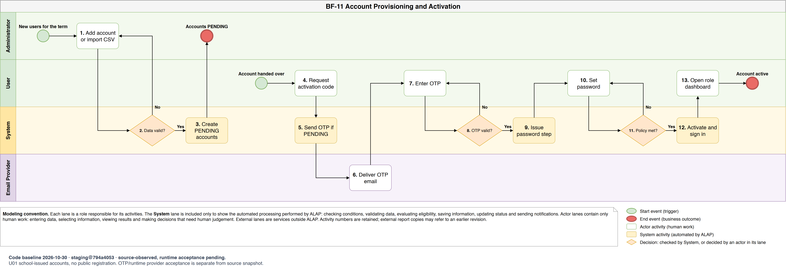

- **Diagram**: [BF-11-Account-Provisioning-and-Activation.drawio](BF-11-Account-Provisioning-and-Activation.drawio)
- **Trigger**: The administrator creates school-issued accounts for a new term; each user later activates their own account.
- **End condition**: The account is ACTIVE with the user's own password and the user lands on the dashboard of their role; invalid data or a wrong OTP is refused.
- **Use cases**: UC 08, 09, 10, 11, 12, 01, 02 — **Units**: U01, U02

| No. | Lane | Type | Activity | Description | UC |
|---|---|---|---|---|---|
| 1 | Administrator | Human | Add account or import CSV | The Administrator adds one account (email, display name, role) or imports a CSV of up to 1,000 rows. ADMIN accounts are created one at a time only. There is no public sign-up. | 08, 09 |
| 2 | System | Automatic check | Data valid? | The System normalises emails and checks the allowed email domain, unique email and a valid role; for a CSV it checks every row first and shows a result per row. The Administrator corrects the input or confirms only the valid rows (back to 1). | 09 |
| 3 | System | Automated | Create PENDING accounts | The System creates the accounts as PENDING without a password, sends no email and records audit. The Administrator tells users to activate their account through the school's usual channel. | 09 |
| 4 | User | Human | Request activation code | The user opens "Activate account for the first time" and enters their school email. | 01 |
| 5 | System | Automated | Send OTP if PENDING | The System always shows the same neutral response; only for a PENDING account, and within rate limits, it creates a 6-digit OTP valid for 10 minutes (stored hashed) and queues the email. | 01 |
| 6 | Email Provider | External | Deliver OTP email | The email provider delivers the OTP email. | — |
| 7 | User | Human | Enter OTP | The user enters the OTP from the email. | 01 |
| 8 | System | Automatic check | OTP valid? | The System checks the OTP for this account and purpose and its expiry. A wrong code returns to 7; after 5 wrong attempts the OTP is cancelled and the user requests a new one. | 01 |
| 9 | System | Automated | Issue password step | The System deletes the OTP and issues a one-time, 10-minute ticket that opens the new-password step. | 01 |
| 10 | User | Human | Set password | The user enters a new password. | 01 |
| 11 | System | Automatic check | Policy met? | The System checks the password policy (at least 8 characters with a letter and a digit, not containing the email name). If not, the user enters another one with the same ticket (back to 10). | 01 |
| 12 | System | Automated | Activate and sign in | The System stores the password hash, sets the account ACTIVE, records audit and signs the user in. | 01, 02 |
| 13 | User | Human | Open role dashboard | The user lands on the dashboard of their role: Class Dashboard for students and teachers, Manager Dashboard for Subject Managers, Admin Dashboard for Administrators. | 02 |

Notes:

- Sign-in (UC 02) accepts only ACTIVE accounts and gives the same message for every failure; 5 wrong passwords lock the account for 15 minutes. Reset password (UC 04) uses the same OTP steps but does not sign the user in.
- Disabling an account (UC 12) ends all sessions and cancels OTPs without deleting history; re-enabling returns it to ACTIVE, or to PENDING if no password was ever set. Changing a role (UC 11) ends the user's sessions and is refused while the old role still holds a subject or class assignment.

## BF-12

**Class Group Setup and Leader Change**

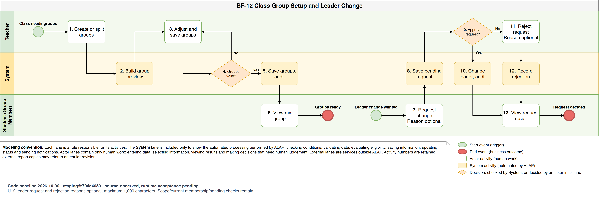

- **Diagram**: [BF-12-Class-Group-Setup-and-Leader-Change.drawio](BF-12-Class-Group-Setup-and-Leader-Change.drawio)
- **Trigger**: The teacher of a class sets up groups before publishing a group Assignment; later a member may ask for a new leader.
- **End condition**: Every group has members and exactly one leader and is ready for group Assignments (BF-03, BF-05); a leader-change request is approved or rejected with a reason.
- **Use cases**: UC 57, 54, 55, 23 — **Units**: U12, U05, U02

| No. | Lane | Type | Activity | Description | UC |
|---|---|---|---|---|---|
| 1 | Teacher | Human | Create or split groups | In the Students tab of the class, the teacher creates groups manually or asks for a random split with a maximum group size (2–20). | 23, 57 |
| 2 | System | Automated | Build group preview | For a random split the System places only students without a group into new groups that differ by at most one member and picks a random leader; existing groups are kept. The result is a preview, nothing is saved yet. | 57 |
| 3 | Teacher | Human | Adjust and save groups | The teacher adds, moves or removes members, renames groups and appoints leaders, then saves the whole set. | 57 |
| 4 | System | Automatic check | Groups valid? | The System checks that every member is an ACTIVE student of the class in at most one group, group names are unique, every group has at least one member and exactly one leader who is a member, and the version is current. Any conflict rejects the whole set with each error (back to 3). | 57 |
| 5 | System | Automated | Save groups, audit | The System saves the groups and records audit. A group that already has group work can only have its members moved, not be deleted. | 57 |
| 6 | Student (Group Member) | Human | View my group | The student sees their group, members, leader and the group documents of open group Assignments on the class detail. | 54 |
| 7 | Student (Group Member) | Human | Request leader change | A member (the leader included) gives a reason (10–1,000 characters) and may propose another member as the new leader. | 55 |
| 8 | System | Automated | Save pending request | The System accepts one pending request per group; the requester can cancel it while it is pending. | 55 |
| 9 | Teacher | Human decision | Approve request? | Human decision by the class teacher. | 57 |
| 10 | System | Automated | Change leader, audit | The System appoints the chosen leader (the proposed member by default) and records audit; the right to assign sections and submit moves to the new leader, held sections stay with their holders. | 57 |
| 11 | Teacher | Human | Give rejection reason | The teacher enters the reason for rejecting the request. | 57 |
| 12 | System | Automated | Record rejection | The System records the rejection with its reason and audit. | 57 |
| 13 | Student (Group Member) | Human | View request result | Members see the result in View My Group; the requester also sees the rejection reason. | 54, 55 |

Notes:

- The teacher can also change a leader directly in step 3; a pending request of that group is then cancelled. A student removed from the class leaves the group, releases held sections, and if they were the leader the teacher must appoint a new one.
- Groups are edited only while the class is DRAFT or OPEN.

## Rules shared by all flows

- Every System check is performed on the server; hiding a button in the UI is not a control. Access outside the user's scope is answered as "not found" and audited.
- Business data is saved before notifications or emails are queued; an email failure never rolls back the business action (BF-10).
- Activity monitoring is off by default, announced to the student before work, recorded per student, and only a signal for a human to review. ALAP never deducts points, auto-submits or concludes cheating because a page was hidden; it does not use webcams, screenshots or OS blocking.
- Automatic submission happens only at the final deadline (or when an Assignment or Quiz is retired) and is marked as automatic for the teacher.
- AI output is always a draft with provenance. Only the Teacher confirms and publishes official grades; only the author publishes an Assignment or Quiz.
- Technical placement (PostgreSQL state, RabbitMQ jobs, Redis TTL data, Google Drive file bytes) stays in the unit designs, not in the business flows.

## Code-aligned deltas and revision scope — 2026-10-30

Single-flow XML, combined 12-page draw.io and PNG exports share the same source revision. AS-IS survey remains separate. The simplified unit dependency diagram is not an exhaustive runtime call graph; use the source import-contract matrix.

- BF-01: Create stays DRAFT. OPEN permits teacher=null; assigned teacher must remain eligible. Teaching scope requires current assignment.
- BF-02: U13 modules own same-subject materials; moduleId required. Quiz at most one module, separate Quiz manage scope. Module delete checks active/archived materials.
- BF-03: U07 owns authoring/rubric and U06 AI proposals. Source existence is separate from historical test evidence; review/publication remain explicit.
- BF-04: Activity retained one day; activity.retentionDays setting removed. No automatic score penalty. Version and owned submission checks remain.
- BF-05: U12 groups/groupdocs; existing claims/locks and leader submission remain. Peer grading/import-by-AI feedback remains proposed.
- BF-06: REVIEWED still exists. OPEN edits remain OPEN; retire any non-RETIRED Quiz. Reopen returns DRAFT/OPEN using publishedAt null vs proven publication; version and active-container guards.
- BF-07: U09 grading/gradebook; structured feedback/proposals require educator review; no AI finalize/publish. Work activity retention one day.
- BF-08: MCP Student/Teacher/Manager; Admin denied. Student personal API/MCP share Practice-feedback guards. Multiple institutional keys/provider. Admin key reveal and ACTIVE owner token reveal are audited source exceptions; no secrets in diagrams.
- BF-09: U03 owns encrypted DB-only backup, seven-day retention. U15 metadata, U14 failure notification. Actual restore evidence required separately.
- BF-10: U14 announcements/notifications; U01 SMTP/OTP. Dedup/retry finite; SENT means provider accepted, not inbox or exactly-once guarantee.
- BF-11: U01 school-issued accounts, no public registration. OTP/runtime provider acceptance is separate from source snapshot.
- BF-12: U12 leader request and rejection reasons optional, maximum 1,000 characters. Scope/current membership/pending checks remain.

Other diagrams under docs/uml remain outside this flow synchronization; use Git history for their older assumptions.
