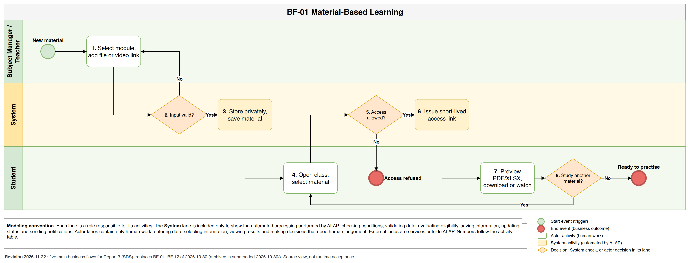
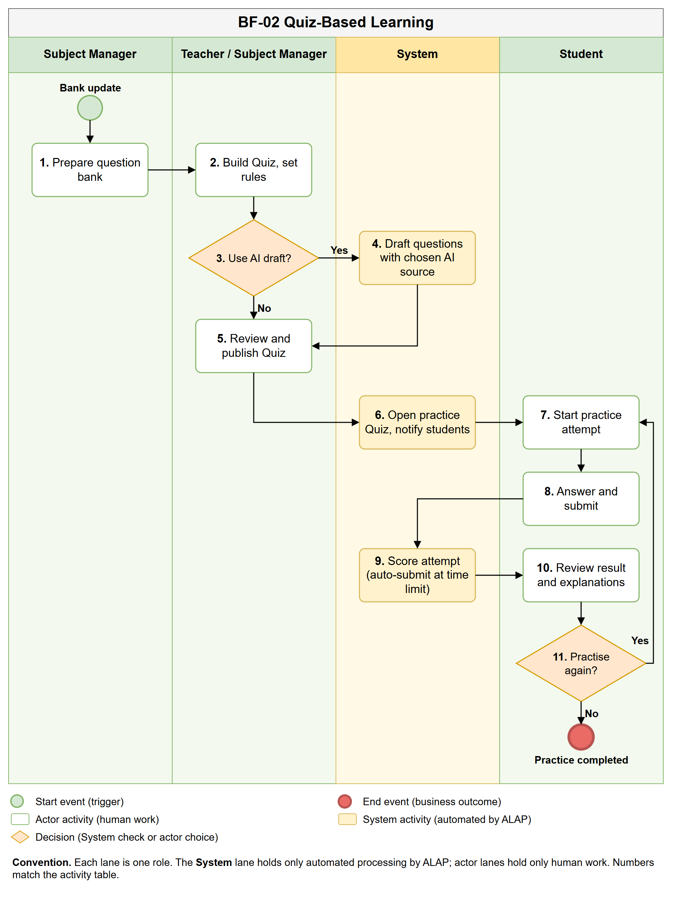
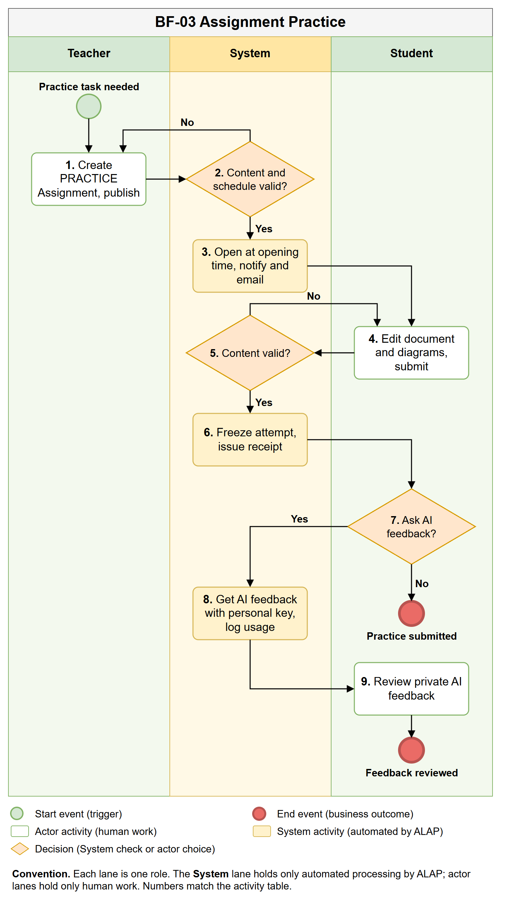
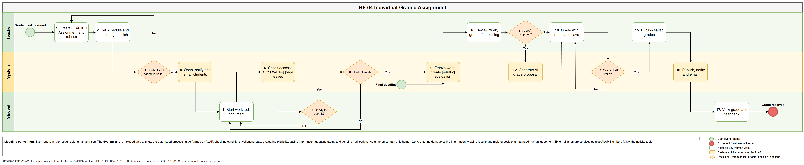
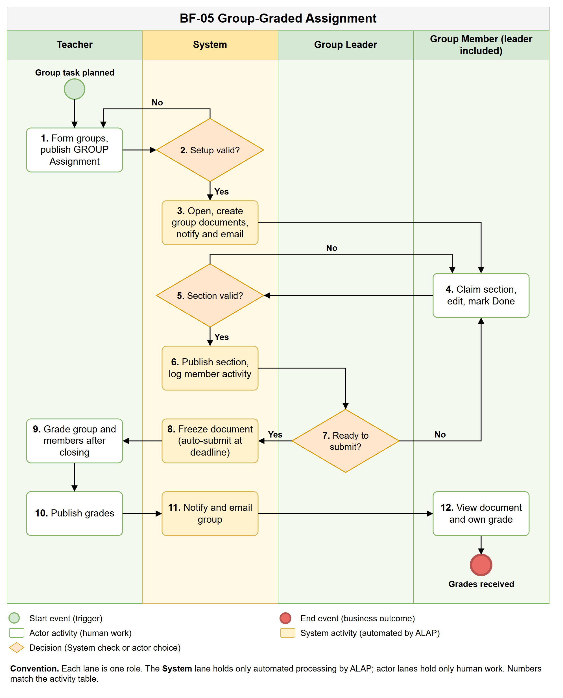

# Main Business Flows

**Revision 2026-11-22 (Jira KAN-204, Report 3 — Software Requirement Specification).** The main business flows are redrawn as five learning-centred flows. They replace the twelve flows of 2026-10-30, which are kept unchanged in [superseded-2026-10-30/](superseded-2026-10-30/README.md). The content follows the same sources: [requirements.md](../requirements/requirements.md), the use case table [docs/usecase_table.md](../../../docs/usecase_table.md) and the unit business rules. These diagrams show the source-observed business process. They are not runtime acceptance evidence.

The activity tables, draw.io pages and 2× PNG exports reflect the code checked at `8afa00b4`. The combined file `AI-Powered-Learning-Platform-Main-Business-Flows.drawio` contains the same five pages as the individual files.

## Modeling convention

The same note is printed under every diagram.

- **Lanes are responsibilities.** Each lane is one role. A lane holds only the work that role is responsible for.
- **System lane = automated processing only.** ALAP checks conditions, validates data, saves information, updates status and sends notifications. The System never makes a human judgement (for example it never concludes that a student cheated).
- **Actor lanes = human work only.** Entering data, selecting information, viewing results and decisions that need human judgement.
- **External lanes** (purple) are services outside ALAP.
- **Decisions** (diamonds) sit in the lane of whoever decides: a System diamond is an automatic check, an actor diamond is a human decision. Every outgoing branch is labelled.
- **Numbering.** Every activity and decision has a number that matches the activity table. Start (green) and End (red) events are not numbered; every End states its business outcome. An extra Start marks a time trigger, such as a deadline.

## Flow overview

| ID | Business flow | Lanes | Use cases | Replaces (2026-10-30) |
|---|---|---|---|---|
| [BF-01](#bf-01) | Material-Based Learning | Subject Manager / Teacher, System, Student | 21, 58, 59, 60, 61, 62 | BF-02 |
| [BF-02](#bf-02) | Quiz-Based Learning | Subject Manager, Teacher / Subject Manager, System, Student | 46, 47, 48, 49, 50, 51, 52, 65 | BF-06 |
| [BF-03](#bf-03) | Assignment Practice | Teacher, System, Student, Student's AI Provider | 34, 35, 36, 37, 38, 39, 40, 41, 53, 65 | BF-03, BF-04 (PRACTICE), BF-08 |
| [BF-04](#bf-04) | Individual-Graded Assignment | Teacher, System, Student | 34, 35, 36, 37, 38, 39, 40, 42, 43, 44, 45, 65 | BF-03, BF-04 (GRADED), BF-07, BF-10 |
| [BF-05](#bf-05) | Group-Graded Assignment | Teacher, System, Group Leader, Group Member | 23, 34, 42, 43, 44, 45, 54, 56, 57, 65 | BF-12, BF-05, BF-07 |

"Lesson-Based Learning" is drawn as **Material-Based Learning**: ALAP has no lesson entity. Students learn from subject and class materials grouped in modules.

**Preconditions shared by all flows** (shown as separate flows in the 2026-10-30 revision and now outside the main flows):

- Accounts exist and are activated (old BF-11).
- The subject and class are set up, the class is OPEN and students hold an ACTIVE enrollment (old BF-01).

Notifications and email (old BF-10) and AI requests (old BF-08) appear as steps inside the flows that trigger them.

## Council feedback coverage

| Council comment | Where it is addressed |
|---|---|
| Separate System and actor responsibilities; System only for automated processing | Every flow, see the convention above |
| Number activities and describe them | Numbers in every diagram, activity tables below |
| Detect switching screens during work (cheating) | BF-04 steps 2, 6 and 10; BF-05 step 10 and 13. Recorded only as a signal for the teacher |
| Send email for important activities | BF-04 steps 4 and 16; BF-05 step 16 |
| Transparent AI usage, not a disguised credit business | BF-02 step 4, BF-03 steps 12–14, BF-04 step 12: source, payer and token usage are recorded; no credit is sold |
| Back up data to Google Drive | **Not a main business flow any more.** Kept in [superseded-2026-10-30/ BF-09](superseded-2026-10-30/README.md#bf-09) and in the NFR/deployment design (U03, U15). Report 3 should point to that section |

## BF-01

**Material-Based Learning**

- **Diagram**: [BF-01-Material-Based-Learning.drawio](BF-01-Material-Based-Learning.drawio)
- **Trigger**: A Subject Manager or teacher adds a learning file or a YouTube video link to a module.
- **End condition**: The student has studied the materials and is ready to practise (BF-02, BF-03), or access is refused.
- **Use cases**: UC 21, 58, 59, 60, 61, 62 — **Units**: U13, U03, U02

| No. | Lane | Type | Activity | Description | UC |
|---|---|---|---|---|---|
| 1 | Subject Manager / Teacher | Human | Select module, add file or video link | A Subject Manager adds a subject material shared with all classes of the subject. A Teacher adds a class material for an assigned class. The user selects the module and adds a PDF, DOCX, PPTX or XLSX file, or a single YouTube video link. | 58, 59, 60, 61 |
| 2 | System | Automatic check | Input valid? | The System checks the user's scope, that the subject or class is not archived, the module, the file type by content and the size limit (default 50 MB), or that the link is a single YouTube video. Invalid input is refused with a reason (back to 1). | 59, 61 |
| 3 | System | Automated | Store privately, save material | The System stores file bytes in private Google Drive storage (no public link) or stores the YouTube link, saves the material as ACTIVE in its module and records audit. Text is extracted in the background for later AI use. | 59, 61 |
| 4 | Student | Human | Open class, select material | The student opens the class detail, or a material attached to an Assignment or Quiz, and selects a material. | 21, 62 |
| 5 | System | Automatic check | Access allowed? | The System checks an ACTIVE enrollment in an OPEN class of the scope and that the material is ACTIVE. Otherwise access is refused. | 62 |
| 6 | System | Automated | Issue short-lived access link | The System creates a 5-minute, user-bound token to stream the file, or returns the YouTube link for the embedded privacy-enhanced player. | 62 |
| 7 | Student | Human | Preview PDF/XLSX, download or watch | The student can preview a PDF or browse the sheets of an XLSX file, download a file, or watch the video. | 62 |
| 8 | Student | Human decision | Study another material? | The student either continues with another material (back to 4) or moves on to practice with a Quiz (BF-02) or a Practice Assignment (BF-03). | 62 |

## BF-02

**Quiz-Based Learning**

- **Diagram**: [BF-02-Quiz-Based-Learning.drawio](BF-02-Quiz-Based-Learning.drawio)
- **Trigger**: The Subject Manager maintains the subject question bank; a teacher (class Quiz) or Subject Manager (subject Quiz) builds a practice Quiz.
- **End condition**: The student finishes practising and has seen the automatic score, or the attempt is refused. Quiz results never enter the gradebook.
- **Use cases**: UC 46, 47, 48, 49, 50, 51, 52, 65 — **Units**: U10, U11, U06, U14, U02

| No. | Lane | Type | Activity | Description | UC |
|---|---|---|---|---|---|
| 1 | Subject Manager | Human | Add, import or approve bank questions | The Subject Manager creates, imports (xlsx/csv), edits and activates multiple-choice questions, and approves questions proposed by teachers. Editing an ACTIVE question creates a new version; Quizzes keep the version they pinned. | 46, 47 |
| 2 | Teacher / Subject Manager | Human | Build Quiz from bank, set rules | The author picks ACTIVE bank questions manually or by tag rules (each attempt can draw its own paper) or writes own questions, and sets scoring, shuffling, time limit, attempts, answer review and activity monitoring (off by default). | 48 |
| 3 | Teacher / Subject Manager | Human decision | Use AI questions? | The author may ask AI to draft questions from selected materials. Writing questions manually is always possible. | 48 |
| 4 | System | Automated | Auto-select source, draft questions | For requests from the web form, U06 selects an eligible shared connection when quota allows, then can use a personal connection. The System records source and token usage. Questions, keys and explanations are proposals. An external MCP agent can submit a proposal through a separate connection using its own model. | 48 |
| 5 | Teacher / Subject Manager | Human | Edit, preview and publish | The author edits and accepts the proposals, previews the Quiz or a sample paper and selects Publish. | 48 |
| 6 | System | Automatic check | Quiz valid? | The System checks 1–200 questions, a valid answer key for every own question, bank questions still ACTIVE, valid points and settings, and that the author teaches the class or manages the subject. Errors return to 2. | 48 |
| 7 | System | Automated | Open practice Quiz, notify students | The System stores the snapshot, makes the Quiz OPEN as PRACTICE (no gradebook entry), retires a previous version and queues an in-app notification for enrolled students. | 48, 65 |
| 8 | Student | Human | Start practice attempt | The student opens the Quiz detail and starts a practice attempt. | 49, 50, 51 |
| 9 | System | Automatic check | Attempt allowed? | The System checks ACTIVE enrollment and that the class and Quiz are OPEN before starting or resuming. It checks the remaining attempts before creating a new one. | 51 |
| 10 | System | Automated | Start or resume Quiz attempt | The System resumes the existing attempt while it is in time, or creates one with the Quiz version, settings, paper and shuffle seed. Resuming an overdue attempt scores the saved answers and opens the result. When monitoring is enabled, the System records page hidden/visible events during the attempt. | 51 |
| 11 | Student | Human | Answer and submit | The student answers (autosaved) and submits; unanswered questions count as wrong. | 51 |
| 12 | System | Automated | Auto-submit if due, score attempt | After the time limit plus 30 seconds, the scanner or a resume, submit or result request submits the saved answers. The System scores the attempt with the pinned answer keys. Activity signals never change the score by themselves. | 51 |
| 13 | Student | Human | Review result and explanations | The student views the answers, the score if shown and, if the policy allows, correct answers and explanations. | 52 |
| 14 | Student | Human decision | Practise again? | The student starts another attempt while attempts remain (back to 8) or stops. | 49, 51 |

## BF-03

**Assignment Practice**

- **Diagram**: [BF-03-Assignment-Practice.drawio](BF-03-Assignment-Practice.drawio)
- **Trigger**: A class teacher wants students to practise writing a design document. A Subject Manager can supply a subject template for the teacher to copy to the class.
- **End condition**: The practice attempt is submitted with a receipt and, if requested, the student has reviewed private AI feedback. Practice work is never graded.
- **Use cases**: UC 34, 35, 36, 37, 38, 39, 40, 41, 53, 65 — **Units**: U07, U08, U06, U14, U02

| No. | Lane | Type | Activity | Description | UC |
|---|---|---|---|---|---|
| 1 | Teacher | Human | Create PRACTICE Assignment | The teacher creates an INDIVIDUAL Assignment of type PRACTICE in the class, prepares the skeleton and configures Draw.io as needed. The teacher can copy a subject template or choose Create with AI. U06 selects the API source for the web request. | 34, 35, 36, 53 |
| 2 | Teacher | Human | Set schedule and attempts, publish | The teacher reviews and completes the Assignment, sets the schedule and the number of attempts (1–10), then publishes it. | 34 |
| 3 | System | Automatic check | Content and schedule valid? | The System checks readiness, the schedule, the attempt limit and that the class is OPEN. Problems return to 1 with the reasons. | 34, 36 |
| 4 | System | Automated | Open, notify students | At the opening time the System sets the Assignment OPEN and queues a notification for enrolled students. | 34, 65 |
| 5 | Student | Human | Start or continue attempt | The student opens the Assignment and selects Start or Continue. | 37, 38, 39 |
| 6 | System | Automatic check | Work allowed? | The System checks an ACTIVE enrollment, an OPEN class, that the Assignment accepts work and the remaining attempts. | 39 |
| 7 | System | Automated | Create attempt, autosave draft | The System creates or reopens the attempt with a snapshot of the Assignment version and autosaves the draft with a version check. | 39 |
| 8 | Student | Human | Edit document and diagrams, submit | The student writes the sections, draws diagrams in the embedded Draw.io editor when enabled, and submits. | 39 |
| 9 | System | Automatic check | Content valid? | The System validates the skeleton blocks, the required diagrams and that every diagram is complete. Invalid content is reported (back to 8). | 39 |
| 10 | System | Automated | Freeze attempt, issue receipt | The System freezes the content snapshot with server time and receipt hash. PRACTICE work is never queued for grading. | 39, 40 |
| 11 | Student | Human decision | Ask AI feedback? | The student may ask for private AI feedback on this submitted attempt. | 41 |
| 12 | System | Automated | Check limits, send request, log usage | The System checks a PRACTICE Assignment, the student's own submitted attempt, one pending request per attempt and 20 requests per day, sends the request through the student's personal API key (students have no shared quota) and records source and token usage. A student may also use their own MCP agent, which calls ALAP and pays for its own model. | 41 |
| 13 | Student's AI Provider | External | Generate narrative feedback | The provider generates general comments, strengths, comments by section and suggestions from the Assignment and the submission. The prompt excludes the rubric. | 41 |
| 14 | Student | Human | Review private AI feedback | The student reads feedback with the label “Góp ý tham khảo” in the Vietnamese UI. It contains comments and suggestions and carries no rubric assessment or estimated score. A new attempt can start while attempts remain. | 40, 41 |

## BF-04

**Individual-Graded Assignment**

- **Diagram**: [BF-04-Individual-Graded-Assignment.drawio](BF-04-Individual-Graded-Assignment.drawio)
- **Trigger**: A teacher plans a graded individual Assignment for a class.
- **End condition**: The teacher publishes the grade and the student sees the score and feedback; invalid content, schedule or grade is returned for correction.
- **Use cases**: UC 34, 35, 36, 37, 38, 39, 40, 42, 43, 44, 45, 65 — **Units**: U07, U08, U09, U06, U14, U02

| No. | Lane | Type | Activity | Description | UC |
|---|---|---|---|---|---|
| 1 | Teacher | Human | Create GRADED Assignment and rubrics | The teacher creates an INDIVIDUAL Assignment of type GRADED, writes the skeleton and rubrics (an AI draft is optional and only a proposal) and turns the Draw.io option on or off. | 34, 35, 36 |
| 2 | Teacher | Human | Set schedule and monitoring, publish | The teacher reviews and completes the Assignment, sets opening, closing and optional late-until time (at most 30 days after closing), and chooses whether to record activity. Individual graded work can be resubmitted while the Assignment accepts submissions. | 34 |
| 3 | System | Automatic check | Content and schedule valid? | The System checks content, rubrics, Draw.io blocks, the schedule and that the class is OPEN. Problems return to 1 with the reasons. On success it locks content and rubrics and sets SCHEDULED. | 34, 36 |
| 4 | System | Automated | Open, notify and email students | At the opening time the System sets the Assignment OPEN and queues an in-app notification and an email for enrolled students; a reminder is sent 24 hours before closing to students who have not submitted. | 34, 65 |
| 5 | Student | Human | Start work, edit document | The student starts or continues an attempt and edits sections and diagrams. A monitoring notice explains which activity is recorded when monitoring is on. | 37, 38, 39 |
| 6 | System | Automated | Check access, autosave, log page leaves | The System checks enrollment and the submission window, autosaves the draft and, when monitoring is on, records page hidden/visible events with server time. Work inside Draw.io does not count as leaving the page. | 39 |
| 7 | Student | Human decision | Ready to submit? | The student continues editing (back to 5) or submits. | 39 |
| 8 | System | Automatic check | Content valid? | The System validates skeleton blocks and required, non-empty diagrams. Invalid content is reported (back to 5). | 39 |
| 9 | System | Automated | Freeze work, create pending evaluation | The System freezes the content with server time, late flag and receipt hash and creates a PENDING evaluation. After the final deadline plus 30 seconds, it auto-submits the saved draft and marks it automatic. Leaving the page never triggers submission or penalties. | 39, 40, 42 |
| 10 | Teacher | Human | Review work, grade after closing | The current primary teacher can review the frozen content, rubric and recorded activity. To start grading, wait for submissions to close or use Close submissions. The class must remain OPEN. The teacher decides how to follow up on activity signals. | 42 |
| 11 | Teacher | Human decision | Use AI proposal? | The teacher grades manually or asks for an AI proposal for one submission or a batch. | 43, 44 |
| 12 | System | Automated | Generate AI grade proposal | The System sends the request without student names through the selected source, records source and token usage and checks the result against the locked rubric and submission hash. An error produces no proposal and no score. | 43 |
| 13 | Teacher | Human | Grade with rubric and save | The teacher scores the rubric or reviews and adjusts an AI proposal, adds an optional adjustment with a reason, writes feedback and saves. | 43, 44 |
| 14 | System | Automatic check | Grade draft valid? | The System checks rubric items, the score range, adjustment reasons and the version. Problems return to 13. A valid first grade is saved as DRAFT and stays private until publication. | 44 |
| 15 | Teacher | Human | Publish saved grades | The teacher can publish one or many eligible DRAFT grades directly. Existing FINALIZED grades can also be published. Edits to a PUBLISHED grade remain visible after a successful save. | 45 |
| 16 | System | Automated | Publish, notify and email | The System publishes the grades, records audit and queues in-app notifications and emails without the score. | 45, 65 |
| 17 | Student | Human | View grade and feedback | The student views the score, rubric items and feedback in Submission History. | 40 |

## BF-05

**Group-Graded Assignment**

- **Diagram**: [BF-05-Group-Graded-Assignment.drawio](BF-05-Group-Graded-Assignment.drawio)
- **Trigger**: A teacher plans a group Assignment for a class. Group Assignments are always GRADED.
- **End condition**: The group document is submitted (by the leader or automatically at the deadline), graded per document and per member, and published; every member sees their own grade.
- **Use cases**: UC 23, 34, 42, 43, 44, 45, 54, 56, 57, 65 — **Units**: U12, U07, U08, U09, U14, U02

| No. | Lane | Type | Activity | Description | UC |
|---|---|---|---|---|---|
| 1 | Teacher | Human | Create or split groups, appoint leaders | In the class Students tab the teacher creates groups manually or by random split (group size 2–20), adjusts members and appoints exactly one leader per group. Members may later request a leader change, which the teacher approves or rejects. | 23, 57 |
| 2 | System | Automatic check | Groups valid? | The System checks that every member is an ACTIVE student of the class in at most one group, names are unique and each group has at least one member and exactly one leader. Any conflict rejects the whole set (back to 1). | 57 |
| 3 | Teacher | Human | Create GROUP Assignment, publish | The teacher creates a GROUP Assignment with skeleton, rubrics, schedule and monitoring policy and publishes it. The System checks content and schedule as in BF-04 step 3. | 34 |
| 4 | System | Automated | Open, create group documents, notify | At the opening time the System sets the Assignment OPEN, creates one shared document per group (each section becomes an item with a fixed rubric) and notifies and emails the students. | 34, 56, 65 |
| 5 | Group Leader | Human | Assign sections to members | Optional: the leader assigns sections to members. | 54, 56 |
| 6 | Group Member | Human | Claim assigned or open section | A member (the leader is also a member) opens the group document from View My Group and claims an assigned or open section. | 54, 56 |
| 7 | System | Automatic check | Section free? | The System checks group membership, that the Assignment accepts work and that no other member holds the section. A held section is refused (back to 6). | 56 |
| 8 | System | Automated | Lock section for member | The System gives the member an exclusive edit lock. The holder, the leader or the teacher can release it so an abandoned section never blocks the group. | 56 |
| 9 | Group Member | Human | Edit section, mark Done | The member writes the section and diagrams and marks it Done. | 56 |
| 10 | System | Automated | Validate, publish section, log member activity | The System validates the content, publishes the section into the shared document with its author, releases the lock and, when monitoring is on, records activity for that member only. | 56 |
| 11 | Group Leader | Human decision | Ready to submit? | The leader reviews the shared document and either submits it (unfinished sections are warned about and not included) or lets members continue (back to 9). | 56 |
| 12 | System | Automated | Freeze document, prepare evaluation | The System checks the current leader for manual submission, validates the document and freezes it with section authors, receipt hash and late flag. It prepares the evaluation for the submission. After the final deadline plus 30 seconds, it auto-submits a changed document. | 56, 42 |
| 13 | Teacher | Human | Grade group and members after closing | The teacher reviews the document, authors and per-member activity. After submissions close, the teacher grades the shared document (with an optional AI proposal) and can adjust individual scores or record contribution levels. | 42, 43, 44 |
| 14 | System | Automatic check | Grade drafts valid? | The System checks the rubric, score ranges, reasons and versions. Problems return to 13. First grades are saved as DRAFT and stay private until publication. | 44 |
| 15 | Teacher | Human | Publish saved grades | The teacher can publish a saved DRAFT group grade directly. The System publishes it with the member results. | 45 |
| 16 | System | Automated | Publish, notify and email group | The System publishes the grades, records audit and notifies and emails each member without the score. | 45, 65 |
| 17 | Group Member | Human | View document and own grade | Each member views the submitted group document and their own score and feedback. | 40, 54 |

## Rules shared by all flows

- Every System check runs on the server; hiding a button is not a control. Access outside the user's scope is answered as "not found" and audited.
- Business data is saved before notifications or emails are queued; an email failure never rolls back the business action.
- Activity monitoring is off by default, announced before work, recorded per student and only a signal for a human to review. ALAP never deducts points, auto-submits or concludes cheating because a page was hidden.
- AI proposals record their source and token usage. The teacher reviews the proposal, saves the grade and decides when to publish. Subject Assignment templates are copied to a class before publishing.
