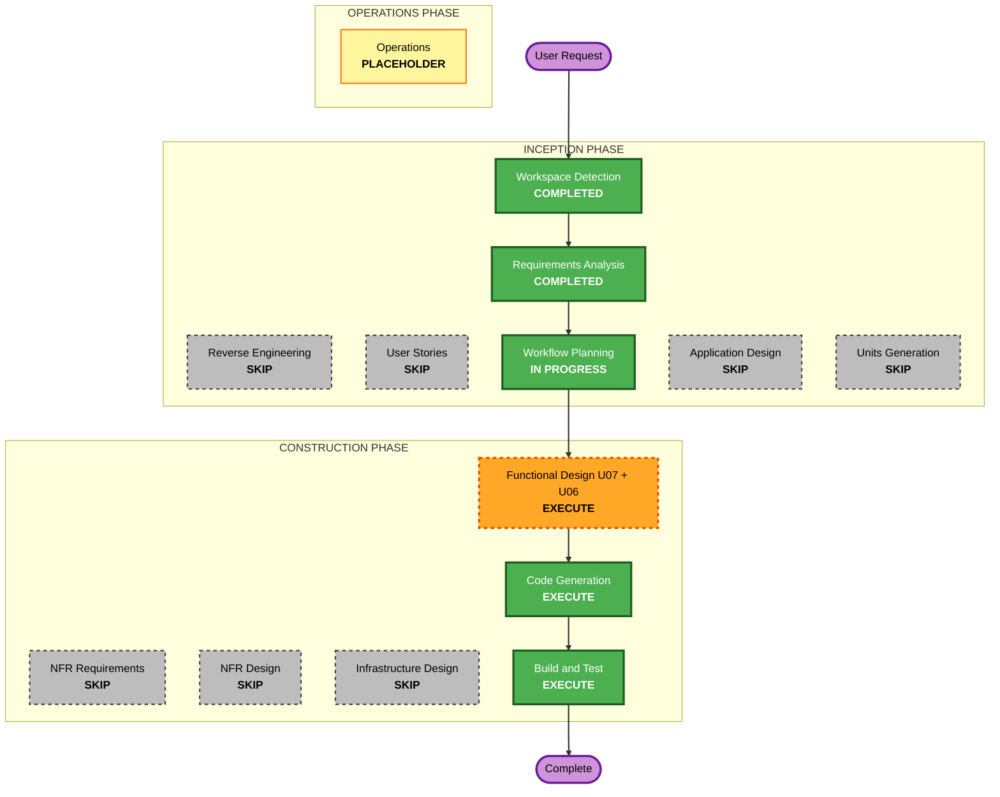

# Execution Plan — Nhập đề từ ảnh/PDF

Dựa trên [yêu cầu đã duyệt](../requirements/2026-11-11-exam-image-import.md) (FR-IMP-01…08). Chưa sửa mã nguồn.

## Detailed Analysis Summary

### Transformation Scope
- **Transformation Type**: thay đổi ứng dụng trong ranh giới các unit hiện có. Không đổi kiến trúc, không đổi hạ tầng.
- **Primary Changes**:
  - U07 thêm luồng nhập ảnh/PDF: kiểm tệp, dựng trang thành ảnh, tác vụ AI, ánh xạ kết quả thành khối, cắt hình, xem trước.
  - U06 cho `IProviderGateway` gửi được ảnh.
- **Related Components**: U03 (giới hạn tệp nhập, lưu ảnh hình qua `DOCUMENT_IMAGE`), frontend `features/assignments`.

### Change Impact Assessment
- **User-facing changes**: Có.
  - Ô "Mẫu đề" trong popup tạo bài nhận thêm ảnh/PDF.
  - Trang soạn bài có nút "Nhập đề từ tệp".
  - Popup chờ có nút Hủy.
  - Màn xem trước có "Thay toàn bộ" / "Chèn vào cuối".
- **Structural changes**: Không. Thêm service và handler trong các package `assignments`, `ai` hiện có.
- **Data model changes**: Ít. Có thể cần loại tác vụ AI mới, và setting giới hạn tệp nhập. Không thêm bảng nếu bản xem trước được giữ trong kết quả tác vụ AI. Chốt ở Functional Design.
- **API changes**: Có, chỉ thêm.
  - Endpoint tạo tác vụ nhập từ ảnh/PDF cho một bài.
  - Đọc trạng thái/kết quả qua cơ chế tác vụ AI hiện có.
  - Endpoint DOCX giữ nguyên.
- **NFR impact**: Có.
  - Giới hạn dung lượng, số trang, số điểm ảnh.
  - Timeout khi gọi nhà cung cấp AI.
  - Chống prompt injection qua ảnh.
  - Không ghi một phần vào đề khi lỗi.

### Component Relationships
- **Primary Component**: `backend/.../assignments` (U07). Change: Major, Critical.
- **Shared Components**:
  - `backend/.../ai` (U06), `IProviderGateway`, `HttpProviderGateway`, `ProviderCatalog`. Change: Minor (thêm trường tương thích ngược), Critical.
  - `backend/.../files` (U03), `PurposePolicy`/Settings. Change: Minor, Important.
- **Dependent Components**: frontend `features/assignments` (`CreateAssignmentDialog`, `AssignmentFormPage`, `api`). Change: Major, Critical.
- **Build**: `backend/pom.xml` thêm Apache PDFBox (dựng trang PDF thành ảnh) và bộ đọc WebP thuần Java (TwelveMonkeys `imageio-webp`). Change: Configuration-only, Important.
- **Supporting**: tài liệu U07, U06, U03, api-inventory, current-code-baseline.

### Risk Assessment
- **Risk Level**: Medium. Đổi gateway dùng chung của mọi tính năng AI; ba nhà cung cấp có định dạng ảnh khác nhau; chất lượng đọc ảnh phụ thuộc model.
- **Rollback Complexity**: Easy. Chỉ thêm, không migrate dữ liệu cũ; gỡ nút giao diện là tắt được tính năng.
- **Testing Complexity**: Moderate.
  - Giả lập HTTP cho ba nhà cung cấp.
  - Ảnh và PDF mẫu nhỏ trong test.
  - Test popup và màn xem trước ở frontend.

## Workflow Visualization

Bản chữ: Workspace Detection (xong) → Requirements Analysis (xong) → Workflow Planning → Functional Design U07 + U06 → Code Generation → Build and Test → xong. Bỏ qua: Reverse Engineering, User Stories, Application Design, Units Generation, NFR Requirements, NFR Design, Infrastructure Design.

## Phases to Execute

### 🔵 INCEPTION PHASE
- [x] Workspace Detection (COMPLETED)
- [x] Reverse Engineering (SKIPPED). Tài liệu reverse engineering đồng bộ ngày 2026-11-10 còn dùng được.
- [x] Requirements Analysis (COMPLETED). Người dùng duyệt lúc 2026-11-11T07:28:36Z.
- [x] User Stories (SKIPPED). Một vai trò (giảng viên/chủ nhiệm môn), mở rộng US-ASM-004; tiêu chí chấp nhận đã có trong tài liệu yêu cầu.
- [x] Execution Plan (IN PROGRESS)
- [ ] Application Design: SKIP
  - **Rationale**: không có unit hay component mới. Service và handler mới nằm trong `assignments` và `ai`, tên và phương thức chốt ở Functional Design.
- [ ] Units Generation: SKIP
  - **Rationale**: dùng lại U07, U06, U03; không cần tách unit.

### 🟢 CONSTRUCTION PHASE
- [ ] Functional Design: EXECUTE (một lượt cho U07, kèm delta U06 và U03)
  - **Rationale**: có quy tắc nghiệp vụ mới cần chốt trước khi viết mã:
    - JSON schema kết quả AI và ánh xạ sang khối;
    - tọa độ cắt hình;
    - ghép nhiều trang và bỏ đầu/chân trang;
    - vòng đời tác vụ (chạy, hủy, lỗi, dọn tệp);
    - API mới;
    - mã lỗi (model không đọc ảnh, tệp sai loại, quá trang);
    - cách gửi ảnh cho từng nhà cung cấp;
    - danh sách model đọc được ảnh;
    - setting giới hạn tệp.
- [ ] NFR Requirements: SKIP
  - **Rationale**: Security và Resiliency đã bật, phạm vi đã duyệt. Các giới hạn cụ thể (10MB, 10 trang, số điểm ảnh, timeout, mục tiêu 60 giây) đã nằm trong yêu cầu. Thư viện mới chỉ là PDFBox và bộ đọc WebP, ghi ở Functional Design.
- [ ] NFR Design: SKIP
  - **Rationale**: dùng lại các mẫu sẵn có: `AiTaskService` (quota, timeout, chạy nền), bộ kiểm khối tài liệu, dọn tệp mồ côi, ánh xạ lỗi nhà cung cấp AI.
- [ ] Infrastructure Design: SKIP
  - **Rationale**: không đổi Docker, mạng, lưu trữ hay CI. Thư viện mới là Java thuần, nằm trong JAR.
- [ ] Code Generation: EXECUTE (ALWAYS)
  - **Rationale**: viết mã backend, frontend, test và cập nhật tài liệu unit.
- [ ] Build and Test: EXECUTE (ALWAYS)
  - **Rationale**:
    - Backend: Maven test phạm vi `ai`, `assignments`, `files`, rồi `verify`.
    - Frontend: `tsc`, `eslint`, Vitest, build.
    - Trình duyệt: thử với stack local.

### 🟡 OPERATIONS PHASE
- [ ] Operations: PLACEHOLDER

## Package Change Sequence

Làm tuần tự, mỗi bước có test riêng trước khi sang bước sau:

1. **U06 `ai`**: `IProviderGateway.Request` thêm phần ảnh (mặc định rỗng, các nơi gọi cũ không đổi); `HttpProviderGateway` gửi ảnh cho Gemini, OpenAI, Claude; `ProviderCatalog` đánh dấu model đọc được ảnh. Các bước sau đều cần bước này.
2. **U03 `files` và build**: giới hạn tệp nhập (setting, trần hệ thống 10MB); thêm PDFBox và bộ đọc WebP vào `pom.xml`.
3. **U07 `assignments` backend**: kiểm tệp và dựng ảnh trang, tác vụ AI nhập đề, ánh xạ JSON sang khối, cắt hình và lưu `DOCUMENT_IMAGE`, endpoint mới, dọn tệp tạm.
4. **Frontend `features/assignments`**: API client, ô "Mẫu đề" nhận ảnh/PDF, nút "Nhập đề từ tệp", chọn và sắp thứ tự tệp, popup chờ có Hủy, màn xem trước với Thay toàn bộ / Chèn vào cuối.
5. **Tài liệu**: functional-design và as-built của U07/U06/U03, api-inventory, current-code-baseline.

## Estimated Timeline
- **Total Stages to Execute**: 3 (Functional Design, Code Generation, Build and Test), mỗi giai đoạn có cổng duyệt.
- **Estimated Duration**: khoảng 1–2 phiên làm việc.

## Success Criteria
- **Primary Goal**: giảng viên tải ảnh hoặc PDF đề cũ và nhận được khung đề chỉnh sửa được, đúng nguyên văn.
- **Key Deliverables**:
  - gateway gửi được ảnh;
  - luồng nhập ở backend;
  - giao diện nhập và xem trước;
  - test;
  - tài liệu unit cập nhật.
- **Quality Gates**:
  - Đạt 7 tiêu chí chấp nhận trong tài liệu yêu cầu.
  - Test cũ của các tính năng AI khác vẫn qua (gateway tương thích ngược).
  - `mvn verify`, `tsc`, `eslint`, Vitest, build đều qua.
  - Không gọi nhà cung cấp AI thật trong test tự động.
- **Integration Testing**: nhập ảnh đầu-cuối trên stack local với nhà cung cấp AI giả lập. Thử với nhà cung cấp AI thật nếu người dùng cho phép.
- **Operational Readiness**: lỗi nhà cung cấp và quota đi qua log và usage AI hiện có; không ghi nội dung đề hay khóa API vào log.
