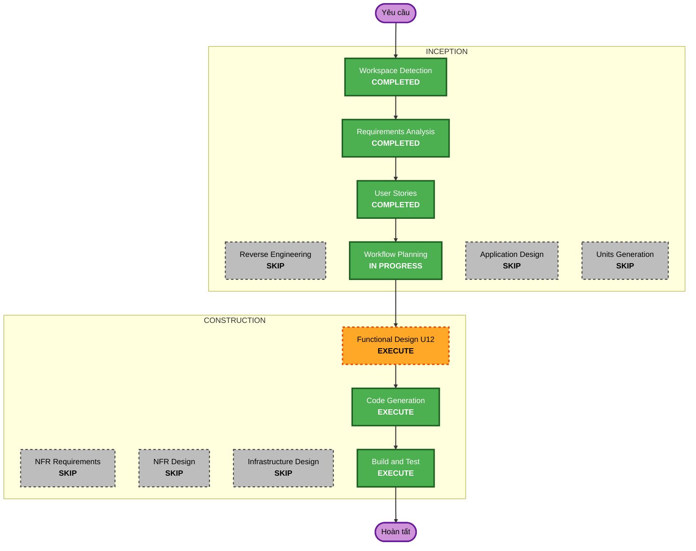

# Sinh viên tự chia nhóm — kế hoạch thực hiện

Dựa trên [yêu cầu SG-01…09](../requirements/2026-11-11-student-self-grouping.md) và US-GRP-007…010 trong [stories.md](../user-stories/stories.md), cả hai đã duyệt 2026-11-11.

## Phân tích chi tiết

### Phạm vi thay đổi (brownfield)

- **Loại**: thay đổi trong một unit (U12), không đổi kiến trúc.
- **Thay đổi chính**: đợt tự chia nhóm theo lớp, đề xuất nhóm và lời mời, duyệt đề xuất thành nhóm chính thức.
- **Thành phần liên quan**: `groups` (chính), `notifications` (loại thông báo mới), `jobs/contract/EventTypes` (loại sự kiện mới), frontend `features/groups`.

### Đánh giá ảnh hưởng

- **Người dùng**: có. Màn Nhóm của sinh viên có trạng thái mới; tab Nhóm của giảng viên có cài đặt đợt, danh sách chờ duyệt và sinh viên chưa có nhóm.
- **Cấu trúc**: không. Thêm service trong package `groups` hiện có.
- **Dữ liệu**: có, chỉ thêm. Migration Flyway mới trong `db/migration/groups`: bảng cài đặt đợt, đề xuất, thành viên/lời mời đề xuất; partial unique index một đề xuất đang hoạt động mỗi sinh viên. Không sửa bảng hiện có.
- **API**: có, chỉ thêm endpoint dưới `/api/v1/classes/{classId}/...` và `/api/v1/group-proposals/...`; endpoint cũ giữ nguyên. Lưu bộ nhóm (`PUT /groups`) thêm bước dọn đề xuất của người vừa được xếp nhóm (SG-07).
- **NFR**: phân quyền backend, audit, khóa `version`, ràng buộc database; dùng cơ chế sẵn có của U12.

### Quan hệ thành phần

- **Thành phần chính**: backend `groups` — thay đổi lớn (mới, tương thích ngược).
- **Thành phần phụ thuộc**: `notifications` — nhỏ (3–4 loại thông báo, người nhận); `jobs/contract/EventTypes` — nhỏ.
- **Dùng lại**: `GroupSetRules`, `GroupAccess`, `ClassGroupService.save` và `setVersion/bumpSetVersion`, `IAudit`, `IEventPublisher`, `RandomGroupSplitter` (không đổi).
- **Frontend**: `features/groups` (api, model, `MyGroup`, `ClassGroupsPanel`, component mới) — thay đổi vừa.

### Rủi ro

- **Mức**: Trung bình. Nhiều trạng thái và thao tác đồng thời; chạm đường lưu bộ nhóm đang dùng cho bài nhóm.
- **Rollback**: dễ đến vừa. Bảng mới độc lập; tắt tính năng bằng cách không bật đợt. Migration không đảo ngược tự động (theo runbook hiện có).
- **Kiểm thử**: vừa. Unit test quy tắc, integration test PostgreSQL cho ràng buộc và đồng thời, test frontend theo trạng thái, E2E API nếu khả thi.

## Sơ đồ quy trình



Bản chữ:

```
INCEPTION
- Workspace Detection (COMPLETED)
- Reverse Engineering (SKIP: tài liệu hiện hành)
- Requirements Analysis (COMPLETED)
- User Stories (COMPLETED)
- Workflow Planning (IN PROGRESS)
- Application Design (SKIP)
- Units Generation (SKIP)
CONSTRUCTION
- Functional Design U12 (EXECUTE)
- NFR Requirements, NFR Design, Infrastructure Design (SKIP)
- Code Generation (EXECUTE)
- Build and Test (EXECUTE)
```

## Các giai đoạn

### INCEPTION

- [x] Workspace Detection — COMPLETED
- [x] Reverse Engineering — SKIP: tài liệu reverse engineering hiện hành (đồng bộ 2026-11-10)
- [x] Requirements Analysis — COMPLETED
- [x] User Stories — COMPLETED
- [x] Workflow Planning — IN PROGRESS
- [ ] Application Design — SKIP
  - **Lý do**: không thêm unit hay ranh giới mới; service mới nằm trong package `groups`, phụ thuộc giữa unit không đổi (U12 → notifications qua sự kiện như hiện nay). Thiết kế service ghi trong Functional Design.
- [ ] Units Generation — SKIP
  - **Lý do**: một unit (U12); thay đổi nhỏ ở notifications đi kèm.

### CONSTRUCTION

- [ ] Functional Design (U12) — EXECUTE
  - **Lý do**: thực thể và bảng mới, máy trạng thái đề xuất/lời mời, quy tắc nghiệp vụ mới (BR-U12 tiếp theo), tương tác với lưu bộ nhóm, component frontend mới. Cập nhật `domain-entities.md`, `business-rules.md`, `business-logic-model.md`, `frontend-components.md` của U12.
- [ ] NFR Requirements — SKIP
  - **Lý do**: stack đã chốt; NFR của tính năng (phân quyền, audit, đồng thời, resiliency thông báo) đã nêu trong yêu cầu và dùng lại mẫu của U12. Security/Resiliency kiểm trong Functional Design và Code Generation.
- [ ] NFR Design — SKIP
  - **Lý do**: NFR Requirements bỏ qua; mẫu khóa `version`, partial unique index và sự kiện đã có trong `nfr-design-patterns.md` U12.
- [ ] Infrastructure Design — SKIP
  - **Lý do**: không đổi hạ tầng; chỉ migration Flyway trong pipeline hiện có.
- [ ] Code Generation — EXECUTE (luôn chạy)
  - **Lý do**: backend, migration, notifications, frontend và test.
- [ ] Build and Test — EXECUTE (luôn chạy)
  - **Lý do**: Maven verify (gồm integration test PostgreSQL), Vitest, tsc, eslint, build frontend; kiểm trên trình duyệt với stack local.

### OPERATIONS

- [ ] Operations — PLACEHOLDER

## Thứ tự thay đổi

1. Migration và model/repository `groups` — nền cho mọi bước.
2. Service đợt, đề xuất, lời mời, duyệt; nối vào `ClassGroupService.save` và xử lý rời lớp (SG-07).
3. Sự kiện và thông báo (`EventTypes`, `notifications`).
4. Controller và API.
5. Frontend: api/model, màn sinh viên, tab giảng viên.
6. Test ở mỗi bước; Build and Test cuối.

Backend trước frontend vì frontend dùng hợp đồng API mới. Bước 3 làm song song được với bước 4.

## Điều kiện trước Code Generation

Thư mục làm việc đang có thay đổi chưa commit của phiên khác (U06 khóa AI, U07 nhập đề từ ảnh, tài liệu frontend) trên nhánh đã merge `fix/profile-inline-password`. Trước khi viết mã cần nhánh riêng (`--no-track`, từ `origin/staging`) hoặc worktree riêng để không trộn thay đổi; người dùng quyết định ở bước Code Generation.

## Tiêu chí thành công

- **Mục tiêu**: giảng viên bật đợt, sinh viên tự lập đề xuất, giảng viên duyệt thành nhóm chính thức, đúng US-GRP-007…010.
- **Sản phẩm**: migration, backend service/API, thông báo, frontend hai vai trò, test, tài liệu U12 cập nhật.
- **Cổng chất lượng**: Maven verify không lỗi, integration test PostgreSQL cho ràng buộc một đề xuất mỗi sinh viên và duyệt đồng thời; Vitest, tsc, eslint, build frontend qua; kiểm trên trình duyệt hai vai trò; Security/Resiliency tuân thủ trong phạm vi.
- **Tích hợp**: luồng bộ nhóm hiện có (tạo tay, chia ngẫu nhiên, đổi trưởng nhóm, bài nhóm) không đổi hành vi.
