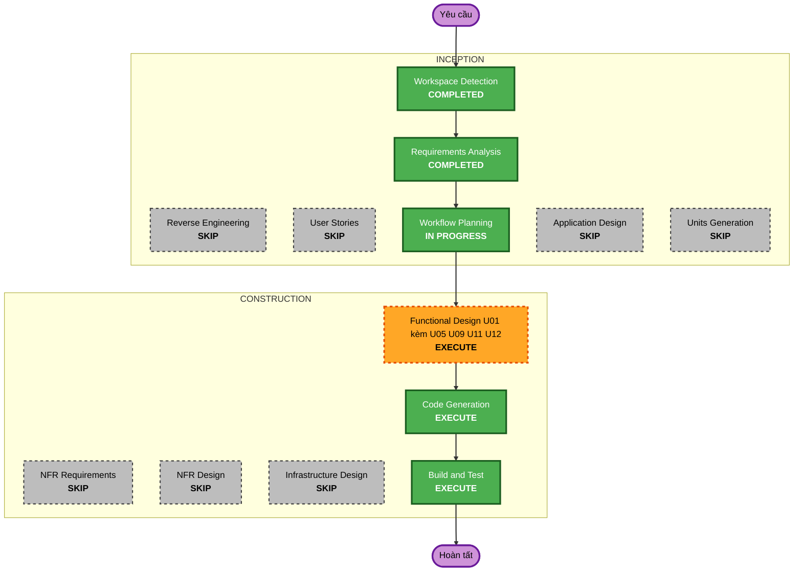

# Mã số sinh viên — kế hoạch thực hiện

Dựa trên [yêu cầu SC-01…11](../requirements/2026-11-13-student-code.md), người dùng duyệt ngày 2026-11-13. Không có User Stories.

## Phân tích chi tiết

### Phạm vi thay đổi (brownfield)

- **Loại**: mở rộng một thuộc tính dữ liệu dùng chung. Kiến trúc và ranh giới giữa các unit không đổi.
- **Thay đổi chính**:
  - Cột `accounts.student_code`, cùng quy tắc định dạng và quy tắc theo role.
  - Admin nhập MSSV khi tạo tài khoản sinh viên. Mã gõ sai chỉ sửa được khi tài khoản còn `PENDING`. Không có chức năng đổi mã và không gán mã cho tài khoản cũ (2026-11-14). Không đổi được role vào hoặc ra khỏi STUDENT.
  - Thêm cột MSSV vào luồng nhập tài khoản hiện có.
  - Tìm tài khoản theo MSSV.
  - Ghi danh lớp bằng MSSV.
  - Hiện MSSV ở các màn có danh sách sinh viên.
- **Thành phần liên quan**:
  - `identity` (U01): thành phần chính.
  - `academics` (U05), `grading` (U09), `quizpractice` (U11), `groups` (U12): các module lấy dữ liệu qua `IAccountLookup`/`AccountContact`.
  - Frontend: các thư mục `features/` tương ứng.

### Đánh giá ảnh hưởng

- **Người dùng**: có.
  - Admin: form tạo tài khoản, trang chi tiết, nhập tệp, danh sách tài khoản.
  - Giảng viên và Chủ nhiệm môn: ghi danh, danh sách lớp, bảng điểm, chấm bài, nhóm, lượt làm quiz.
  - Sinh viên: hồ sơ, thành viên lớp, nhóm.
- **Cấu trúc**: không đổi. Service mới nằm trong package `identity` hiện có.
- **Dữ liệu**: có, chỉ thêm. Migration Flyway mới trong `db/migration/identity` gồm:
  - Cột `student_code varchar(8)` cho phép trống.
  - Unique index chỉ áp dụng khi cột có giá trị.
  - Check định dạng.
  - Check: chỉ tài khoản role `STUDENT` được có mã.
  - Dữ liệu có sẵn không đổi.
- **API**: có, chỉ thêm. Các response dạng `Person`/`AccountContact` có thêm trường `studentCode` có thể rỗng. Request tạo và sửa tài khoản nhận thêm `studentCode`. Không có endpoint gán MSSV hàng loạt (đã bỏ 2026-11-14). Endpoint cũ giữ nguyên hợp đồng.
- **NFR**:
  - Kiểm đầu vào ở backend.
  - Không ghi giá trị MSSV vào log hay audit.
  - Chỉ trả MSSV trong phạm vi quyền đang có (SC-11).
  - Unique index dùng cho tìm kiếm theo MSSV.

### Quan hệ thành phần

- **Thành phần chính**: `identity`, thay đổi lớn nhưng tương thích ngược.
  - Gồm: `Account`, `StudentCodePolicy` mới, `AccountRepository`, `AccountAdminService`, `AccountImportService`, `ProfileService`, `AccountLookupService`, controller và contract.
- **Contract dùng chung**: thay đổi nhỏ.
  - `AccountContact` thêm `studentCode`.
  - `IAccountLookup` thêm `findByStudentCodes`. Hàm `findStudents` và `findAccounts` tìm thêm theo mã.
- **Các module phụ thuộc**: mỗi module thay đổi nhỏ, chủ yếu thêm trường vào DTO.
  - `academics`: ghi danh theo MSSV, parser danh sách dán vào, DTO `Person`.
  - `grading`: `GradebookService`, `GradebookExporter`, `SubmissionReviewService`, DTO.
  - `groups`: `ClassGroupService`, `ProposalPeople`, `MyGroupService`, tìm bạn để mời.
  - `quizpractice`: `TeacherQuizAttemptService`.
- **Không đổi**: `ai`, `notifications`, `audit` (G2). Riêng nội dung metadata audit ở `identity` có đổi.
- **Frontend**:
  - `features/identity`: admin, hồ sơ, types.
  - `academics`: `EnrollmentPanel`, `PersonPicker`, các trang lớp.
  - `grading`: bảng điểm, chấm bài.
  - `groups`, `quizpractice`.

### Rủi ro

- **Mức**: Trung bình.
  - Chạm nhiều module, nhưng mỗi chỗ chỉ thêm trường.
  - Đổi role bị chặn theo cả hai chiều vào và ra khỏi `STUDENT` (`STUDENT_ROLE_CHANGE_NOT_ALLOWED`). Đây là thay đổi hành vi của F11 đang có, nên frontend cũng phải bỏ các lựa chọn tương ứng.
  - Phải chặn đổi mã ở backend: tài khoản đã có mã và không còn `PENDING` thì không đổi được, dù gọi qua giao diện hay API.
  - Đã bỏ chức năng đổi mã, nên không còn trường hợp hai tài khoản hoán đổi mã cho nhau.
- **Rollback**: dễ. Cột cho phép trống, code cũ bỏ qua cột này. Migration không tự đảo ngược, theo runbook hiện có.
- **Kiểm thử**: vừa.
  - Unit test cho policy, nhập tệp, khóa đổi mã và đổi role.
  - Integration test với PostgreSQL cho unique index và các check constraint.
  - Test frontend cho form, bảng nhập và các cột MSSV.

## Sơ đồ quy trình



Bản chữ:

```
INCEPTION
- Workspace Detection (COMPLETED)
- Reverse Engineering (SKIP: tai lieu hien hanh)
- Requirements Analysis (COMPLETED)
- User Stories (SKIP)
- Workflow Planning (IN PROGRESS)
- Application Design (SKIP)
- Units Generation (SKIP)
CONSTRUCTION
- Functional Design U01 kem U05/U09/U11/U12 (EXECUTE)
- NFR Requirements, NFR Design, Infrastructure Design (SKIP)
- Code Generation (EXECUTE)
- Build and Test (EXECUTE)
```

## Các giai đoạn

### INCEPTION

- [x] Workspace Detection: COMPLETED
- [x] Reverse Engineering: SKIP, vì tài liệu reverse engineering hiện hành vẫn dùng được.
- [x] Requirements Analysis: COMPLETED, người dùng duyệt ngày 2026-11-13.
- [x] User Stories: SKIP, vì đây là thuộc tính mới cho các vai trò đã có, không thêm persona hay hành trình mới.
- [x] Workflow Planning: IN PROGRESS
- [ ] Application Design: SKIP
  - **Lý do**: không thêm unit hay ranh giới mới. Contract `IAccountLookup` chỉ thêm một hàm, sẽ ghi trong Functional Design.
- [ ] Units Generation: SKIP
  - **Lý do**: U01 là unit chính. Các phần sửa ở U05, U09, U11, U12 chỉ là thêm trường hiển thị và tìm kiếm.

### CONSTRUCTION

- [ ] Functional Design (U01, kèm phần sửa của U05, U09, U11, U12): EXECUTE
  - **Lý do**: đây là thuộc tính dữ liệu mới, có các quy tắc nghiệp vụ mới:
    - Định dạng mã và tính duy nhất.
    - Quy tắc theo role, kể cả khi đổi role.
    - Khi nào được sửa mã (chỉ khi tài khoản còn `PENDING`).
    - Cách nhận biết email hay MSSV khi ghi danh.
    - Phạm vi hiện MSSV.
  - **Tài liệu cập nhật**: `domain-entities.md`, `business-rules.md`, `business-logic-model.md`, `frontend-components.md` của U01, và phần thay đổi trong tài liệu của U05, U09, U11, U12.
- [ ] NFR Requirements: SKIP
  - **Lý do**: stack đã chốt. Các NFR đã nêu trong NFR-SC-01…07 và dùng lại mẫu của U01 (kiểm đầu vào, audit không ghi nội dung, khóa `version`). Security và Resiliency sẽ được kiểm ở Functional Design và Code Generation.
- [ ] NFR Design: SKIP
  - **Lý do**: NFR Requirements đã bỏ qua. Các mẫu cần dùng (partial unique index, transaction cho nhập tệp, kiểm lại khi xác nhận) đều đã có ở U01.
- [ ] Infrastructure Design: SKIP
  - **Lý do**: không đổi hạ tầng. Chỉ thêm migration Flyway, chạy trong pipeline hiện có.
- [ ] Code Generation: EXECUTE (luôn chạy)
  - **Lý do**: cần viết migration, backend, frontend và test.
- [ ] Build and Test: EXECUTE (luôn chạy)
  - **Lý do**:
    - Backend: `mvn verify`, gồm integration test với PostgreSQL.
    - Frontend: Vitest, tsc, eslint và build.
    - Thử trên trình duyệt với stack local, đủ 3 vai trò Admin, giảng viên và sinh viên.

### OPERATIONS

- [ ] Operations: PLACEHOLDER

## Thứ tự thay đổi

1. Migration, `Account`, `StudentCodePolicy`, `AccountRepository`. Đây là nền cho mọi bước sau.
2. Các service của U01:
   - Tạo, sửa và đổi role tài khoản.
   - Thêm cột vào luồng nhập tài khoản.
   - Tìm kiếm.
   - Hồ sơ.
3. Contract `AccountContact`/`IAccountLookup` và `AccountLookupService`.
4. Các module phụ thuộc. Các module này độc lập với nhau, làm theo thứ tự nào cũng được.
   - U05: ghi danh theo MSSV, DTO.
   - U09: bảng điểm, file xuất, chấm bài.
   - U11: lượt làm quiz.
   - U12: nhóm, đề xuất, tìm bạn để mời.
5. Controller và API của U01.
6. Frontend: types và api trước, rồi đến màn Admin, các màn của giảng viên và các màn của sinh viên.
7. Viết test ngay ở mỗi bước. Build and Test chạy ở cuối.

Backend làm trước frontend vì frontend dùng hợp đồng API mới.

## Điều kiện trước Code Generation

Code được viết trên nhánh hiện tại `fix/student-code`. Lúc bắt đầu phiên, nhánh sạch và nằm ở `3b86e57d`. Thư mục làm việc hiện chỉ có tài liệu AIDLC của tính năng này. Nếu người dùng muốn nhánh tách từ `origin/staging` mới nhất, sẽ quyết định ở bước lập kế hoạch Code Generation.

## Tiêu chí thành công

- **Mục tiêu**: đáp ứng đủ SC-01…11 và NFR-SC-01…07.
- **Sản phẩm**:
  - Migration.
  - Backend U01 và các phần sửa ở U05, U09, U11, U12.
  - Frontend cho cả 3 vai trò.
  - Tệp mẫu nhập.
  - Test.
  - Tài liệu functional design đã cập nhật.
- **Cổng chất lượng**:
  - Toàn bộ `mvn verify` qua, gồm integration test với PostgreSQL cho unique index và check theo role.
  - Vitest, tsc, eslint và build frontend qua.
  - Thử trên trình duyệt đủ 3 vai trò.
  - Security và Resiliency tuân thủ trong phạm vi đã duyệt.
- **Tích hợp**:
  - Tài khoản cũ chưa có MSSV vẫn đăng nhập và dùng được mọi chức năng.
  - Ghi danh bằng email, nhập tài khoản và file xuất bảng điểm vẫn chạy đúng như trước, ngoài phần thêm cột MSSV.
