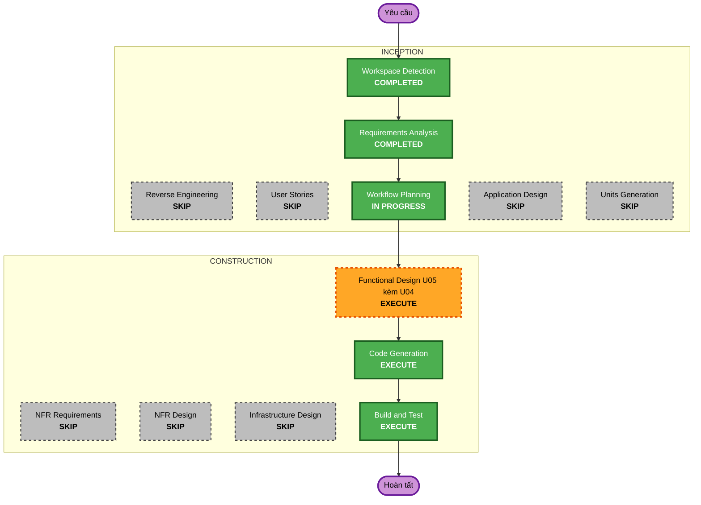

# Học kỳ của lớp — kế hoạch thực hiện

Dựa trên [yêu cầu CT-01…09](../requirements/2026-11-14-class-term.md), người dùng duyệt ngày 2026-11-14T15:48:47Z. Không có User Stories.

## Phân tích chi tiết

### Phạm vi thay đổi (brownfield)

- **Loại**: thêm thuộc tính dữ liệu cho lớp (ngày bắt đầu) và thuộc tính suy ra (học kỳ), kèm bộ lọc. Kiến trúc và ranh giới giữa các unit không đổi.
- **Thay đổi chính**:
  - Cột `course_classes.starts_on` và `course_classes.term`; ràng buộc duy nhất đổi sang `(subject_id, term, code)`.
  - Quy tắc tính học kỳ từ ngày bắt đầu (SP/SU/FA + 2 số năm, `-BL5` cho tháng 4/8/12).
  - Tạo lớp bắt buộc có ngày bắt đầu; sửa ngày bắt đầu khi lớp chưa lưu trữ, học kỳ tính lại.
  - Lọc theo học kỳ ở API danh sách lớp và các trang Lớp học.
  - Hiện học kỳ ở bảng lớp, thẻ Thông tin lớp và mọi nhãn chọn lớp.
- **Thành phần liên quan**:
  - `academics` (U05): thành phần chính.
  - `subjects` (U04): `SubjectClassSummary`, `SubjectClassesReader`, bảng lớp trong chi tiết môn.
  - Các module đọc `ClassRef` (thông báo, bài tập, quiz, nhóm…): chỉ nhận thêm trường, không đổi logic.
  - Frontend: `features/academics`, `features/subjects`, `shared/ui/ClassFilter`, sidebar (`shared/layout`, `ClassNavContexts`).

### Đánh giá ảnh hưởng

- **Người dùng**: có.
  - Chủ nhiệm môn: form tạo lớp, thẻ Thông tin lớp, danh sách lớp có bộ lọc học kỳ.
  - Giảng viên, sinh viên: trang Lớp học có bộ lọc học kỳ; nhãn lớp có học kỳ.
  - Admin: bảng lớp trong chi tiết môn có cột học kỳ.
- **Cấu trúc**: không đổi. Quy tắc tính học kỳ là một lớp domain mới trong package `academics.model`.
- **Dữ liệu**: có. Migration Flyway mới trong `db/migration/classes`:
  - Thêm `starts_on DATE`, `term VARCHAR(8)`.
  - Backfill lớp cũ: `starts_on` = ngày của `created_at` theo giờ Việt Nam, `term` tính theo CT-02 bằng SQL.
  - Đặt `NOT NULL`, check mẫu `term`, bỏ `uq_course_classes_subject_code`, thêm ràng buộc duy nhất `(subject_id, term, code)`, chỉ mục `(subject_id, term)`.
  - Không sửa migration cũ (gồm `V20261107_2200__remove_class_term.sql`).
- **API**: có.
  - Tạo và sửa thông tin lớp bắt buộc thêm `startsOn` (thay đổi không tương thích ngược cho client cũ; frontend, seed, script e2e sửa cùng đợt).
  - Ba API danh sách lớp nhận `term` tùy chọn.
  - `ClassView`, `ClassRef`, `SubjectClassSummary`, MCP `list_my_classes` thêm trường.
- **NFR**: kiểm đầu vào ở backend, học kỳ chỉ do server tính, giữ phạm vi quyền, khóa `version` khi sửa, lỗi trùng trả `CLASS_EXISTS`.

### Quan hệ thành phần

- **Thành phần chính**: `academics`, thay đổi vừa.
  - `CourseClass` (thêm `startsOn`, `term`; `createClass`/`updateInfo` nhận ngày bắt đầu), `ClassTermPolicy` mới, `CourseClassRepository`, `AcademicsReadRepository` (lọc `term`), `AcademicsService`, `AcademicsController`, `AcademicsDtos`, `AcademicsContractAdapter`, `AcademicsMcpTools`.
- **Contract dùng chung**: thay đổi nhỏ, chỉ thêm trường.
  - `ClassRef` thêm `term` (và stub `AcademicsContractStubs`).
  - `SubjectClassSummary` thêm `term`.
- **Không đổi**: luật ghi danh (`IN_OTHER_CLASS`, `ENROLLMENT_CONFLICT`), quyền, `ai`, `notifications`, `audit` (G2).
- **Frontend**:
  - `features/academics`: types, api, `ClassFormDialog`, `ClassInfoForm`, `ClassListPage`, `ClassDashboardPage`, `ClassNavContexts`.
  - `features/subjects`: types, `SubjectClassesTable`.
  - `shared/ui/ClassFilter` (`ClassLabel`) và các nơi dùng: Thông báo lớp, Bài tập sinh viên, hộp thoại thông báo.

### Rủi ro

- **Mức**: Trung bình.
  - Migration có cập nhật dữ liệu và đổi ràng buộc duy nhất; cần test PostgreSQL cho backfill theo giờ Việt Nam (lớp tạo lúc 23:30 ngày 31/3 giờ UTC là ngày 1/4 giờ Việt Nam → `SP..-BL5`).
  - Sau khi bỏ `(subject_id, code)`, mọi chỗ ngầm coi mã lớp là duy nhất trong môn phải được rà (nhãn hiển thị, tìm theo mã, copy giữa các lớp).
  - API tạo/sửa lớp đổi hợp đồng: test và seed e2e cần cập nhật.
- **Rollback**: migration không tự đảo ngược, theo runbook hiện có. Code cũ không chạy được trên schema mới khi có hai lớp trùng mã khác học kỳ, nên rollback code phải đi kèm khôi phục backup.
- **Kiểm thử**: vừa.
  - Unit test quy tắc tính học kỳ (12 tháng, biên năm, ngoài khoảng 2000–2099).
  - Test PostgreSQL cho migration và ràng buộc duy nhất mới.
  - Test API, service, MCP; Vitest cho form, bộ lọc, nhãn lớp.

## Sơ đồ quy trình



Bản chữ:

```
INCEPTION
- Workspace Detection (COMPLETED)
- Reverse Engineering (SKIP: tai lieu hien hanh)
- Requirements Analysis (COMPLETED)
- User Stories (SKIP)
- Workflow Planning (IN PROGRESS)
- Application Design (SKIP)
- Units Generation (SKIP)
CONSTRUCTION
- Functional Design U05 kem U04 (EXECUTE)
- NFR Requirements, NFR Design, Infrastructure Design (SKIP)
- Code Generation (EXECUTE)
- Build and Test (EXECUTE)
```

## Các giai đoạn

### INCEPTION

- [x] Workspace Detection: COMPLETED
- [x] Reverse Engineering: SKIP, vì tài liệu reverse engineering hiện hành vẫn dùng được.
- [x] Requirements Analysis: COMPLETED, người dùng duyệt 2026-11-14T15:48:47Z.
- [x] User Stories: SKIP, vì đây là thuộc tính mới trên luồng lớp có sẵn, không thêm persona hay hành trình mới.
- [x] Workflow Planning: IN PROGRESS
- [ ] Application Design: SKIP
  - **Lý do**: không thêm unit, service hay ranh giới mới. `ClassTermPolicy` là lớp domain nội bộ của `academics`, sẽ ghi trong Functional Design.
- [ ] Units Generation: SKIP
  - **Lý do**: U05 là unit chính; phần U04 chỉ thêm trường hiển thị.

### CONSTRUCTION

- [ ] Functional Design (U05, kèm phần sửa của U04): EXECUTE
  - **Lý do**: có dữ liệu mới và quy tắc nghiệp vụ mới:
    - Quy tắc tính học kỳ và khoảng ngày hợp lệ.
    - Khi nào được sửa ngày bắt đầu, tính lại học kỳ, xử lý trùng mã.
    - Ràng buộc duy nhất mới và backfill lớp cũ.
    - Cách sắp xếp và lọc học kỳ trên giao diện; nhãn lớp.
    - Ghi thay thế D-U04-04 trong các tài liệu U04/U05 đang ghi "bỏ học kỳ".
  - **Tài liệu cập nhật**: `domain-entities.md`, `business-rules.md`, `business-logic-model.md`, `frontend-components.md` của U05, và phần tương ứng của U04.
- [ ] NFR Requirements: SKIP
  - **Lý do**: stack đã chốt; NFR đã nêu trong NFR-CT-01…07 và dùng lại mẫu sẵn có của U05 (strict-input, khóa `version`, map lỗi trùng). Security và Resiliency được kiểm ở Functional Design và Code Generation.
- [ ] NFR Design: SKIP
  - **Lý do**: NFR Requirements đã bỏ qua; không cần mẫu mới.
- [ ] Infrastructure Design: SKIP
  - **Lý do**: không đổi hạ tầng. Chỉ thêm migration Flyway, chạy trong pipeline hiện có.
- [ ] Code Generation: EXECUTE (luôn chạy)
  - **Lý do**: cần viết migration, backend, frontend, seed e2e và test.
- [ ] Build and Test: EXECUTE (luôn chạy)
  - **Lý do**:
    - Backend: `mvn verify`, gồm integration test với PostgreSQL.
    - Frontend: Vitest, tsc, eslint và build.
    - Thử trên trình duyệt với stack local: Chủ nhiệm môn tạo/sửa lớp, giảng viên và sinh viên lọc theo học kỳ.

### OPERATIONS

- [ ] Operations: PLACEHOLDER

## Thứ tự thay đổi

1. `ClassTermPolicy` (tính học kỳ) và `CourseClass`. Đây là nền cho mọi bước sau.
2. Migration và `CourseClassRepository` (ghi/đọc `starts_on`, `term`; map trùng sang `CLASS_EXISTS`).
3. `AcademicsReadRepository` (lọc `term`, thứ tự G3) và `AcademicsService` (tạo, sửa, danh sách).
4. Contract: `ClassRef`, stub, `AcademicsContractAdapter`; `SubjectClassSummary` và `SubjectClassesReader`.
5. `AcademicsController`, `AcademicsDtos`, `AcademicsMcpTools`.
6. Frontend: types và api trước; rồi form tạo lớp, thẻ Thông tin lớp; bộ lọc ở `ClassListPage` và `ClassDashboardPage`; `ClassLabel`/`ClassFilter` và sidebar; bảng lớp của môn.
7. Seed và script e2e gửi `startsOn`.
8. Viết test ngay ở mỗi bước. Build and Test chạy ở cuối.

Backend làm trước frontend vì frontend dùng hợp đồng API mới.

## Điều kiện trước Code Generation

Code được viết trên nhánh hiện tại `fix/term`. Lúc lập kế hoạch, nhánh nằm ở `6c0bdc16`, trùng với `origin/staging`; thư mục làm việc chỉ có tài liệu AIDLC của tính năng này.

## Tiêu chí thành công

- **Mục tiêu**: đáp ứng đủ CT-01…09 và NFR-CT-01…07.
- **Sản phẩm**:
  - Migration.
  - Backend U05 và phần sửa ở U04.
  - Frontend cho Chủ nhiệm môn, giảng viên, sinh viên, Admin.
  - Seed/script e2e.
  - Test.
  - Tài liệu functional design đã cập nhật.
- **Cổng chất lượng**:
  - Toàn bộ `mvn verify` qua, gồm test PostgreSQL cho backfill và ràng buộc duy nhất mới.
  - Vitest, tsc, eslint và build frontend qua.
  - Thử trên trình duyệt: tạo hai lớp cùng mã ở hai học kỳ, lọc đúng, nhãn lớp phân biệt được.
  - Security và Resiliency tuân thủ trong phạm vi đã duyệt.
- **Tích hợp**:
  - Lớp cũ có học kỳ sau migration và vẫn dùng mọi chức năng như trước.
  - Ghi danh, mở/lưu trữ lớp, thông báo, bài tập, quiz, nhóm, bảng điểm chạy đúng như trước.
