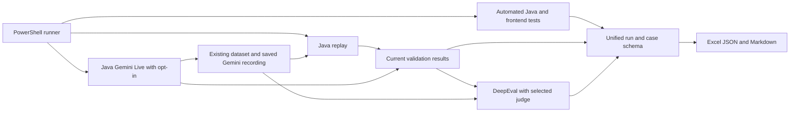

# Unified U09 AI grading evaluation

Use one runner for the existing grading suites, Java replay and live evaluation, and DeepEval GEval. The Java runner still owns grading validation and records Gemini responses. The Python runner joins evidence and writes one QA report set.



## Setup on Windows

Use PowerShell 7, Python 3.14 x64 and uv. From the repository root:

```powershell
.\scripts\ai-grading-eval\setup.ps1
.\scripts\ai-grading-eval\run-tests.ps1
.\scripts\ai-grading-eval\run-evaluation.ps1 -Mode doctor
```

`setup.ps1` installs the pinned packages from `requirements.lock` into this directory's `.venv`. It uses an existing Python interpreter. Unit tests use mocked judge responses and work without accounts, AI quotas, Ollama or saved private artifacts. To regenerate the Windows lockfile deliberately, run `uv pip compile requirements.in --python-version 3.14 --python-platform x86_64-pc-windows-msvc --only-binary :all: --output-file requirements.lock`.

## Choose a judge

| Judge | How it is selected |
|---|---|
| `codex` | Requires a supported native Codex CLI and a ChatGPT login. Defaults to `gpt-6.2-sol`. Uses a temporary directory, read-only mode, disabled shell, plugins, collaboration and web search, and a strict output schema. |
| `claude` | Requires a native CLI and a first-party Claude subscription login in `claude auth status`. Defaults to `sonnet`. Uses an empty MCP configuration, disabled built-in tools, hooks and connectors, and no transcript persistence. Check compatibility with your CLI before using it for a long run. |
| `ollama` | Requires an already installed local model at `http://127.0.0.1:11434`. Defaults to the 2.5 GB `qwen3:4b-instruct-2507-q4_K_M`. Requests use Ollama's native structured output schema. |
| `gemini` | Requires the official Windows npm CLI, configured Google personal OAuth, and an explicit `--model`. The runner denies all tools and disables hooks, MCP and extensions in a temporary profile. The JSON envelope parser is regression-tested. A live run depends on OAuth access to the requested model. |
| `opencode` | Detection only in this release. Selection fails until tool isolation and the effective upstream account can be verified. |

`auto` checks readiness in priority order and prints the provider and model it selects. Use `-AllowHosted codex` or `-AllowHosted claude` to permit that judge to use account quota. Set `QA_JUDGE_PRIORITY` in `.env` to change the order when you run the PowerShell wrapper. The selected judge is fixed for the run. The CLI judges reuse the provider login.

Codex returned all three GEval scores in the unified runner. Claude `sonnet` passed the login check. Its recorded smoke returned `JUDGE_ERROR`, including a quota or billing error. A `ready` status from `doctor` confirms the local CLI and supported login. A completed offline run with three scores and reasons confirms inference. Gemini passed local discovery and the parser tests. Ollama requires an installed local service and model.

Check your plan's quota and extra-usage or credit settings before a hosted run. A subscription login can still use paid credits when your account is configured for it. Review the source files first. Hosted runs are limited to the bundled `SYNTHETIC_TEAM` dataset and require explicit provider opt-in. Use Ollama for private submissions. Other people can read the reports without any judge installed.

Optional local configuration in `.env` beside this README:

```dotenv
QA_JUDGE_PRIORITY=codex,claude,ollama
QA_RESULTS=C:/absolute/path/to/original/results.json
QA_RUBRIC_ADHERENCE_THRESHOLD=0.8
QA_FEEDBACK_GROUNDEDNESS_THRESHOLD=0.8
QA_FEEDBACK_QUALITY_THRESHOLD=0.8
```

Ollama is optional. If you choose it, install it using the [official Windows instructions](https://docs.ollama.com/windows), then start the local service if it is not already running. Download the model yourself after checking its size.

```powershell
# Run in a separate terminal when the Ollama desktop service is stopped.
$env:OLLAMA_NO_CLOUD = '1'
ollama serve
```

```powershell
ollama pull qwen3:4b-instruct-2507-q4_K_M
Invoke-RestMethod http://127.0.0.1:11434/api/tags
.\scripts\ai-grading-eval\run-evaluation.ps1 -Mode doctor -Judge ollama
```

## Run the framework

Use an original Gemini **live** Java `results.json` and its sibling `recordings` directory. The runner joins results by dataset, provider, model, case ID and attempt number. Use the same dataset version that produced the archive. A missing recording is skipped. Offline mode replays through the **current** Java validator before it sends an eligible response to GEval. The judge receives the rubric, submission and original response. Reference scores and prior verdicts stay in the report layer.

Run these from the repository root. Select a saved archive before running the first check. The example path exists only on a machine with that archive. Keep `results.json` and its sibling `recordings/` directory together when copying an archive. If you omit `-Results`, the runner uses `QA_RESULTS`, then the newest matching `backend/target/ai-eval/<dataset>-live-*/results.json`. It prints the selected source.

```powershell
$qa = '.\scripts\ai-grading-eval\run-evaluation.ps1'
$source = '.\backend\target\ai-eval\badminton-booking-live-20261121-043944\results.json'
& $qa -Mode automated
& $qa -Mode replay -Results $source -All
& $qa -Mode offline -Results $source -Case 08-wrong-actors -Run 1 -Judge codex -AllowHosted codex
```

On the example archive, replay of `08-wrong-actors` attempt 1 returns exit code `2`. The current validator sets the review flag for `s-name-actors` and keeps the score. Open `Replay Results` to inspect the change.

### Try Claude on one saved response

Check the Claude subscription quota and extra-usage settings before the hosted step. Use the same source, case and attempt as the Codex command if you want to compare the two judges.

```powershell
& $qa -Mode doctor -Judge claude
& $qa -Mode offline -Results $source -Case 08-wrong-actors -Run 1 -Judge claude -AllowHosted claude -MaxCalls 6
```

Open the `DeepEval Semantic Metrics` sheet. Confirm that `judge_provider` is `claude` and that each of the three metrics has a score and reason. If replay passes and Claude fails, check `Provider & Judge Errors`. The replay result remains available.

### Run a full evaluation

```powershell
& $qa -Mode full -Results $source -All -Judge auto -AllowHosted codex -MaxCalls 60
```

Use the established case IDs from the [badminton-booking dataset](../../backend/src/test/resources/ai-eval/grading/badminton-booking/assignment.json). `-Case` without `-Run` selects all saved attempts for that case. `-All` selects all attempts from the source. Add `-NoSemantic` to limit the run to the configured test suites and replay. The default `-MaxCalls` is 6. Budget three judge calls per eligible attempt and allow for retries. For a batch with 17 valid responses, 60 calls allows 51 initial calls and up to 9 retries.

| Exit code | Meaning |
|---|---|
| `0` | The report was generated and no stage returned a run failure. Check the workbook for quality failures, saved provider errors and skipped layers. |
| `1` | Configuration or input error. Read the terminal message. |
| `2` | Automated, replay, live execution or judge failure. Open the generated report and the linked evidence. |

| Mode | Execution |
|---|---|
| `automated` | Run the existing Java grading suites and Vitest grading tests. Use `-CollectOnly -BackendXml <file-or-folder> -FrontendJson <file>` to import existing results instead. Imported evidence is labeled. |
| `replay` | Run the Java replay harness and compare status, total, rubric item scores and review flags to the original saved artifact. |
| `offline` | Run replay, then GEval for responses validated both in the archive and on replay. This is the default. A hosted judge requires explicit opt-in. |
| `live` | Run Gemini and judge the freshly validated responses. Requires `-AllowLive`, `-GeminiModel` and session variable `AI_EVAL_API_KEY`. The runner prints a billing warning before running Gemini. |
| `full` | Run automated tests, replay and GEval together. It imports the saved Gemini evidence by default. Add the live opt-in to collect fresh Gemini results before replay and GEval. |
| `report` | Rebuild the reports from a saved unified JSON and optionally compare a baseline. Starts no model or test process. |
| `doctor` | Inspect judge availability. Starts no inference. |

The Windows wrapper uses Maven on PATH or a cached Maven Wrapper distribution. Set `-Maven` and `-JavaHome` explicitly if needed. CI behavior is unchanged. Maven defaults to cached dependencies. Use `-MavenOnline` to resolve missing dependencies before execution. Keep frontend dependencies installed using the existing project setup.

An authorized live run uses the existing Gemini gateway and can consume paid quota. From PowerShell 7, read the evaluation API key into a temporary session variable:

```powershell
$env:AI_EVAL_API_KEY = Read-Host 'Gemini evaluation key' -MaskInput
try {
    & $qa -Mode live -AllowLive -GeminiModel gemini-3.5-flash-lite -Case 08-wrong-actors -Repeats 1 -NoSemantic
} finally {
    Remove-Item Env:AI_EVAL_API_KEY -ErrorAction SilentlyContinue
}
```

For a Google OAuth judge, use `-Mode doctor -Judge gemini -Model <model-id>` with the exact model available to your account. After checking quota and privacy settings, select `-Judge gemini -AllowHosted gemini -Model <model-id>`. In offline mode this uses Gemini as a semantic judge of an existing response.

### Rebuild reports and compare a baseline

```powershell
$current = '.\scripts\ai-grading-eval\reports\current\ai-grading-evaluation.json'
$baseline = '.\scripts\ai-grading-eval\reports\baseline\ai-grading-evaluation.json'
& $qa -Mode report -InputReport $current -Baseline $baseline
& $qa -Mode report -InputReport $current -Share
```

Use real report paths in those variables. Each run writes `ai-grading-evaluation.xlsx`, `ai-grading-evaluation.json` and `ai-grading-evaluation.md` under one timestamped directory. The workbook has 11 filterable sheets. Fresh logs and Java reports stay under `raw/`. Raw Gemini inputs for offline runs remain in the original archive and are linked in the report. Existing output directories and baselines are preserved.

### Review an unexpected result

1. Open `Executive Summary` to check which layers ran. In `Test Cases`, filter by `test_case_id` and `run_index`.
2. In `Replay Results`, check current validation and the `changes` column. For example, actor review can change from `false` to `true` with the same score. Record whether that change matches the intended fix.
3. In `Score Comparison`, compare the total and item scores. Check whether the reference is `SYNTHETIC_TEAM` or `LECTURER_VERIFIED`.
4. In `DeepEval Semantic Metrics`, read the reason for rubric adherence, feedback groundedness and feedback quality. Each metric defaults to a threshold of 0.8. Open `Provider & Judge Errors` for timeouts, quota errors and invalid responses.
5. Follow `evidence_paths` to the original Gemini recording and the replay artifact. For a before-and-after comparison, reuse the same recording, rubric and judge settings.

The shared JSON tracks the evaluation run ID, case and attempt, dataset and rubric versions, provider status, current validation, replay result, semantic scores, score comparison, judge identity and evidence paths. Automated assertions belong to their suites and have a null dataset case ID unless their source explicitly provides a mapping.

Per case, errors in the saved provider outcome take precedence. A current validator rejection becomes `DETERMINISTIC_FAIL`. A change from the saved state or a missing replay row becomes `REPLAY_FAIL`. Judge errors and quality failures remain visible alongside the other layers. `NOT_EVALUATED` indicates required evidence was never evaluated. `SKIPPED` indicates a deliberate skip or unavailable recording. `PASS` requires current validation and, when requested, successful semantic evaluation. The run summary prioritizes deterministic and replay failures before provider, invalid output, judge and quality failures.

For QA regression review, compare runs with matching judges, model versions where exposed, dataset, metric definition and thresholds. A drop greater than `--drop-tolerance` (default 0.05), a missing item or run, a newly failing quality result, or increased error relative to the reference is shown in the comparison. Across judges, the report shows individual scores side by side. Save the same Gemini artifact for a fair comparison between judges. A CLI version or model alias cannot identify every server-side model revision.

Coverage counts fully judged attempts over selected attempts. Semantic pass rate uses only fully judged attempts. Provider success counts returned responses, including those later rejected by schema validation. Deterministic pass rate excludes provider errors without a response to validate. Score MAE uses current validated scores with a complete labeled reference. Synthetic expectations and lecturer-verified references are reported separately. Defect detection rate remains unavailable until defect labels are verified.

### Sharing and troubleshooting

- Share the aggregate `-Share` Markdown in a GitHub PR after reviewing it. Raw JSON, Excel and logs can contain grading text. Keep them in ignored `reports/` or use an approved private channel.
- `JUDGE_AUTH` or `JUDGE_QUOTA_OR_BILLING`: check the CLI's login and plan in its official UI. The runner never requests a key or changes billing settings.
- `JUDGE_TIMEOUT` or `JUDGE_SCHEMA`: try one saved attempt, inspect the judge version, and use a longer `--timeout` if appropriate.
- `REJECTED_503` belongs to the original Gemini run and appears in `Provider & Judge Errors`. Run `-Mode replay` to inspect it without inference.
- If every evaluation is skipped, confirm that the input came from the Java live mode and that the corresponding `recordings` directory was copied. See the [existing Java evaluation guide](../../aidlc-docs/construction/build-and-test/ai-grading-evaluation-instructions.md).

### Compatibility

Existing Maven, Vitest, replay and live commands continue to work and produce the same intermediate artifacts. The legacy Python commands `evaluate.py evaluate`, `evaluate.py doctor` and `evaluate.py report` are accepted and map to the unified modes. Legacy `deepeval-results.json` can be imported or used as a baseline. Its missing layer results stay unverified and its old scores retain archive provenance.

### Improve the dataset

Keep bundled synthetic examples for deterministic regression. Build a separate deidentified fixture set with lecturer-verified item scores, adjudicated differences and rubric versions. Add an explicit mandatory-versus-conditional relationship pair and multiple examples of unequal partial-credit allocation. Retain matching grading output, rubric and submission hashes in future collection runs. Historical Java artifacts identify cases and models but lack a content hash for the original dataset, so preserve the original dataset snapshot alongside any future exported artifact.

[DeepEval custom LLMs](https://deepeval.com/guides/guides-using-custom-llms) · [GEval](https://deepeval.com/docs/metrics-llm-evals) · [Codex exec](https://learn.chatgpt.com/docs/non-interactive-mode) · [Claude headless](https://code.claude.com/docs/en/headless) · [Ollama structured outputs](https://docs.ollama.com/capabilities/structured-outputs)
